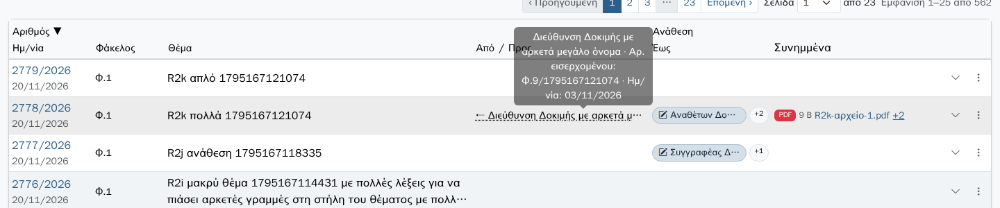

# R2k: list rows of one height; Από / Προς details in a tooltip

| | |
|---|---|
| Status | ✅ Done |
| Branch | `task/R2k-list-two-lines` (on top of R3g) |

## What was asked (owner, 2026-11-20)
- *Από / Προς* showed the sender with *Αρ. εισερχομένου* and a date. These rarely fit, so put them in a tooltip.
- Rows with *«+1 ακόμη»* were taller than the rest. The owner asked for suggestions to make the row height truly fixed,
  and chose **at most two lines in every cell** until the row is opened.

## What changed
- **Από / Προς:** one line for the sender, one for the recipient (if any), shortened with … when long.
  - The mouse over the name, or the keyboard, opens a tooltip with the whole name, the number and the date: *«Δήμος …
    · Αρ. εισερχομένου: 4521 · Ημ/νία: 03/11/2026»*. The name is underlined with dots to show that it has one.
  - It does not open the protocol.
  - An opened row (▾ or *Αναλυτικά*) shows the details in full.
- **Ανάθεση:** the first pill, then *+N* for the others. The deadline (*έως …*) or ✔ stays as the second line.
- **Συνημμένα:** the first file, then *+N* on the same line. Clicking *+N* opens the row.
- **Θέμα:** two lines, as since R2i.
- So every row is two lines tall unless opened. ▾ opens it with everything (all pills and files), as before.

## How verified
- PHPUnit:
  - `ProtocolListTest::test_from_to_details_are_in_a_tooltip_and_cells_stay_short`: the tooltips' text for the sender
    and the recipient, the details for the opened row, and *+2* for three assignees.
  - `test_rows_are_short_with_a_toggle_to_show_all`: now expects *+2* for three files.
- Browser (`protocol-list.spec.js`, R2k), with a protocol with 3 files, 3 assignees and incoming details:
  - its row is as tall as a plain one;
  - one file and one pill are shown, each with *+2*;
  - the number appears only in the tooltip, and hovering stays on the list;
  - opened, all 3 files, all 3 pills and the number show.

  The R2j test now opens the row to see every pill. All 10 list browser tests pass, and the search ones too.
- Full PHPUnit: 555 tests pass.

## Review
- Codex (P2): the search results reuse the list's rows but have no ▾. They too showed only the first assignee and
  the first file, possibly hiding the very file that matched the search.
  - Fixed: the two-line rules apply only to the protocol list; the search results show everything, as before.
  - Browser test (`search.spec.js`): a result with 3 files and 2 assignees shows all of them. It failed before.

## Owner actions
None. To try it: step 48 in [OWNER-TODO.md](../../OWNER-TODO.md).
