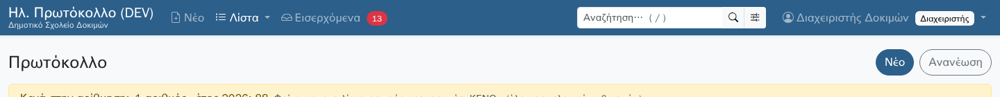

# R2l: list: no «Αναζήτηση» button of its own

| | |
|---|---|
| Status | ✅ Done |
| Branch | `task/R2l-list-no-search-button` |

## What was asked (owner, 2026-11-23)
The *Αναζήτηση* button on the list page (`/home/list`) is not needed: the search field already does the same.

## What changed
- The list's header has only *Νέο* and *Ανανέωση*.
- The *Αναζήτηση* pill linked to the advanced search page (`/find`). That page stays one click away through the
  search box in the top bar, on every page: the 🔍 button searches, and the sliders button opens *Σύνθετη αναζήτηση*.

## How verified
- PHPUnit `ProtocolListTest::test_the_list_has_no_search_button_of_its_own`: the list has *Νέο* and *Ανανέωση* and no
  *Αναζήτηση* link, and the top bar's advanced-search button is still there. The test fails without the change.
- Browser (`protocol-list.spec.js`, R2l): the header has *Νέο* and *Ανανέωση* and no *Αναζήτηση*; the top bar's
  *Σύνθετη αναζήτηση* is visible. All 11 list browser tests pass.

## Owner actions
None. To try it: step 60 in [OWNER-TODO.md](../../OWNER-TODO.md).
