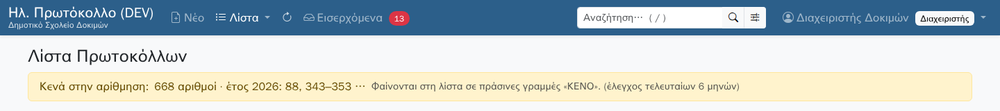
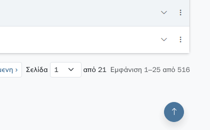

# R2m: the list's header; ↻ in the top bar; ↑ back to the top

| | |
|---|---|
| Status | ✅ Done |
| Branch | `task/R2m-list-header` |

## What was asked (owner, 2026-11-25)
- The top section of the screen (the top bar) always visible while scrolling, app-wide.
- So the list's own *Νέο* is no longer needed; *Ανανέωση* next to *Λίστα*, with an icon.
- *Λίστα Πρωτοκόλλων* instead of *Πρωτόκολλο*, so the user always sees which screen this is.
- On the list, a small «scroll to top» button, always at the bottom right.

## What changed
- **The top bar** already stays at the top of the window on every page of the new layout (it has done so since N03).
  Checked in the browser on the list, the protocol form, the inbox and the settings, scrolled to the bottom. A new
  browser test now keeps it so. If on your copy it does not, tell me the page and the browser.
- **The list's title:** *Λίστα Πρωτοκόλλων*, then whose and which when chosen, e.g. *Λίστα Πρωτοκόλλων · Όλοι οι
  χρήστες · προς Διεκπεραίωση*. The browser tab says *Λίστα Πρωτοκόλλων* too.
- **No *Νέο* and *Ανανέωση* on the list:** *Νέο* is in the top bar. *Ανανέωση* is now **↻** right after *Λίστα ▾* in
  the top bar, on the list's pages. It refreshes the list in place (same filters, page and scroll) and turns once to
  show it did.
- **↑ back to the top:** a small round button (40 px) at the bottom right of the list, left of the *Σημειώσεις* tab
  on wide screens. The list keeps a little room below it, so at the very bottom the button covers nothing (it covered
  the end of the lower pager at first).

## How verified
- PHPUnit:
  - `ProtocolListTest::test_the_list_header_names_the_screen_and_refresh_is_in_the_top_bar`:
    - the heading and the tab's title;
    - no Νέο or Ανανέωση in the list;
    - ↻ after «Λίστα» and its menu, before «Εισερχόμενα»;
    - ↑ on the list's pages only;
    - the title with a filter and with «all users»;
    - the refresh event.
  - `test_choosing_a_user_under_all_shows_that_users_protocols` follows the new title.

  Full suite: 677 tests, green.
- Browser (`protocol-list.spec.js`, R2m test at 1440 × 800):
  - scrolled to the bottom of the list, the form, the inbox and the settings: the top bar is at the top and *Νέο* in
    view;
  - the title; no Νέο or Ανανέωση in the list;
  - ↻ between *Λίστα ▾* and *Εισερχόμενα*: a click asks the server for a refresh and the address stays the same;
  - ↑ is in view at the bottom right, at most 44 px, not over the notepad's tab and not over the pager or the rows;
    a click goes back to the top.

  The other list tests follow the new title; all 12 tests of the file pass.

## Owner actions
None. To try it: step 77 in [OWNER-TODO.md](../../OWNER-TODO.md).
