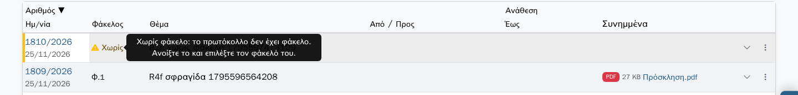

# R2n: a protocol without a folder is flagged in the list

| | |
|---|---|
| Status | ✅ Done |
| Branch | `task/R2n-list-no-folder-flag` |

## What was asked (owner, 2026-11-25)
When a protocol has no folder, mark it in the main list as problematic, as is done for wrong dates.

## What changed
- In *Λίστα*, a protocol without a folder shows **⚠ Χωρίς** in the *Φάκελος* column, and its row is tinted with a
  yellow edge like a date out of order (R2f). The mouse over ⚠ says: *Χωρίς φάκελο: το πρωτόκολλο δεν έχει φάκελο.
  Ανοίξτε το και επιλέξτε τον φάκελό του.* Pointing at it does not open the protocol.
- On narrow screens, where the *Φάκελος* column is hidden, a small ⚠ folder icon appears next to the date.
- Giving the protocol a folder removes the flag.
- *— Χωρίς φάκελο* can still be chosen in the protocol form (on hold, 2026-11-18); the list now shows it as something
  to fix. The inbox no longer allows it at all (R5s).

## How verified
- PHPUnit `ProtocolListTest::test_a_protocol_without_a_folder_is_flagged`:
  - the protocols without a folder (also a blank one) are flagged, the one with a folder is not, and no others;
  - the warning in the column with its text, and the narrow-screen icon.

  The R2f date tests are unchanged: the two flags are kept apart. Full suite: 682 tests, green.
- Browser (`protocol-list.spec.js`, R2n):
  - a protocol saved without a folder: its row flagged, ⚠ Χωρίς visible, the explanation on hover;
  - the list stays on screen (the protocol does not open);
  - a protocol with a folder: no flag.

## Owner actions
None. To try it: step 83 in [OWNER-TODO.md](../../OWNER-TODO.md).
