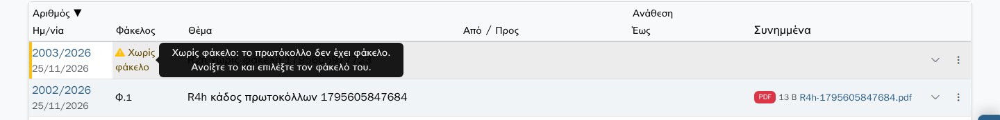

# R2o: «Χωρίς φάκελο» in full

| | |
|---|---|
| Status | ✅ Done |
| Branch | `task/R2o-no-folder-label` |

## What was asked (owner, 2026-11-25)
The list's flag for a protocol without a folder (R2n) said «⚠ Χωρίς»: it should say «Χωρίς φάκελο».

## What changed
- The flag in the *Φάκελος* column says **⚠ Χωρίς φάκελο**; in the narrow column it takes two lines. The explanation on
  hover and the narrow-screen icon are as before.

## How verified
- PHPUnit `ProtocolListTest::test_a_protocol_without_a_folder_is_flagged`: the flag's text is «Χωρίς φάκελο». List tests:
  24, green; full suite green.
- Browser (`protocol-list.spec.js`, R2n's test): the flag's text is exactly «Χωρίς φάκελο».

## Owner actions
None. To try it: step 92 in [OWNER-TODO.md](../../OWNER-TODO.md).
