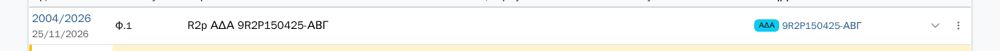

# R2p: an ΑΔΑ without a file in the list

| | |
|---|---|
| Status | ✅ Done |
| Branch | `task/R2p-list-ada-pill` |

## What was asked (owner, 2026-11-25)
As in the protocol form (R1m), in the main list: an attachment that only has an ΑΔΑ should be a pill, followed by its
code as the link.

## What changed
- In *Λίστα → Συνημμένα*, an ΑΔΑ without a file shows the pill **ΑΔΑ** and then **its code**, always visible. The code
  links to Διαύγεια (when its address is set in Ρυθμίσεις), like a file's name; the code alone opens it, not the row.
- A file that also has an ΑΔΑ keeps its small «ΑΔΑ» badge after the file's name, as before.

## How verified
- PHPUnit `ProtocolListTest::test_an_ada_only_attachment_is_a_pill_and_its_code`: the pill, then the code linked to
  Διαύγεια; not the old small badge. List tests: 25, green; full suite green.
- Browser (`protocol-list.spec.js`, R2p): an ΑΔΑ added in the form; its row in the list shows the pill «ΑΔΑ» and the code.

## Owner actions
None. To try it: step 93 in [OWNER-TODO.md](../../OWNER-TODO.md).
