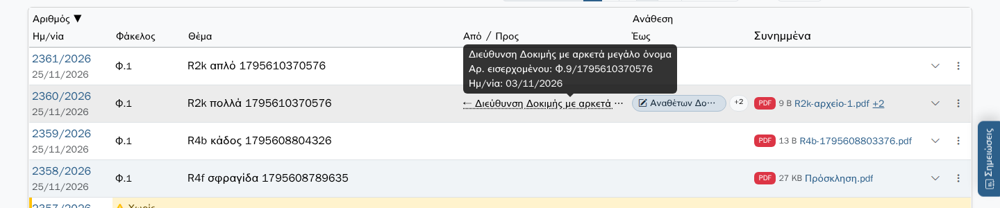

# R2q: the Από / Προς tooltip on separate lines

| | |
|---|---|
| Status | ✅ Done |
| Branch | `task/R2q-from-to-tooltip-lines` |

## What was asked (owner, 2026-11-25)
The list's tooltip over a sender (*Από / Προς*) ran its parts together with « · ». It should have one line per part,
three lines in all, for readability.

## What changed
- The tooltip shows **one line each**: the sender (whole), *Αρ. εισερχομένου: …*, *Ημ/νία: …*; for an outgoing one, the
  recipient and *Ημ/νία εξερχομένου: …*.
- The lines are line breaks in the text, not ` `: the tooltip still shows only text, so a sender's name can never
  turn into HTML.

## How verified
- PHPUnit `ProtocolListTest` (R2k's test): the tooltips' text has its parts on separate lines, incoming and outgoing.
  List tests 25, green; full suite green.
- Browser (`protocol-list.spec.js`, R2k's test): hovering the sender shows a tooltip of exactly three lines: the
  sender, the number, the date.

## Owner actions
None. To try it: step 96 in [OWNER-TODO.md](../../OWNER-TODO.md).
