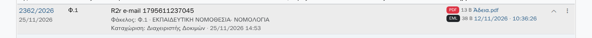

# R2r: the e-mail's file in the list: last, by its date and time

| | |
|---|---|
| Status | ✅ Done |
| Branch | `task/R2r-email-file-last` |

## What was asked (owner, 2026-11-25)
In the protocol list, the EML file of a protocol that came from an e-mail always appears first, which is not useful:
every such file is named the same way. Put it at the bottom of the attachments (unless it is the only one), show its
name as a date and time, and make its place an option in the settings, set by the administrator for everyone.

## What changed
- In *Λίστα → Συνημμένα*, the e-mail kept with a protocol from the inbox (`email_20261112_103626.eml`) comes **after
  the real attachments**. The short row (one file and «+N») shows a real attachment. If the e-mail is the only file, it
  is shown alone.
- It is shown as **12/11/2026 · 10:36:26** (the date and time in its name), with its **EML** pill. The file's name is on
  hover; the download is the same file.
- **Ρυθμίσεις → Συνημμένα → «Το αρχείο του e-mail πρώτο στα συνημμένα της λίστας»**: off (as you prefer) puts it last;
  on puts it first, as before. It applies to every user.

## How verified
- PHPUnit `ProtocolListTest::test_the_email_file_comes_last_shown_by_its_date`:
  - an EML and a PDF: the PDF first, the e-mail «12/11/2026 · 10:36:26» last, its name on hover;
  - an e-mail alone: shown by its date;
  - the setting on: the e-mail first;
  - another name stays as it is;
  - the setting is in the «Συνημμένα» section.

  Full suite green.
- Browser (`protocol-list.spec.js`, R2r): a protocol with an EML and a PDF; opened in the list: the PDF, then the EML
  pill with «12/11/2026 · 10:36:26».

## Owner actions
None. To try it: step 97 in [OWNER-TODO.md](../../OWNER-TODO.md).
