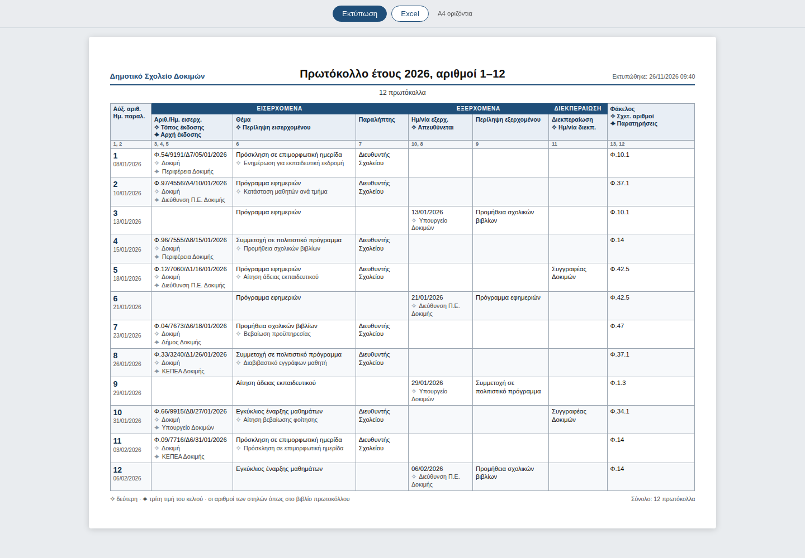
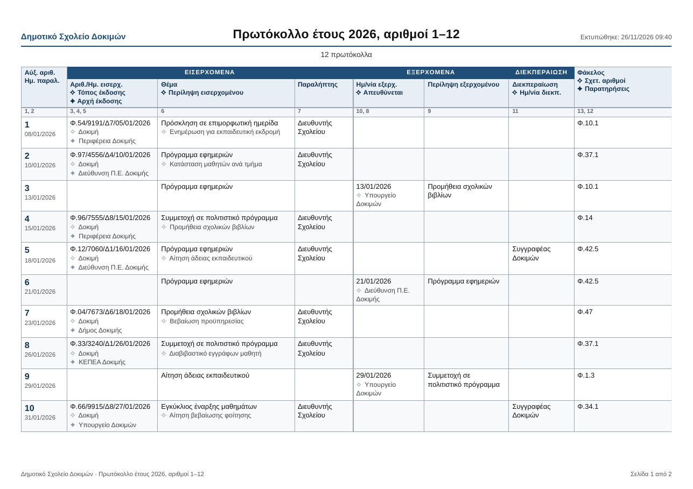
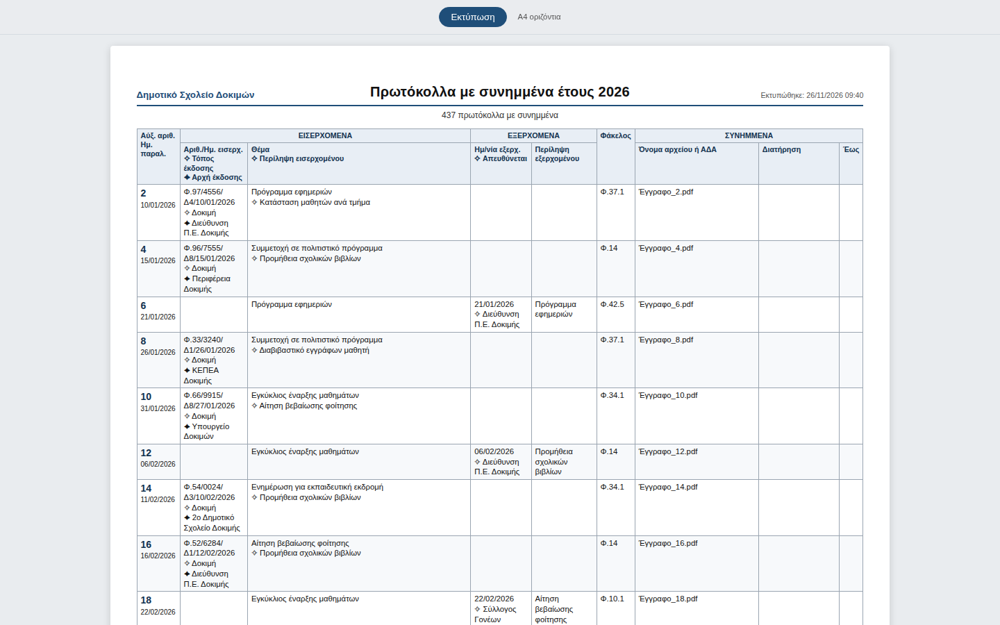
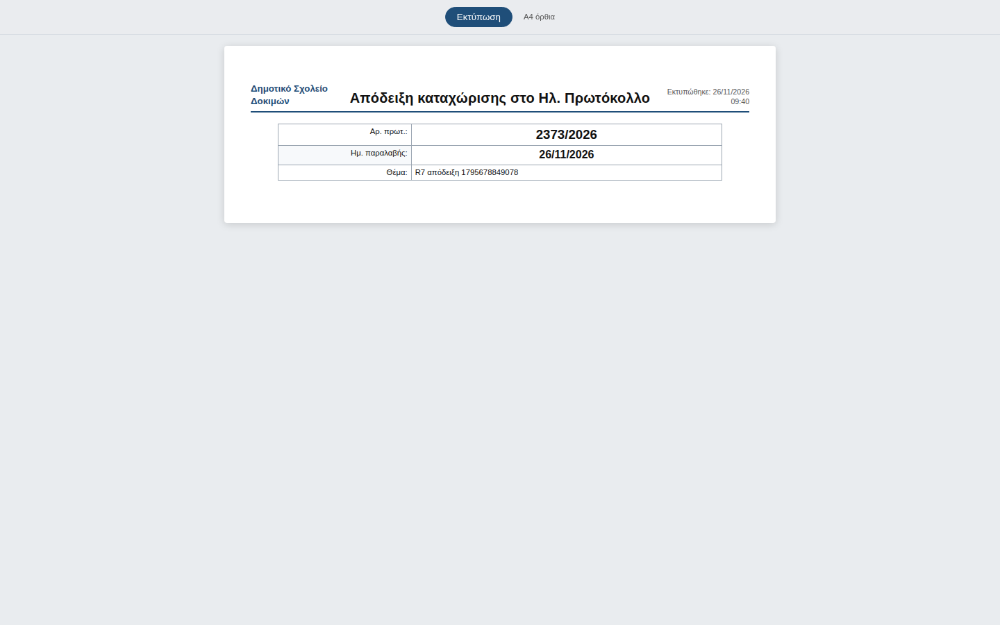

# R2s: the printed protocol book, laid out for paper

| | |
|---|---|
| Status | ✅ Done |
| Branch | `task/R2s-printed-book` |

## What was asked (owner, 2026-11-26)
«Let's make the /printed page more beautiful and suitable for printing.»

## What changed
The protocol book (*Εκτύπωση → Πρωτόκολλο*, `/printed`) keeps the same columns, numbers and content (and the Excel
file is unchanged), but:

- **On screen** it is a sheet of paper on a grey desk.
  - The buttons (*Εκτύπωση*, *Excel*) stay at the top while scrolling.
  - It says which paper it is meant for (*A4 οριζόντια*).
- **The heading**:
  - the institution, the title and when it was printed, over a blue line;
  - the number of protocols under it.
- **The table**:
  - **Header:**
    - a dark band for *ΕΙΣΕΡΧΟΜΕΝΑ / ΕΞΕΡΧΟΜΕΝΑ / ΔΙΕΚΠΕΡΑΙΩΣΗ*;
    - light headings for the columns;
    - the book's column numbers small;
    - all of it repeated on every page.
  - **Rows:**
    - thin grey lines, every other row lightly shaded;
    - a row is never split between pages.
  - **Cells:**
    - the protocol number large, its date small under it;
    - the second and third value of a cell (✧ ✦) on their own lines, smaller, with a light mark.
  - **Widths:** fixed column widths, so the subject and the folder get the room they need.
- **At the end:** what ✧ and ✦ mean, and *Σύνολο: N πρωτόκολλα*.
- **On paper:**
  - A4 landscape, with no buttons and no grey;
  - at the foot of every page, the institution with the title, and *Σελίδα 1 από 2*. Page numbers work in Chrome and
    Edge; Firefox prints the pages without them.
- *Πρωτόκολλα με συνημμένα* and the receipt use the same layout, so they get the new heading, lines and sheet too.

| On screen | Printed (page 1 of the PDF) |
|---|---|
|  |  |

The same layout:  

## How verified
- PHPUnit `PrintTest`:
  - `test_the_book_prints_the_chosen_year_with_dates_and_names`: the same values in the same order (now checked as
    text, since the marks are in their own element), plus the total.
  - `test_the_book_is_laid_out_for_paper`:
    - the page-number rule and the foot text;
    - an institution named with `"` and `</style>` is escaped for CSS and cannot end the styles;
    - the sheet;
    - the marks;
    - a width for each of the 8 columns;
    - the receipt upright.

  Full suite: 703 tests, green.
- Browser (`printing.spec.js`, R2s): the sheet, the header band, the total; in print view no buttons. Chromium's PDF of
  12 protocols: 2 pages, A4 landscape, *Σελίδα 1 από 2* / *2 από 2* with the institution and title at the foot
  (checked with `pdftotext`; page 1 above).

## Owner actions
None. To try it: step 102 in [OWNER-TODO.md](../../OWNER-TODO.md).
