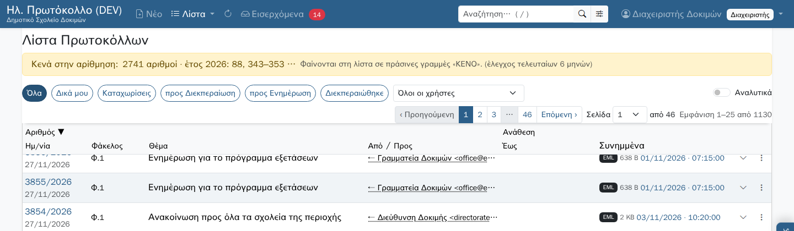

# R2t: the list's head stays under the top bar

| | |
|---|---|
| Status | ✅ Done |
| Branch | `task/R2t-list-head-fixed` |

## What was asked (owner, 2026-11-27)
«In the main screen make this part of the screen freeze in position»: the title *Λίστα Πρωτοκόλλων*, the
*Κενά στην αρίθμηση* notice, the filters (*Όλα*, *Δικά μου* …, the user menu, *Αναλυτικά*) and the pager.

## What changed
- These four now form the list's head, which stays under the top bar while the list scrolls. The table's column titles
  (*Αριθμός*, *Θέμα* …) stick right under it, as they stuck under the top bar before.
- Its height changes (the gaps notice comes and goes, a narrower window wraps the filters). It is measured each time, so
  the column titles always meet it.
- While rows go under it, a thin shadow at its bottom shows that it is fixed.
- It covers the rows that go under it, so the filters and the page buttons stay clickable.
- The lower pager used to scroll the upper pager into view to show the list's start. The upper pager is now always in
  view, so on the list the lower pager scrolls to the top of the page instead (review finding). Other paged pages are
  unchanged.
- On small or low screens (under 768 px wide or 600 px high) it would leave too little room for the list. There it
  scrolls away as before, and the column titles stick under the top bar.

## How verified
- Browser (`protocol-list.spec.js`):
  - **R2t**, at 1440 × 900:
    - scrolled: the head is right under the top bar, at its full height, with title, filters, *Αναλυτικά* and pager in
      view;
    - the column titles right under it;
    - the shadow on;
    - the point just above its bottom edge belongs to it, not to a row;
    - a filter clicked while scrolled works; after a re-render it sticks again;
    - from the bottom of the page, the lower pager's › goes to page 2 with the first rows in view. Without the fix the
      page stayed 908 px down.
  - At 560 px high it scrolls away and the column titles meet the top bar.
  - **R2**: the column titles meet the head's bottom.

  The whole list spec is green (16 tests).
- PHPUnit list tests green. Only the view, CSS and JS changed.

## Owner actions
None. To try it: step 113 in [OWNER-TODO.md](../../OWNER-TODO.md).
