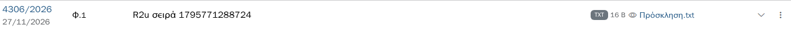
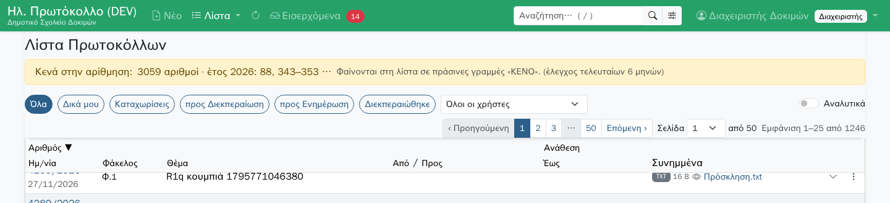

# R2u: list: a file's 👁 before its name; the fixed head blends with the page

| | |
|---|---|
| Status | ✅ Done |
| Branch | `task/R2u-list-preview-first` |

## What was asked (owner, 2026-11-27)
- «In the main protocol screen the preview icon should be moved before the filename for consistency reasons.»
- «The part of the screen that stays frozen does not blend completely with the background. Can we fix that?»

## What changed
- **A file's line in the list** is now, as in the form: its type (e.g. PDF, 27 KB), 👁, its name.
  - The name is the link that opens the file, as before.
  - The type is a link too, for the mouse; TAB passes only the 👁 and the name.
  - A long name still shortens; the type and 👁 keep their size.
- **The fixed head** (R2t) had the white of the cards, so it showed as a lighter band over the page's light grey. It now
  has the page's own grey (theme colour), so only its contents show.

## How verified
- Browser (`protocol-list.spec.js`, R2u):
  - a saved protocol's line in the list: type, then 👁, then the name, from left to right;
  - the head's background equals the page's, and it is fixed when scrolled.

  The R2b test now picks the name's link. The list and preview specs are green (19).
- PHPUnit list and preview tests green (only the view and CSS changed).

## Owner actions
None. To try it: step 115 in [OWNER-TODO.md](../../OWNER-TODO.md).
