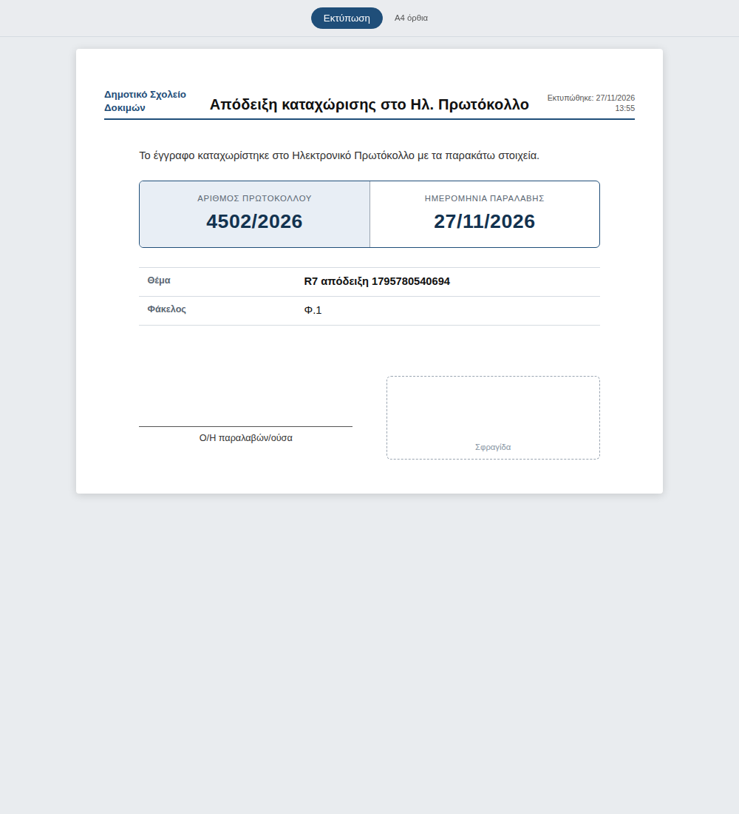
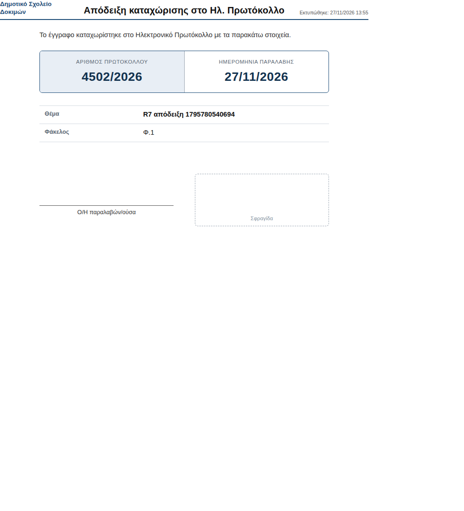

# R2v: the receipt restyled for paper

| | |
|---|---|
| Status | ✅ Done |
| Branch | `task/R2v-receipt-print` |

## What was asked (owner, 2026-11-27)
«Let's beautify /receipt like we did for the print page.»

## What changed
The receipt (a protocol → *Απόδειξη*) uses the same sheet as the protocol book (R2s):
- the service's name, the title and «Εκτυπώθηκε» at the top, and the service's name and page number at the foot;
- on screen, a white A4 sheet on a grey desk with *Εκτύπωση* above it; on paper, the sheet alone.

On the sheet:
- a short line: «Το έγγραφο καταχωρίστηκε στο Ηλεκτρονικό Πρωτόκολλο με τα παρακάτω στοιχεία»;
- **the number and the date of receipt, large, in a box**;
- the details, in a clean table, only those filled in: *Θέμα* (bold), *Αρχή έκδοσης*, *Αρ./Ημ. εισερχομένου*,
  *Τόπος έκδοσης*, *Φάκελος*. Before: the number, the date, the subject and the incoming number only;
- **a place to sign** (Ο/Η παραλαβών/ούσα) **and a box for the stamp**.

## How verified
- PHPUnit `PrintTest::test_the_receipt`:
  - the sheet, the number and the date in their box;
  - the filled-in details, with an empty one left out;
  - a subject with `<b>` and `&` stays text;
  - the signature and the stamp box.

  The access tests (a protocol the user may not see: 404) are unchanged and green.
- Browser (`printing.spec.js`, R7 / R2v): the receipt opens from the form with the sheet, the number and the date;
  printed, the toolbar is gone.

## Owner actions
None. To try it: step 117 in [OWNER-TODO.md](../../OWNER-TODO.md).
