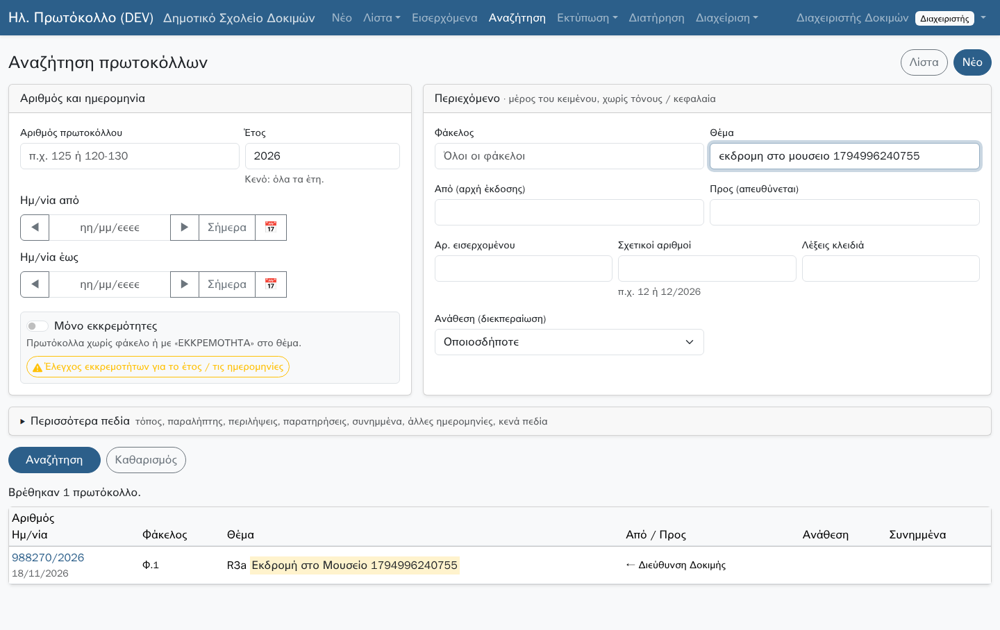
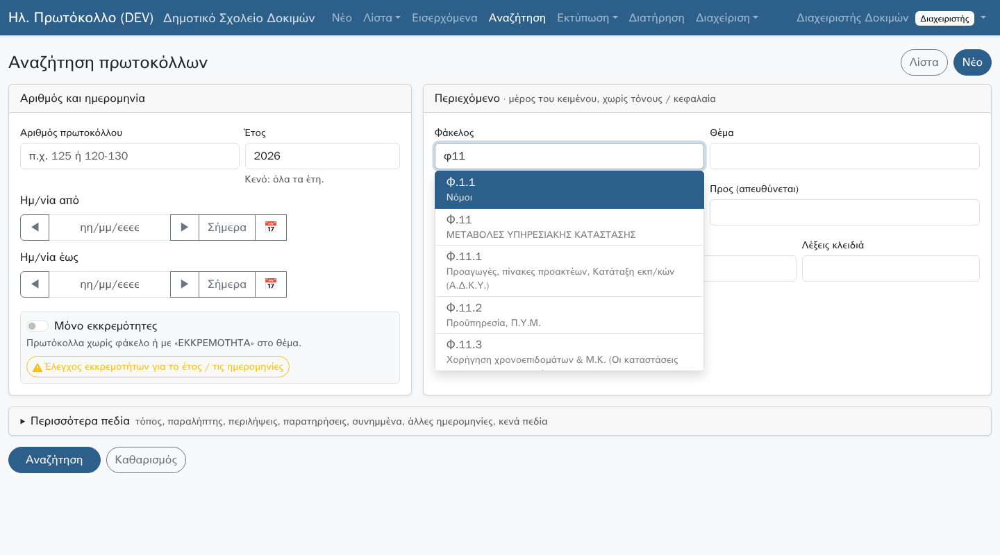
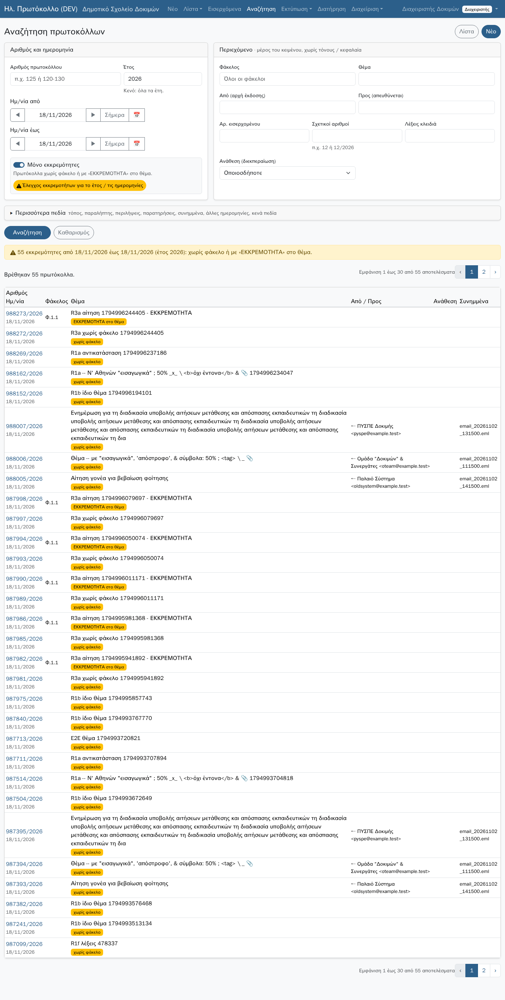
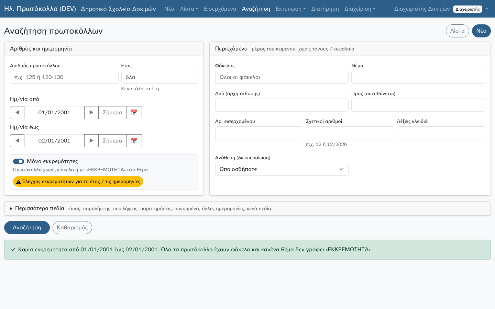

# R3a: advanced search screen

| | |
|---|---|
| Status | ✅ Done |
| Branch | `task/R3a-advanced-search` |

## What was asked
- The year is optional and filled in with the current one.
- Enter starts the search from any field, including *Σχετικοί αριθμοί*.
- Partial match on the incoming number and on the text fields.
- Folder autocomplete that ignores accents, case and symbols.
- Owner, 2026-11-18:
  - a folder choice **«Χωρίς φάκελο»** (protocols on hold / placeholders);
  - a **pending check** for a date range: protocols without a folder **or** with ΕΚΚΡΕΜΟΤΗΤΑ in the subject;
  - when nothing is pending, the page must say so clearly.

## What was wrong
- The old page (jQuery, `/find` + `/getFindData`) had no default year. It searched while typing, so Enter did nothing
  useful.
- It had three "field / text / Κενό" rows chosen from a list.
- It could not find protocols without a folder as one choice, and it had no pending check.
- Its highlight was case-insensitive but not accent-insensitive.

## What changed
- **`/find` is a new page** (Livewire `App\Livewire\SearchPage`). The old page, `/getFindData` and their views are
  removed.
- **Number and date** (left):
  - *Αριθμός πρωτοκόλλου* takes one number (`125`) or a range (`120-130`);
  - *Έτος* is filled in with the year in use; empty means every year;
  - *Ημ/νία από / έως* use the usual date field (`9`, `9/4` … work).
- **Content** (right):
  - *Φάκελος*: the form's folder picker, with «Όλοι οι φάκελοι» and «Χωρίς φάκελο» first. A code typed without dots
    works (`φ11` finds Φ.1.1), and so does a word of the description;
  - *Θέμα*, *Από (αρχή έκδοσης)*, *Προς (απευθύνεται)*, *Αρ. εισερχομένου*, *Σχετικοί αριθμοί*, *Λέξεις κλειδιά*;
  - *Ανάθεση*: a user, or «Κανένας».
- **Περισσότερα πεδία** (closed unless used; remembered per browser): the other text fields, the attachment name and
  ΑΔΑ, the incoming/outgoing date ranges, and the "must be empty" boxes (they replace the old *Κενό* boxes).
- **Pending check**: the switch *Μόνο εκκρεμότητες*, or the button *Έλεγχος εκκρεμοτήτων*.
  - The button keeps only the year and the dates, so no other field left filled can hide a pending protocol.
  - Pending means: no folder, or "εκκρεμότητα" in the subject in any case or accents (ΕΚΚΡΕΜΟΤΗΤΕΣ too).
  - Each result shows why it is pending.
  - When nothing is pending, a green message says: *Καμία εκκρεμότητα από … έως …. Όλα τα πρωτόκολλα έχουν φάκελο και
    κανένα θέμα δεν γράφει «ΕΚΚΡΕΜΟΤΗΤΑ».* With another filter, an empty result only says "nothing found".
- **Matching:**
  - every text field matches part of the text, without case or accents;
  - `%` and `_` are plain characters;
  - *Σχετικοί αριθμοί* match whole numbers: `12` finds "12/2026" but not "112" or "5/2012";
  - the found text is marked, also when its accents differ. Fields not shown in the table (e.g. Παρατηρήσεις) appear
    under the subject when they matched.
- **Enter** in any field searches. The search is kept in the address, so reload, back and bookmarks work.
- Writers and readers limited to their own protocols (setting) find only those, as in the list.
- Shared parts for R3b/R3c: `App\Services\Search\SearchCriteria` (what to look for) and
  `App\Services\Search\ProtocolSearch` (the query), plus the results table `resources/views/search/results.blade.php`.
- The settings *searchField1–3* (the old page's default fields) are no longer used. They stay in Ρυθμίσεις until the
  settings screen is rebuilt (R6c).

## How verified
- PHPUnit `SearchTest` (13 tests):
  - year filled in and clearable;
  - partial text without accents/case, with marks;
  - `%` `_`;
  - folder exact / without dots / by description / «Χωρίς φάκελο» / a folder not in the list;
  - pending check in a range, the "nothing pending" message, and no such message when another filter is set;
  - the button clears other fields;
  - related numbers matched whole;
  - empty fields and attachments;
  - limited writers;
  - no criteria;
  - short dates and a reversed range;
  - number ranges;
  - highlight.
- Old `/getFindData` tests moved to the new page: `AssignmentsTest`, `RobustnessTest` (wrong numbers/dates are now
  marked on the field, still no error page), `DateColumnsTest`, `ProtocolAccessTest`, `ProtocolWriterTest` (escaping).
- Browser `search.spec.js`:
  - subject typed without accents and Enter, mark, reload;
  - middle of the incoming number;
  - Enter in Σχετικοί αριθμοί;
  - folder `φ11` → Φ.1.1, then «Χωρίς φάκελο»;
  - pending check for today with reasons;
  - "Καμία εκκρεμότητα" for 2001.
- `assignments.spec.js` and `dates.spec.js` now use the new page.
- Full suites: PHPUnit 369, browser 54/54.

  
  
  
  

## Review (Codex)
- A filter on the attachment name and one on the ΑΔΑ could be met by two different attachments of the same protocol.
  Now every attachment condition must hold for the same attachment, as in the old search. This covers the name, the
  ΑΔΑ and "ΑΔΑ empty". Tested in `SearchTest::test_empty_fields_and_attachments`.

## Owner actions
- None. Try *Αναζήτηση → Έλεγχος εκκρεμοτήτων* for a month of your real copy (8081).
