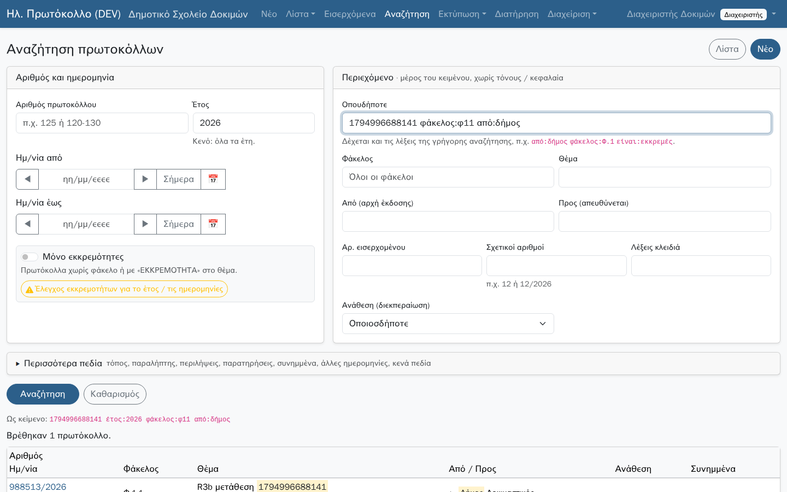

# R3b: search words (Gmail-style)

| | |
|---|---|
| Status | ✅ Done |
| Branch | `task/R3b-query-parser` (on top of R3a) |

## What was asked
A search text like Gmail's: free words plus `από:` `προς:` `φάκελος:` `έτος:` `αρ:` `θέμα:` …, with unit tests. It
feeds the search box in the top bar (R3c).

## What changed
- `App\Services\Search\QueryParser`:
  - `parse(text)` → the same `SearchCriteria` the advanced screen uses;
  - `format(criteria)` → text again. `parse(format(c))` gives the same criteria (tested).
- **Words** without an operator must all be found, each one anywhere: any text field, the folder, an attachment's
  name or ΑΔΑ, or the number (`125`, `125/2026`). `"Quoted text"` is one phrase. No case or accents, as everywhere.
- **Search words** (the name ignores case and accents; short and English forms in brackets):

  | Word | Meaning |
  |---|---|
  | `αρ:125`, `αρ:120-130`, `αρ:125/2026` | number, range, number of a year (`αριθμός:`, `num:`) |
  | `έτος:2026`, `έτος:όλα` | year (`year:`) |
  | `ημ:9/1/2026`, `ημ:1/1/2026..31/3/2026`, `ημ:..31/3/2026` | protocol date or range (`date:`) |
  | `ημεισ:…`, `ημεξ:…` | incoming / outgoing date |
  | `φάκελος:Φ.1`, `φάκελος:φ11`, `φάκελος:εκδρομές`, `φάκελος:κανένας` | folder as in the picker (`φακ:`, `folder:`) |
  | `θέμα:` `από:` `προς:` `εισ:` `σχετ:` `λέξη:` `τόπος:` `παραλήπτης:` `περίληψη:` `περίληψηεξ:` `παρατηρήσεις:` `συνημμένο:` `αδα:` | that field contains the value (`subject:` `from:` `to:` `file:` `ada:` …) |
  | `ανάθεση:Μαρία`, `ανάθεση:κανένας` | assigned for διεκπεραίωση / to nobody |
  | `κενό:φάκελος`, `κενό:λέξη` … | the field is empty |
  | `είναι:εκκρεμές` | pending: no folder or ΕΚΚΡΕΜΟΤΗΤΑ in the subject (`is:pending`) |

- A value with spaces goes in quotes: `από:"Δήμος Πατρέων"`.
- An unknown word with `:` is searched as text (`10:30`, `http://…`).
- A known word with a value it cannot use (`έτος:πέρσι`, `ημ:31/2/2026`) is not used, and the page says so.
- **Advanced screen:**
  - new field *Οπουδήποτε* (free words; it also accepts the search words, while a field filled in on the form wins);
  - under the results, *Ως κείμενο: …* shows the same search as text, so the words can be learnt by example.

## How verified
- PHPUnit `QueryParserTest` (7 unit tests):
  - words and phrases;
  - operator names without accents/case, short and English;
  - number/year/dates (short forms, open and reversed ranges);
  - folder/assignee/empty/pending;
  - unknown operators as words, wrong values reported;
  - unclosed quotes;
  - round trip with `format()`.
- `SearchTest`:
  - free words across fields, attachment, number and number/year, a phrase in one field;
  - «Οπουδήποτε» with operators;
  - `έτος:όλα` overriding the prefilled year;
  - the error message.
- Browser `search.spec.js`: words in two fields, `φάκελος:φ11 από:δήμος`, `φάκελος:κανένας`, the error on
  `έτος:πέρσι`.
- Full suites: PHPUnit 378, browser 55/55.

  

## Owner actions
None.
