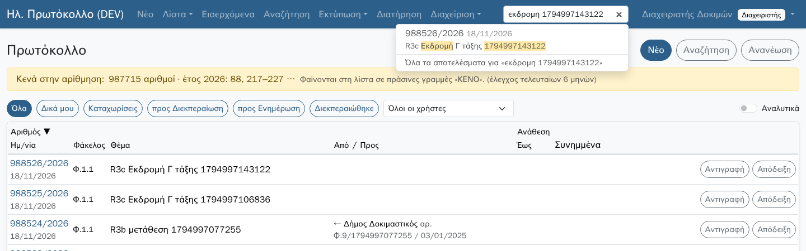
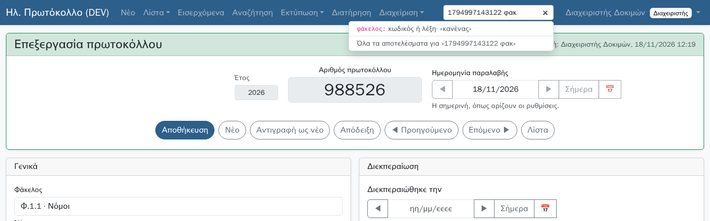
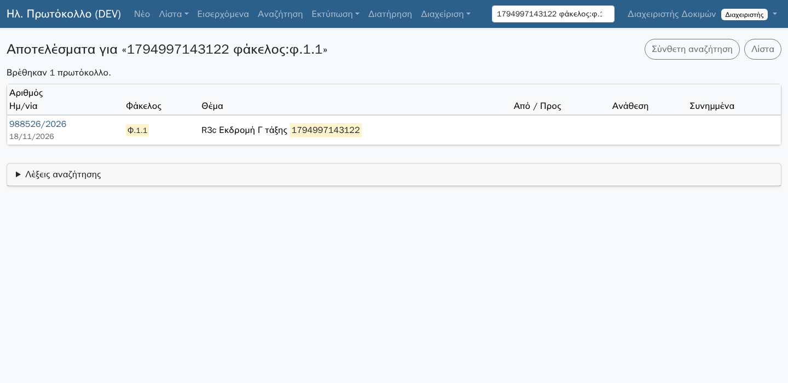

# R3c: search box in the top bar + results page

| | |
|---|---|
| Status | ✅ Done |
| Branch | `task/R3c-global-search` (on top of R3b) |

## What was asked
A Gmail-style search box in the top bar, on every screen. Results on a **separate page** (owner's decision). Live
suggestions while typing. Only protocols the user may see.

## What changed
- **The box** is in the top bar of every page:
  - the rebuilt pages (`resources/views/search/box.blade.php`);
  - the old pages too (a plain box, without suggestions).
  - The `/` key puts the cursor in it, as in Gmail.
- **While typing** (from 2 letters, a quarter of a second after the last key):
  - up to 6 matching protocols: number/year, date, subject with the words marked, sender or recipient;
  - the search words whose start was typed (`φακ` → `φάκελος:` with what it does); a click or Enter puts it in the
    box;
  - "Όλα τα αποτελέσματα για «…»".
  - ↑ ↓ choose, Enter opens the chosen protocol (or the results page), Escape closes.
  - The suggestions come from `GET /search/suggest?q=…`:
    - only the user's protocols when the list is limited for them;
    - the subject is escaped before the marks are added;
    - at most 120 calls a minute per user.
- **Results page** `/search?q=…` (Livewire `SearchResults`):
  - the text is read by R3b's parser; every year unless `έτος:` is given; newest first;
  - the same table and marks as the advanced screen;
  - anything that could not be used is listed;
  - a closed list *Λέξεις αναζήτησης* explains the search words;
  - **Σύνθετη αναζήτηση** opens the advanced screen with the same search filled in. What has no field there (free
    words, an assignee by name) goes to *Οπουδήποτε*. A folder named exactly (`φάκελος:φ.1.1`) shows as that folder.
- **Folders without dots**, refined: a code typed with its dots (any case) means only that folder. Without dots it
  means every folder it could be: `φ11` is both Φ.1.1 and Φ.11 in the demo list.
- **Top bar width:** the institution's name next to the brand shows only on screens at least 1600 px wide, so the
  search box fits next to the menu.

## How verified
- PHPUnit `GlobalSearchTest`:
  - the box on new and old pages, not on the login page;
  - results across years, newest first, the box keeps the text;
  - `11/2026`;
  - unusable words listed, empty text;
  - the advanced-screen link's fields and the same result there;
  - suggestions: 6 + "more", newest first, marked and escaped (`<b>` stays text), limited writer sees only theirs,
    too short or unusable text gives nothing, login needed.
- `SearchTest`: folders with/without dots (Φ.1.1 vs Φ.11).
- Route snapshot: `/search`, `/search/suggest` (auth, throttle).
- Browser `global-search.spec.js`:
  - `/` focuses the box;
  - typing shows the protocol with the mark; ↓ Enter opens it;
  - `φακ` offers `φάκελος:`;
  - Enter → results page; *Σύνθετη αναζήτηση* → the advanced screen with *Οπουδήποτε*, folder and empty year filled
    in;
  - the old page's box.
- Full suites: PHPUnit 383, browser 57/57.

  
  
  

## Owner actions
None.
