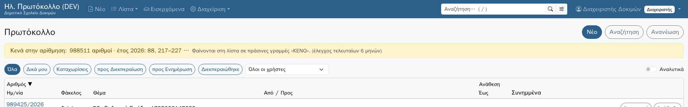
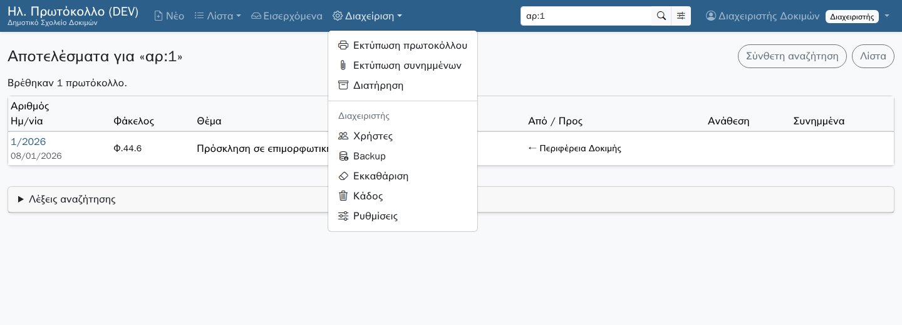
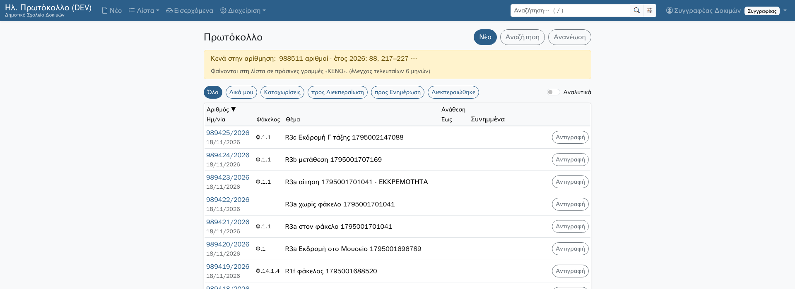

# R3d: top bar and page width

| | |
|---|---|
| Status | ✅ Done |
| Branch | `task/R3d-top-bar` |

## What was asked (owner, 2026-11-18)
- Move *Εκτύπωση* and *Διατήρηση* into *Διαχείριση*; integrate *Αναζήτηση* into the search box.
- Put the organisation's name under the application's name, so the top bar fits a 1920 × 1080 screen.
- Add icons to every item and button of the top bar.
- Keep the full-window layout, but add a switch for a narrower layout (the page about half the screen wide, as older
  applications did), per user.

## What changed
- **Menu:** *Νέο · Λίστα · Εισερχόμενα · Διαχείριση*.
  - *Διαχείριση* now opens for every role. It always has *Διατήρηση*. It has *Εκτύπωση πρωτοκόλλου* and
    *Εκτύπωση συνημμένων* when the user may print, under the same rule as before.
  - For administrators it also has *Χρήστες, Backup, Εκκαθάριση, Κάδος, Ρυθμίσεις* under a *Διαχειριστής* heading.
- **Search box:** a magnifier button runs the search; a second button opens *Σύνθετη αναζήτηση*, which replaces the
  menu's *Αναζήτηση*.
- **Brand:** the application's name with the organisation on a smaller second line (cut with … if very long).
- **Icons:** every menu item and menu entry, the search buttons and the user menu (*Περί*, *Έξοδος*, page width).
  They come from Bootstrap Icons (MIT, by the Bootstrap team), npm package `bootstrap-icons` 1.13.2, bundled by Vite.
- **Page width** (user menu → *Πλάτος σελίδας*):
  - *Όλη η οθόνη* (the default) or *Στενό, στο κέντρο*. Narrow is about half a wide screen, at least 960 px,
    centred.
  - The choice is saved with the account (new column `users.preferences`, `App\Support\UserPreferences`), so it
    follows the user to every computer, and it applies at once.
  - In narrow mode, tables hide their less important columns as they would on a window of that width, so the subject
    keeps its room.
  - The top bar keeps the whole width: its items would not fit in half a 1080p screen.
- **Old pages** (Εισερχόμενα, Ρυθμίσεις, Διατήρηση, Εκτύπωση…) keep their old menu until they are rebuilt (R5c,
  R6a–c, R7). Their search box was added in R3c.

## How verified
- PHPUnit (`ModernLayoutTest`):
  - each role's menu;
  - the contents of *Διαχείριση* per role;
  - every item has an icon;
  - printing still hidden for limited writers/readers;
  - the brand's second line;
  - the search buttons;
  - the page width saved per user (another user keeps the default; unknown keys/values refused; login needed);
  - the route snapshot (`POST /preferences`: auth, throttle).
- Browser (`modern-layout.spec.js`):
  - one row at 1920 and 1440 px, with nothing wider than the window;
  - the icon font loaded;
  - the advanced-search and search buttons work;
  - readers see *Διαχείριση* with *Διατήρηση* but not *Ρυθμίσεις*;
  - the mobile menu;
  - width: narrow below 1000 px and centred, kept after a reload, back to full.
- Full suites: PHPUnit 414, browser 61/61.

  
  
  

## Owner actions
None. The new column is added by `php artisan migrate`, also in the final deployment.
