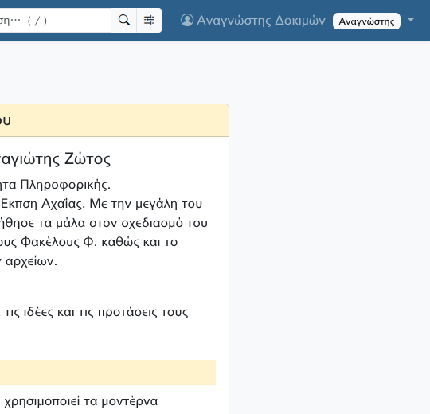
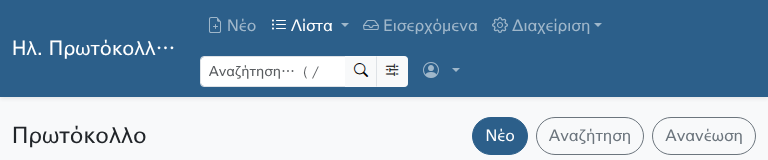
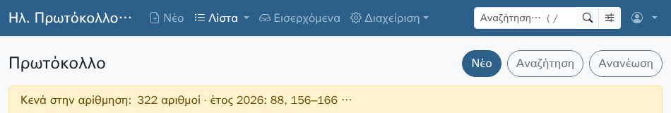
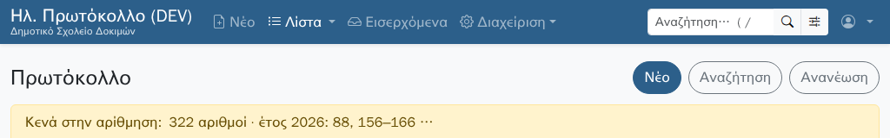
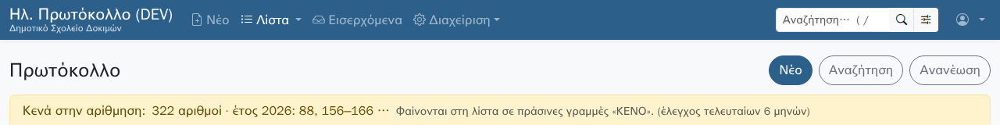

# R3e: each user chooses their home page; the top bar stays open on medium screens

| | |
|---|---|
| Status | ✅ Done |
| Branch | `task/R3e-home-page` (on top of R1j) |

## What was asked (owner, 2026-11-20)
- Users work differently: some view all protocols, some those assigned to them *προς Ενημέρωση*, some those *προς
  Διεκπεραίωση*. So each user should choose what their home page shows.
- The top bar folded its menu behind a ☰ button too soon, on screens with enough room. Its buttons are used all the
  time by everyone, so they should stay visible.

## What was found
- The home page was set per **role** only, in a configuration file: writers and readers start from *προς
  Διεκπεραίωση*, administrators and assigners from all the protocols.
- *Όλα τα πρωτόκολλα* in the *Λίστα* menu led to that home page. For a writer, it opened *προς Διεκπεραίωση*.
- The menu folded under 992px wide, e.g. in a window of half a screen.

## What changed
- **Αρχική σελίδα** in the user menu (click your name at the top right): *Όλα τα πρωτόκολλα*, *προς Διεκπεραίωση* or
  *προς Ενημέρωση*. A ✓ shows the current one. The choice is saved with the account, so it follows the user to every
  computer, like *Πλάτος σελίδας*.
  - Until a user chooses, their role's page stays the home page, as before.
  - The home page is where the login leads, and where the application's name and *Λίστα* (R1j) lead. They change as
    soon as the choice is made, without reloading.
  - Opening the login page while logged in leads there too.
- *Όλα τα πρωτόκολλα* now always opens all the protocols.
- **Top bar:** the menu stays open from 768px wide (a tablet held upright), instead of 992px. Between 768 and 1400px
  the bar makes room:
  - the user's name and role go into the tooltip of the 👤 button;
  - the application's name shortens with … if needed;
  - the search box is a little narrower;
  - just above 768px, the search box and 👤 go to a second row.

  Under 768px (phones) the ☰ button remains.

The top bar at 768, 950, 1024 and 1280px:

## How verified
- PHPUnit:
  - `ModernLayoutTest::test_each_user_chooses_their_home_page` checks:
    - the role's page until the user chooses, with its ✓;
    - for each choice: the application's name, *Λίστα*, the ✓, the page after login and the login page all lead to
      it;
    - another user keeps the role's page;
    - an unknown value is refused;
    - *Όλα τα πρωτόκολλα* always leads to all the protocols.
  - `RouteAccessTest::test_logged_in_user_opening_login_lands_on_their_home_page` replaces the test of the old rule,
    which always opened the full list.
- Browser (`modern-layout.spec.js`):
  - R3e home page: a reader chooses *προς Ενημέρωση*. The name and *Λίστα* lead there at once, and after logging out
    and in the reader starts there.
  - R3e top bar at 768, 950, 1024 and 1280px:
    - *Νέο*, *Λίστα*, *Εισερχόμενα*, *Διαχείριση*, the search box and 👤 are visible, with no ☰;
    - nothing is wider than the screen;
    - one row from 950px, at most two at 768px.
  - The other top-bar tests pass too (7/7), among them one row at 1440 and 1920px, and ☰ on a phone.
- Full PHPUnit: 538 tests pass.

## Owner actions
None. To try it: step 40 in [OWNER-TODO.md](../../OWNER-TODO.md).
