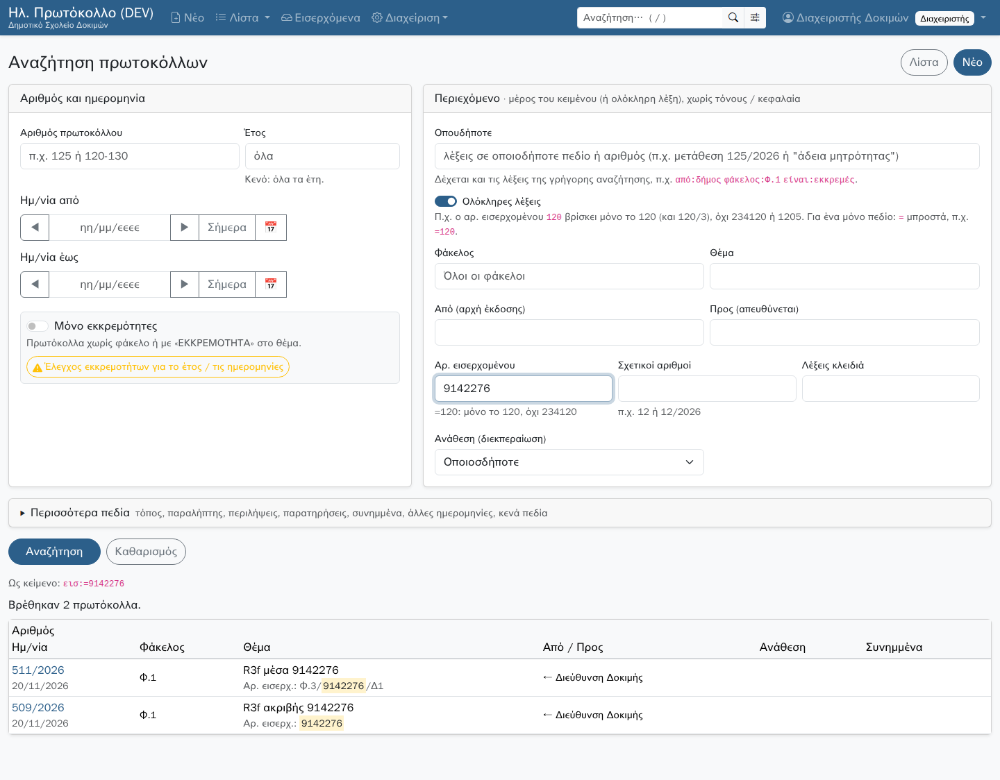
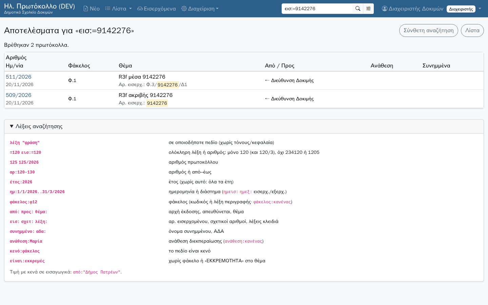

# R3f: search for whole words or numbers

| | |
|---|---|
| Status | ✅ Done |
| Branch | `task/R3f-whole-words` (on top of R2i) |

## What was asked (owner, 2026-11-20)
Searching *Αρ. εισερχομένου* for `120` also finds every number containing 120: 234120, 451205, 120112. The owner
asked for an option to find only 120, explained in the help text too.

## What changed
- **`=` before a value** finds it only as a whole word or number:
  - `=120` finds *120*, *120/3*, *Φ.2/120/Δ1* and *αρ. 120*, but not *234120*, *1205* or *120112*;
  - a letter or a digit right before or after it means it is part of something longer;
  - case, accents and final ς are still ignored: `=άδεια` finds *Άδεια* and *ΑΔΕΙΑ*, not *αδειούχος*;
  - it works in every text field of *Σύνθετη αναζήτηση*, in *Οπουδήποτε*, and in the search box at the top:
    `εισ:=120`, `θέμα:=άδεια`, or simply `=120` for anywhere.
- ***Ολόκληρες λέξεις*** switch on *Σύνθετη αναζήτηση*, under *Οπουδήποτε*: every field and word is matched whole,
  without typing `=`. It is kept in the address, so a link or a reload keeps it.
- **Help:**
  - the search help (under the results) has a line *`=120` `εισ:=120`: ολόκληρη λέξη ή αριθμός: μόνο 120 (και 120/3),
    όχι 234120 ή 1205*;
  - the switch has an explanation;
  - *Αρ. εισερχομένου* has the hint *=120: μόνο το 120, όχι 234120*;
  - typing `εισ` in the box offers *εισ:* with *(εισ:=120 μόνο το 120)*.
- The found text is marked in the results as before. The `=` is not part of the mark.

## How verified
- PHPUnit `SearchTest::test_whole_words_and_numbers`, on seven incoming numbers containing 120:
  - without `=`: all seven;
  - with `=120`: the four where 120 stands alone (also `= 120`, and as a free word);
  - `=αδεια` ignores case and accents and skips *αδειούχος*;
  - a part of a word with `=` finds nothing; a whole phrase works;
  - an attachment's name: *αίτηση-120.pdf* matches, *αίτηση1205.pdf* does not;
  - `εισ:=120` in the box; the switch in the address; the help; the mark without `=`.
- Browser (`search.spec.js`, R3f), on three protocols with the number alone, inside a longer number and between
  slashes:
  - 3 found without the switch, 2 with it, and the switch kept in the address;
  - 2 found with `=` in the field;
  - `εισ:=…` in the box, and the help's line.

  All 7 search browser tests pass.
- Full PHPUnit: 550 tests pass.

## Owner actions
None. To try it: step 42 in [OWNER-TODO.md](../../OWNER-TODO.md).
