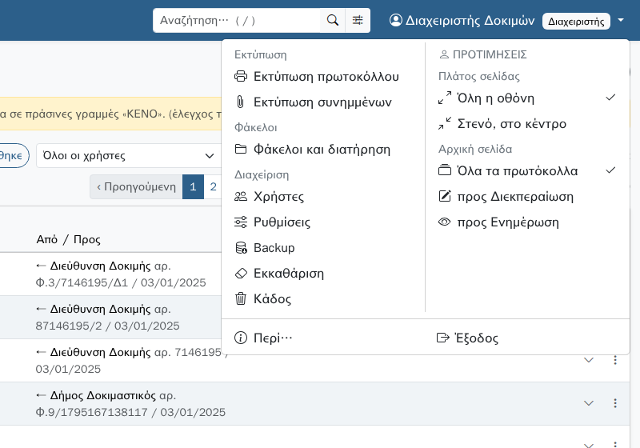

# R3g: Διαχείριση in the user menu, in groups

| | |
|---|---|
| Status | ✅ Done |
| Branch | `task/R3g-manage-in-user-menu` (on top of R5g) |

## What was asked (owner, 2026-11-20)
- Move the *Διαχείριση* button of the top bar into the user menu at the top right.
- Group the entries accordingly.
- Also: note that *Αριθ. εισερχ.* in *Εισερχόμενα* starts with the e-mail's time on purpose, and leave it as it is.

## What changed
- **Top bar:** *Νέο* · *Λίστα* · *Εισερχόμενα*, the search box, and the user menu.
- **User menu** (click your name), in two columns:

  | Διαχείριση | Προτιμήσεις |
  |---|---|
  | *Εκτύπωση*: Εκτύπωση πρωτοκόλλου, Εκτύπωση συνημμένων | *Πλάτος σελίδας*: Όλη η οθόνη, Στενό |
  | *Φάκελοι*: Φάκελοι και διατήρηση | *Αρχική σελίδα*: Όλα τα πρωτόκολλα, προς Διεκπεραίωση, προς Ενημέρωση |
  | *Διαχείριση* (administrators): Χρήστες, Ρυθμίσεις, Backup, Εκκαθάριση, Κάδος | |

  *Περί…* and *Έξοδος* are below both columns.
  - The administrators' entries are in a new order: the people and settings first, then the data (Backup,
    Εκκαθάριση, Κάδος).
  - The rules stay the same: *Εκτύπωση* is hidden from writers and readers when *Περιορισμός λίστας* is on, and
    *Διαχείριση* is for administrators only.
  - On a phone the menu is one column. There, *Προτιμήσεις* starts after a line and some space, as its own
    section.
  - The owner asked (same day) for the administrators' group to be called *Διαχείριση* (it was *Διαχειριστής*).
    The heading above the groups was dropped, so «Διαχείριση» does not appear twice.
- **Incoming number:** a comment in `EmailRegistration::defaults` says the e-mail's time stands in for the sender's
  protocol number when the attachment has none. The user types the real number over it when there is one. The same
  note is in *Already decided* in OWNER-TODO and in HANDOFF.

## How verified
- PHPUnit `ModernLayoutTest`:
  - the bar's items per role, without *Διαχείριση*;
  - the groups and their entries per role, each with an icon;
  - the menu's order: *Διαχείριση* then *Προτιμήσεις*, *Περί…*, *Έξοδος*;
  - printing hidden under *Περιορισμός λίστας*.
- Browser (`modern-layout.spec.js`):
  - R3g: no *Διαχείριση* button in the bar; every entry in the user menu; two columns side by side within the window;
    *Ρυθμίσεις* opens the settings; on a phone, one column without sideways scrolling.
  - The earlier top-bar tests now open the user menu instead.

  Top-bar and list browser tests pass: 17 of 17.
- Full PHPUnit: 554 tests pass.

## Owner actions
None. To try it: step 47 in [OWNER-TODO.md](../../OWNER-TODO.md).
