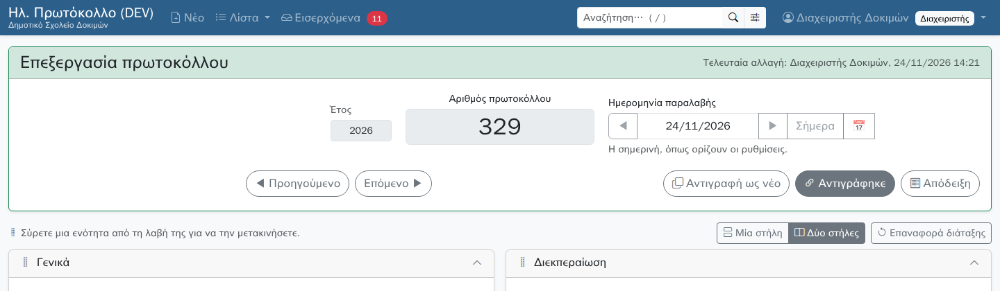
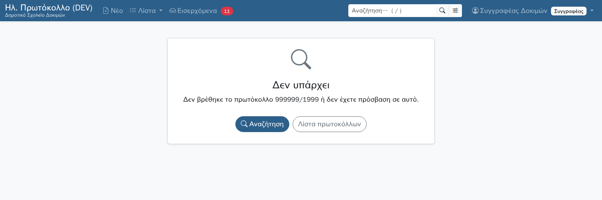

# R3h: direct links to a protocol

| | |
|---|---|
| Status | ✅ Done |
| Branch | `task/R3h-direct-links` |

## What was asked (owner, 2026-11-23)
A short address that opens a protocol by its number, to send to a colleague or keep in a note:
`/protocol/125` (this year) and `/protocol/125/2025`. The form should offer the link to copy.

## What changed
- **`/protocol/{num}`** and **`/protocol/{num}/{year}`** open the protocol's form (`/home/{id}`). Without a year, this
  year (Greek time). Leading zeros are fine (`/protocol/015`).
- **One «Δεν υπάρχει» page** (404) for a number that does not exist, a protocol the user may not see (*Περιορισμένη
  πρόσβαση* on), and a malformed number or year (`abc`, `-1`, `1.5`, a 3-digit year…). The page is the same word for
  word in all three cases, so a link never tells whether a protocol exists. It offers *Αναζήτηση* (searches
  `αρ:N/YYYY`, which shows only what the user may see; for a malformed link the advanced search) and *Λίστα
  πρωτοκόλλων*. What was typed is shown escaped and shortened.
- **Not logged in:** the login page first, then straight to the protocol.
- **«Σύνδεσμος»** in the form's pills (next to *Αντιγραφή ως νέο* and *Απόδειξη*, every role that sees the protocol):
  copies `…/protocol/N/YYYY` and says *Αντιγράφηκε* for two seconds. On a plain-http school server, where browsers do
  not allow the clipboard API, it copies the old way; if even that is refused, the link is shown to copy by hand.

## How verified
- PHPUnit `DirectLinkTest` (5 tests): this year / a given year / leading zeros; a guest logs in and lands on the
  protocol; missing vs. forbidden give identical pages (compared after replacing the number), malformed numbers and
  years give the same page and never echo HTML; a limited writer opens their own and assigned protocols; the pill
  carries the link (readers too, at the far right) and is not on a new protocol.
  `ProtocolFormTest`: the pills' order now includes the link; for readers the link (not the receipt) starts the
  far-right group. Route snapshot: the new route has `auth`. Full suite: 608 tests, green.
- Browser (`direct-links.spec.js`, 2 tests): the link and the year-less link open the form; *Σύνδεσμος* puts the exact
  URL on the clipboard and the label comes back; a guest is sent to login and then to the protocol; a missing number
  gives 404 with *Δεν υπάρχει*, its *Αναζήτηση* opens the search; `/protocol/abc` the same page.

## Owner actions
None. To try it: step 63 in [OWNER-TODO.md](../../OWNER-TODO.md).
