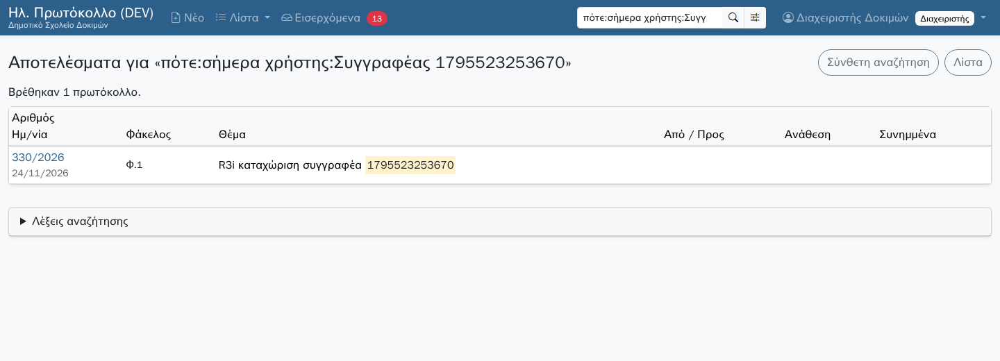
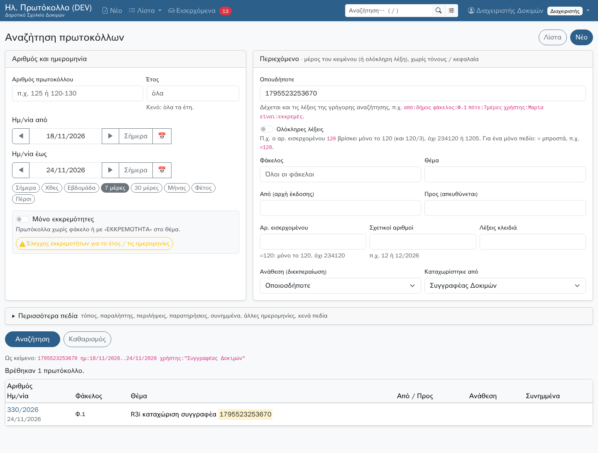

# R3i: search by «when» and «who registered»

| | |
|---|---|
| Status | ✅ Done |
| Branch | `task/R3i-relative-dates-registrar` |

## What was asked (owner, 2026-11-23)
Search for *today*, *yesterday*, *this week*, *the last N days*, and for the protocols a given user registered, e.g.
`πότε:7μέρες χρήστης:Α είναι:εκκρεμές`.

## What changed
- **`πότε:`** is a new name for `ημ:` (protocol date). Every date word (`πότε:` `ημ:` `ημεισ:` `ημεξ:`) also takes:

  | value | means (today = Wednesday 18/11/2026) |
  |---|---|
  | `σήμερα` | 18/11 |
  | `χθες` | 17/11 |
  | `εβδομάδα` | Monday to today: 16/11–18/11 |
  | `7μέρες` (also `7ημέρες`, `τελευταίες7`; any N) | the last N days, today included: 12/11–18/11 |
  | `μήνας` | the 1st to today: 01/11–18/11 |
  | `φέτος` / `πέρσι` | the whole year: 2026 / 2025 |

  Case and accents do not matter; English forms work too (`today`, `week`, `last7`, `lastyear`). A wrong value
  (`πότε:αύριο`, `πότε:0μέρες`) is reported under *Δεν χρησιμοποιήθηκαν*, as before.
- **`χρήστης:`** (also `καταχώρισε:`, `user:`): who registered the protocol, by part of the name (like `ανάθεση:`).
  It searches only among the protocols the user may see.
- **Written back as typed:** the search shown *Ως κείμενο* keeps `ημ:7μέρες` (not the dates), so a bookmarked search
  keeps meaning «the last 7 days» tomorrow too.
- **Advanced search (`/find`):** quick buttons under the dates (*Σήμερα, Χθες, Εβδομάδα, 7 μέρες, 30 μέρες, Μήνας,
  Φέτος, Πέρσι*) fill *Ημ/νία από / έως*, clear the year and search; a new menu **«Καταχωρίστηκε από»** next to
  *Ανάθεση*. A protocol date typed in *Οπουδήποτε* (`πότε:πέρσι`) now decides the year instead of the prefilled one
  (otherwise last year's protocols could never be found that way); a typed `έτος:` still counts. The menu wins over a
  typed `χρήστης:`, like the assignee menu.
- The search help and the words offered while typing in the top bar list `πότε:` and `χρήστης:`.

## How verified
- PHPUnit `QueryParserTest` (3 new): every relative value on a fixed day, Monday and new-year edges, wrong values
  reported; `χρήστης:` names; `format()` keeps relative dates and the registrar and parses back to the same criteria.
- PHPUnit `SearchWhenAndWhoTest` (6): the results for each relative value and for `χρήστης:` (also an unknown name and
  the owner's example); a limited writer does not find others' protocols by registrar; the quick buttons; the
  registrar menu, typed dates vs. the prefilled year; the advanced link keeps a relative date relative. Full suite:
  612 tests, green.
- Browser (`search-when-who.spec.js`): a writer registers a protocol; the admin finds it with
  `πότε:σήμερα χρήστης:Συγγραφέας`, not with another user or `πότε:χθες`; the box offers `πότε:`; on `/find`,
  «Καταχωρίστηκε από» + *7 μέρες* fill the dates, clear the year and find it; another registrar finds nothing.

## Owner actions
None. To try it: step 64 in [OWNER-TODO.md](../../OWNER-TODO.md).
