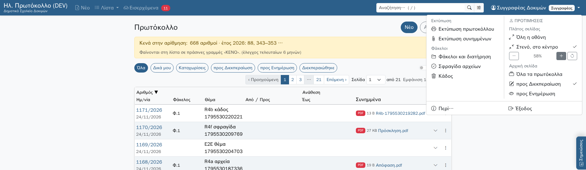
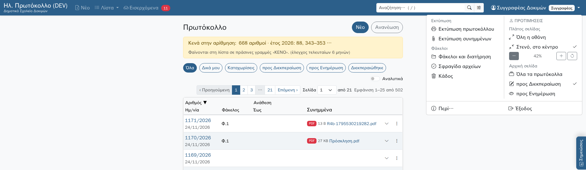

# R3j: the narrow page's width with − / + / ↺

| | |
|---|---|
| Status | ✅ Done |
| Branch | `task/R3j-narrow-width` |

## What was asked (owner, 2026-11-25)
*Πλάτος σελίδας → Στενό, στο κέντρο* should also have plus, minus and reset buttons that change the width of the page,
set and saved per user.

## What changed
- Under *Στενό, στο κέντρο* (your name → *Προτιμήσεις*) there is now a row **− 50% + ↺**, shown while the narrow page is
  on:
  - **−** / **+**: the page narrower / wider by 5 rem (80 px) at a time, at once. The menu stays open, so you see
    the page change behind it;
  - the number says how much of the window the page takes;
  - **↺**: back to the default (about half of the screen, at least 60 rem, as before).
- Limits: 40 rem (640 px) to 160 rem; − and + are greyed at the limits, and + also when the page already fills the
  window. ↺ is greyed while the page has the default width.
- **Saved per user** with the other choices (`users.preferences`, key `narrowWidth`, in rem), so it follows the user to
  every computer. Several clicks in a row are saved once, with the last width. ↺ removes the choice; the default then
  follows the screen as before.
- The server keeps only whole steps inside the limits (40, 45, …, 160); anything else (text, fractions, values outside)
  is refused, and the value reaches the page only as a number.
- *Όλη η οθόνη* is unchanged; switching back to *Στενό* uses the width chosen before.

## How verified
- PHPUnit `ModernLayoutTest::test_narrow_width_steps_are_saved_per_user`:
  - the row is in the menu under *Στενό, στο κέντρο*, with its limits;
  - a width is saved for one user and drawn on their pages only (another user keeps the default);
  - wrong values are refused: outside the limits, not a whole step, a fraction, a text number, CSS text, `true`;
  - ↺ (null) removes only this choice;
  - null does not clear a non-numeric choice.

  `ModernLayoutTest`: 13 tests, green.
- Browser (`modern-layout.spec.js`, at 1920 × 1000):
  - the row is hidden for the whole-window page; after choosing *Στενό*, the default is 960 px, «50%», and ↺ is
    greyed;
  - + twice: 1120 px at once, the menu still open, one save of 70, «58%»;
  - − four times: 800 px, still centred, saved as 50;
  - after a reload: 800 px;
  - ↺: 960 px, saved as null, and still 960 px after a reload.

  The R3d and R3e menu tests still pass (all 9 tests of the file).

## Owner actions
None. To try it: step 74 in [OWNER-TODO.md](../../OWNER-TODO.md).
