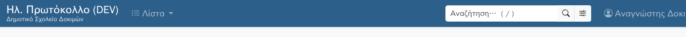

# R3k: no «Νέο» for readers

| | |
|---|---|
| Status | ✅ Done |
| Branch | `task/R3k-no-new-for-readers` |

## What was asked (owner, 2026-11-26)
«A user with this role (Αναγνώστης) does not need to see Νέο at the top bar since they cannot use it. Can we hide it
just for them?»

## What changed
- A reader no longer sees *Νέο* in any of the three places it appeared:
  - the top bar;
  - the *Αναζήτηση* page;
  - the old layout's menu.

  Readers could already not create a protocol (`ProtocolPolicy::create`, R1j), and *Αντιγραφή ως νέο* was already
  hidden for them.
- The top bar's items keep the same ids for every role, so *Λίστα* is still `nav-1` (`Navigation::for` is keyed by
  position).

## How verified
- PHPUnit `ModernLayoutTest`:
  - `test_menu_items_follow_the_roles`: a reader's items are `['Λίστα']`;
  - `test_readers_see_no_new_protocol_link`: on `/about` and `/find`, no *Νέο* link for a reader, *Λίστα* still
    `nav-1-link`; a writer still sees it.
- Browser (`modern-layout.spec.js`, readers): no *Νέο* in the bar or on the search page; *Λίστα* there.

## Owner actions
None. To try it: step 99 in [OWNER-TODO.md](../../OWNER-TODO.md).
