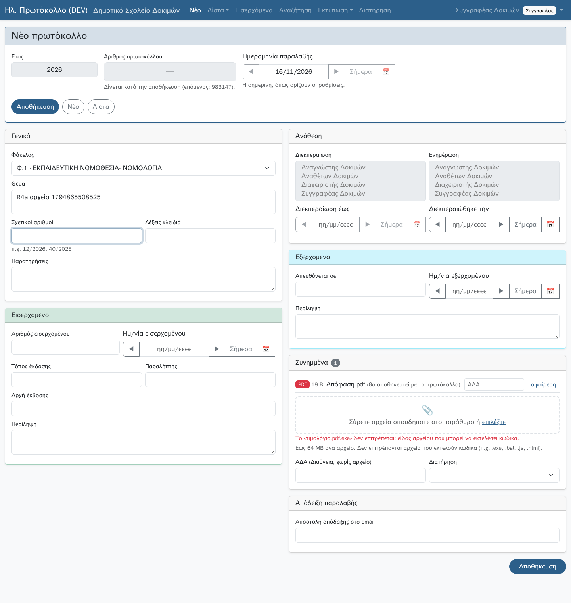

# R4a: safe attachment files

| | |
|---|---|
| Status | ✅ Done (reaches the production server with the final deployment) |
| Branch | `task/R4a-secure-files` |

## What was wrong
- **An uploaded web page ran inside the application.** A download was sent with the type stored at upload time and
  without `attachment`. An `.html` or `.svg` file attached to a protocol therefore opened as a page of the application
  when someone clicked it. Its scripts ran with that person's login and could do anything that person can do (🔎 S06).
- **File names broke the download header.** The name went into the header as typed (`filename=Απόφαση "τελική"; …`):
  Greek, quotes and `;` came out wrong or cut, and a name with a line break could add a header.
- Every download was read whole into memory first: a 60 MB scan took 60 MB of server memory per click.
- **Uploads were not checked.** Any type was taken in, including programs (`.exe`, `.bat`, `.js`) and programs
  renamed to `.pdf`.

## What changed
- `App\Support\SafeFile` gives every stored attachment back, and also attachments of inbox e-mails:
  - **PDF, images (png, jpg, gif, webp) and plain text open in the browser**, with the type their extension says.
    The type stored at upload is ignored for them.
  - **Everything else downloads** (`attachment`). Web pages, SVG, XML and scripts are sent as
    `application/octet-stream`. Office and other files keep their own type, so Word/Excel open them.
  - The name is encoded properly (`filename*=utf-8''…`, with a plain fallback). `nosniff` stops the browser from
    guessing another type. Anything that is not a PDF or an image also gets a sandbox, so it can't run script.
    PDFs are left out of the sandbox because Chrome refuses to show a sandboxed PDF.
  - The file is streamed from disk, not loaded into memory.
  - Access is unchanged (S02: same as the protocol). A file missing from the disk gives a message, with its name
    escaped.
- **Upload checks** (`config/attachments.php`), on every path: the new form when a file is chosen or dropped, and the
  service for any screen:
  - **Size:** up to 64 MB per file, as PHP, nginx and the form allow (`ATTACHMENT_MAX_KB` changes it).
  - **Types that run code are refused:** `.exe .bat .cmd .js .vbs .ps1 .msi .hta .html .svg .php …`. This is also
    checked behind a second extension (`τιμολόγιο.pdf.exe`) and in the content itself (a program or web page renamed
    to `.pdf`).
  - Everything else is accepted. Public services exchange many formats: pdf, office, images, zip, signed `.p7m`,
    `xml`, `eml`. An allow-list would have refused real documents.
  - The form says at once which file was refused and why, and keeps the others.
- The inbox attachment viewer (R5a) uses the same rules.

Not done here: attachments arriving by e-mail are not refused at registration (R5d decides how to report those).
They are served safely by the rules above.

## How verified
- `SafeFileTest` (8 tests):
  - an uploaded `.html` downloads as `application/octet-stream`, with `attachment`, sandbox and nosniff (before:
    `text/html`, opened inside the application);
  - a PDF with a Greek name with quotes and `;` opens inline, with the name encoded, even if a wrong type was stored;
  - a `.docx` downloads with its own type;
  - access rules and the missing-file message still apply;
  - refused: `.exe`, `.pdf.exe`, `.JS`, `.html`, `.svg`, a program renamed `.pdf`; accepted: pdf, p7m, xlsx, jpg,
    zip, eml;
  - size limit from the settings file;
  - the service refuses a bad file and saves nothing;
  - the form shows the refusal and keeps the good file.
- `InboxTest` (R5a): the PDF test now checks `inline` + `nosniff` instead of the sandbox (the PDF exception above).
- Browser (`e2e/tests/secure-files.spec.js`):
  - a PDF and `τιμολόγιο.pdf.exe` are chosen together: the program is refused at once with its name, the PDF is
    saved; its download has `application/pdf`, the encoded Greek name and `nosniff`;
  - an inbox attachment is never sent as a page or script and downloads unless it is a PDF, image or text.

  
- Full suites: PHPUnit 321, browser 39/39.

## Owner actions
1. Nothing to do. If a file type you need is refused, send me its extension (e.g. `.dwg`) and I'll check it.
2. Final deployment: nothing extra.
