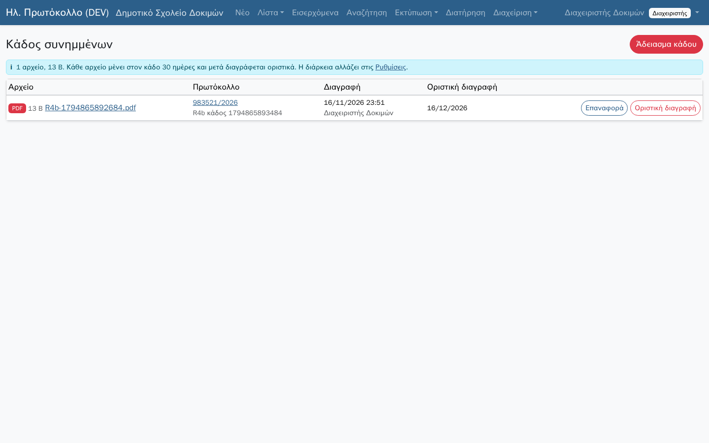

# R4b: attachments' trash with retention

| | |
|---|---|
| Status | ✅ Done (takes effect on the production server at the final deployment, when `migrate` runs) |
| Branch | `task/R4b-trash` |

## What was wrong
- **The trash only moved files.** "Delete" on an attachment moved its file from `arxeio/` to `trash/`, but the
  record kept the `arxeio/` path (found in D03), and nothing remembered where the file had been. There was no way
  to see the trash or restore from it.
- **The trash could overwrite files.** A second attachment with the same name sent to the trash deleted the first
  one's file to make room.
- **Deleting a protocol deleted its files at once**, with no way back.
- *Εκκαθάριση → Οριστική διαγραφή* deleted the whole `trash/` folder: every file in it, also ones no record pointed
  to.
- Nothing ever emptied the trash by itself.

The owner asked for:
- a trash that keeps files for N days, with daily automatic deletion;
- a page that shows the original protocol, who deleted the file and when;
- restore and "delete now";
- the attachments of deleted protocols kept there too.

## What changed
- `App\Services\Attachments\Trash` does everything:
  - **To the trash:** the file moves to `trash/…`. The record keeps both the new path and the old one
    (`trashed_from`), plus who deleted it. A name already taken in the trash gets ` (2)`; nothing is overwritten.
  - **Restore:** back to its old place (` (2)` if that name is taken meanwhile), on its protocol. Attachments sent
    to the trash before R4b (old shape) are restored too.
  - **Delete for good:** the file and the record.
  - **Deleting a protocol** sends its attachments to the trash with the protocol's number and subject
    (`protocol_label`). They stay viewable and can be deleted for good, but not restored (there is no protocol to go
    back to).
- **Retention:** *Ρυθμίσεις → Κάδος συνημμένων: ημέρες* (empty = 30, 0 = until emptied by hand). **Files already
  in the trash at the upgrade count their days from the upgrade.** Production has never emptied its trash; without
  this, its old deleted files would be deleted for good on the first day. The daily
  clean-up deletes for good what has been in the trash longer. The Docker stack has no scheduler, so the first
  request of each day runs it, after the page has been sent; the date is claimed so it runs once. There is also an
  artisan command (`attachments:purge-trash`) and a schedule entry, for a server with a scheduler.
- **Κάδος page** (*Διαχείριση → Κάδος*, administrators). For each file:
  - type and size, with a download link (safe headers, R4a);
  - the protocol, with a link and subject, or the deleted protocol's number and subject;
  - when and by whom it was deleted;
  - when it will be deleted for good;
  - *Επαναφορά* and *Οριστική διαγραφή* (with confirmation).

  Also *Άδειασμα κάδου* and the totals.
- The old *Εκκαθάριση* page now uses the same service. "Expired" files go to the trash the same way. "Empty"
  deletes only the files of trashed records and leaves anything else in `trash/` alone.
- Migration: two new columns on `attachments`, safe to run twice; existing rows are left as they are.

## How verified
- `TrashTest` (10 tests):
  - to the trash: new path, old path, who;
  - a name already in the trash is kept (before: deleted);
  - restore, also of a row in the old shape;
  - a deleted protocol's files are in the trash with its number and subject and can't be restored;
  - retention 0 / default 30 through the artisan command;
  - files trashed years before the upgrade are kept for the days after it;
  - the first request of the day runs the clean-up, and only once that day;
  - the trash page for administrators only: protocol, deleted one, who, purge date, download, restore (and refused
    for a deleted protocol), delete now, empty;
  - the setting is validated;
  - the old *Εκκαθάριση* actions use the trash and no longer delete unrelated files.
- `ProtocolFormTest`: deleting a protocol now leaves its files in the trash (changed on purpose: before, they were
  deleted).
- Browser (`e2e/tests/trash.spec.js`): an administrator saves a protocol with a PDF and sends it to the trash from
  the form (confirmation). The *Κάδος* page shows it with the protocol and the administrator's name; *Επαναφορά*
  puts it back and it downloads intact. A writer gets 403 on `/trash`.

  
- Full suites: PHPUnit 331, browser 41/41.

## Owner actions
1. Optional, after `git pull`: **Real data: load** (runs `migrate`). Then *Διαχείριση → Κάδος* shows the
   attachments your copy has in the trash, each with the date it will be deleted for good: 30 days after the upgrade
   for the old ones.
2. Final deployment: decide the number of days (30 if left empty; 0 keeps everything until you empty the trash).
   The old trash of the server gets those days from the deployment day.
