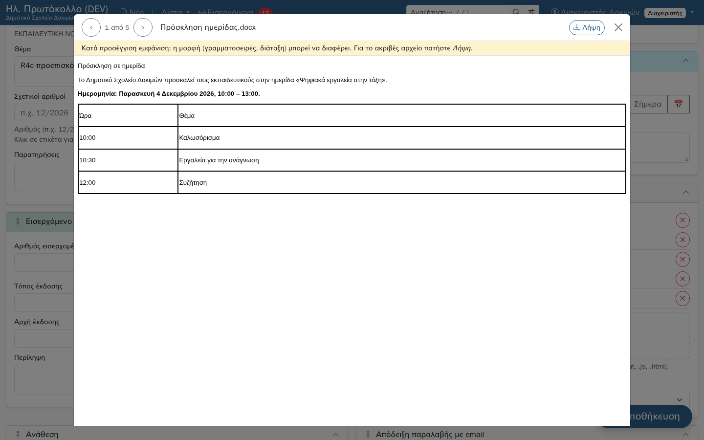
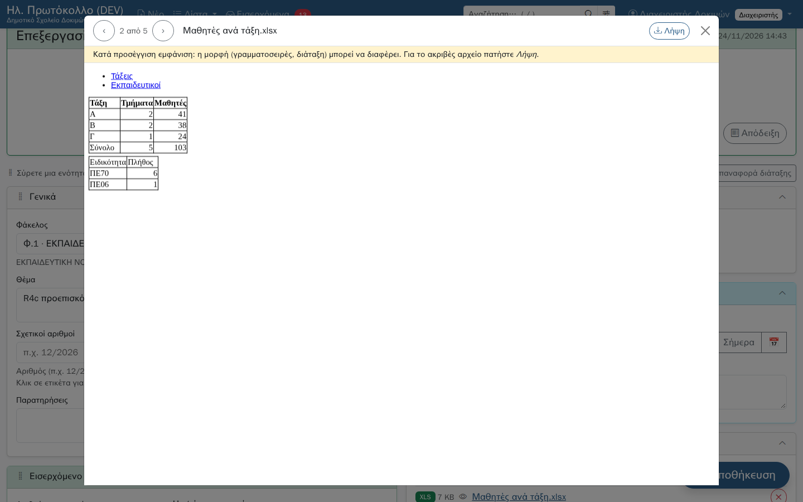
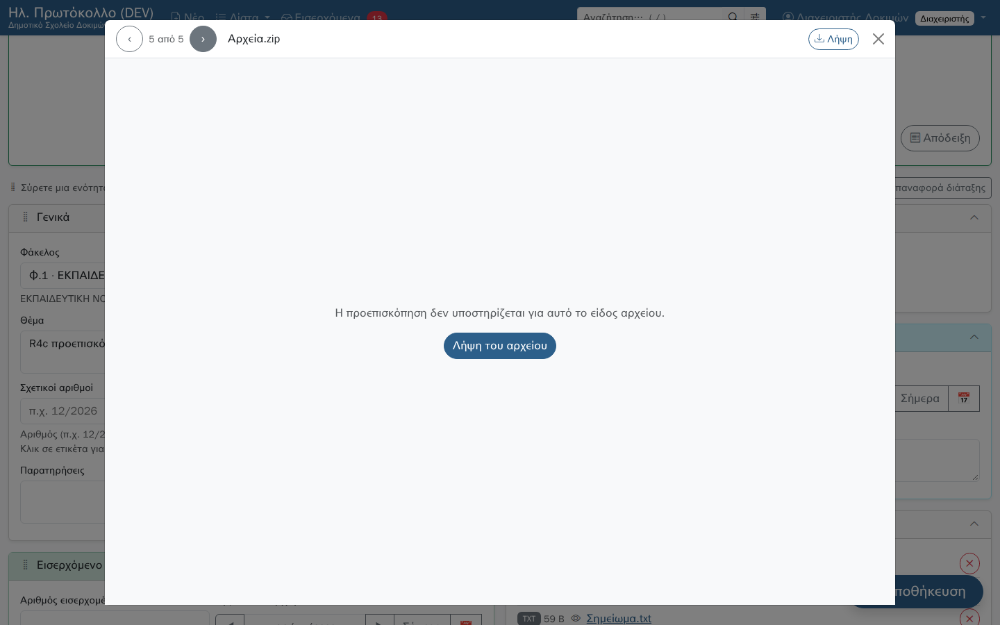

# R4c: preview files in the application

| | |
|---|---|
| Status | ✅ Done |
| Branch | `task/R4c-preview` |

## What was asked (owner, 2026-11-23)
See a protocol's files without downloading them: a large window with ‹ › to go from one file to the next, also for
the inbox's attachments, with the same access checks as the download.

## What changed
- **👁 next to every file** in the protocol form's *Συνημμένα* (every role that sees the protocol) and next to every
  attachment of an e-mail in *Εισερχόμενα*. It opens a large window (full screen on narrow screens) with the file's
  name, *N από M*, ‹ › (also the ← → keys; they go round), *Λήψη* and ×.
- **What is shown:**

  | file | how |
  |---|---|
  | PDF | the browser's own viewer (from the same safe download as before) |
  | png, jpg, gif, webp | the picture, fitted to the window |
  | txt, csv | the text; Greek files of older programs (Windows-1253) are read correctly; long files: the first 1 MB |
  | docx, odt | converted to a page; a yellow line says the layout is approximate (fonts, spacing) |
  | xlsx, xls, ods | every sheet as a table (links at the top go to each sheet), the first 500 rows × 50 columns; formulas show the value the file saved, nothing is calculated |
  | anything else (zip, doc, …), or larger than 10 MB | *Η προεπισκόπηση δεν υποστηρίζεται…* and *Λήψη του αρχείου* |

- **Safety:** the converted page is served with a sandbox (no scripts, no forms, nothing loaded from anywhere: only its
  own styles and embedded pictures) and shown in a sandboxed frame, so a crafted document cannot act in the
  application; its text is escaped. PDFs and images come from the existing download (`/download/{id}`,
  `/viewEmailAttachment/…`), with its checks and headers (R4a). The new addresses `/preview/{id}` and
  `/previewEmailAttachment/{uid}/{key}` check exactly what the download checks (readers yes; a limited user only
  what they may see; the inbox only for inbox users).

### A change from the plan: converted on the server
The plan said Word and spreadsheet files would be converted **in the browser** with two new JavaScript libraries
(docx-preview, SheetJS). Adding new packages was not possible in this session (the tool refused to install new
dependencies without the owner), and the npm copy of SheetJS is an old version with known security advisories (the
maintained one is only on SheetJS's own site). So the conversion uses the two PHP libraries the application already
has and keeps up to date (PhpWord, PhpSpreadsheet: `composer audit` checks them in CI). Differences: the server does
the work (limited to 10 MB per file, `ATTACHMENT_PREVIEW_MAX_KB`); Word layout is somewhat plainer than docx-preview's.
If the owner prefers the browser libraries, that is a small follow-up (the window and the buttons stay the same).

## How verified
- PHPUnit `PreviewTest` (7): the kinds; Word (docx, odt) converted, `<script>` in the text shown as text, never as a
  tag; spreadsheets: all sheets, 500-row limit, formulas with their saved values (also `#DIV/0!`), ods and old xls;
  text escaped, BOM dropped, Windows-1253 read, long text cut with a note; too big, broken, unsupported and missing
  files; the sandbox headers on every converted page; access as the download (reader yes, limited writer 404 / own
  file yes, guest → login); the form's 👁 buttons (PDF from the download, Word from the preview, zip: none; not on
  ΑΔΑ-only rows) and one modal per page. `InboxTest`: an e-mail's CSV attachment (Windows-1253) previewed for inbox
  users only. Route snapshot: the two new routes have the download's guards. Full suite: 616 tests, green.
- Browser (`preview.spec.js`): a protocol with a docx, an xlsx, a txt, a png and a zip (synthetic files in
  `e2e/fixtures/preview/`): 👁 opens each; the frame is sandboxed; the Word text, both sheets and the saved sum, the
  escaped text, the picture; ‹ › and the arrow keys go through all 5 and round; the zip gets the message and a
  download link.

## Owner actions
None. To try it: step 66 in [OWNER-TODO.md](../../OWNER-TODO.md). Decide only if you want the browser libraries
instead (see above).
