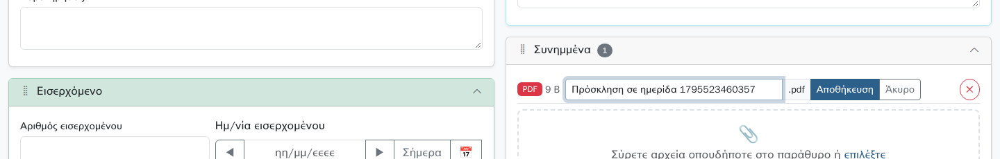
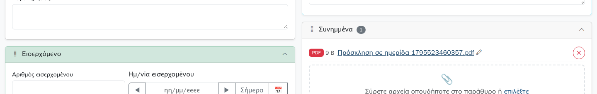

# R4d: rename an attachment

| | |
|---|---|
| Status | ✅ Done |
| Branch | `task/R4d-rename-attachment` |

## What was asked (owner, 2026-11-23)
Attachments often arrive as `scan0001.pdf` or `document (3).pdf`. Users who may edit the protocol should be able to
give them a meaningful name.

## What changed
- **✎ next to the attachment's name** (only for users who may save the protocol: the same rule as ✕ *Στον κάδο*).
  It opens a field with the name **without its extension**, which stays fixed next to it (`.pdf`). *Enter* or
  *Αποθήκευση* saves it at once (not the whole form), *Escape* or *Άκυρο* leaves it as it was. A message confirms
  *Μετονομάστηκε σε «…»*.
- **Only the name shown changes** (`attachments.name`). The file on disk keeps its path, so nothing moves, older
  links keep working, and the download is offered under the new name.
- **The extension stays** the one the attachment has (or its stored file's, when the name had none). Typed again
  (`Απόφαση.PDF`), it is not doubled; another extension typed (`Απόφαση.docx`) becomes part of the name
  (`Απόφαση.docx.pdf`), so a file can never pretend to be another type.
- **Characters not allowed in file names** (`/ \ : * ? " < > |` and a few others) are replaced by `-`, exactly as on
  upload; an empty name is refused (*Γράψτε το νέο όνομα.*). Attachments with only an ΑΔΑ (no file) have no ✎.
- **Search:** `συνημμένο:` and the *Όνομα συνημμένου* field find the new name at once (they read the same column).
- Recording who renamed what is left to X01 (Batch 10, the change log), as planned.

## How verified
- PHPUnit `AttachmentRenameTest` (5): only the name changes (path, file and SHA-256 unchanged); extension kept, not
  doubled, another extension kept in the name; dots inside the name; unsafe characters replaced; the extension from
  the stored file when the name has none; empty names and ΑΔΑ-only attachments refused; readers and other writers
  refused; the form's action, its messages, the reader sees no ✎, an attachment of another protocol is not reachable
  (404); `συνημμένο:` finds the new name and no longer the old one. Full suite: 608 tests, green.
- Browser (`attachment-rename.spec.js`): upload `scan0001.pdf`, save, ✎ shows `scan0001` + `.pdf`, Escape keeps the
  name, Enter renames, the message appears, the download answers 200 with the new name, the search finds it.

## Owner actions
None. To try it: step 65 in [OWNER-TODO.md](../../OWNER-TODO.md).
