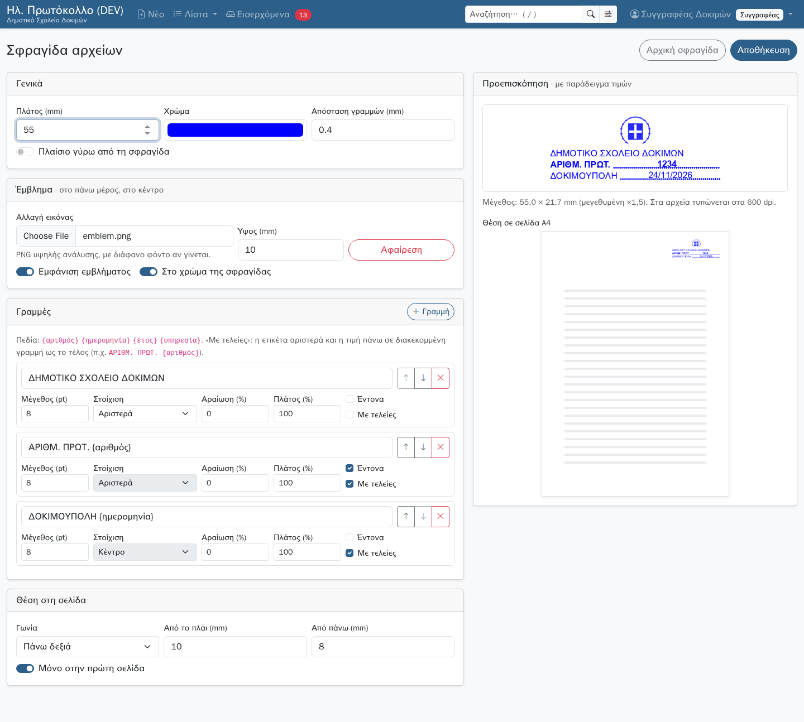
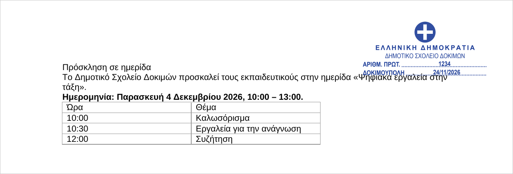

# R4e: stamp designer

| | |
|---|---|
| Status | ✅ Done |
| Branch | `task/R4e-stamp-designer` |

## What was asked (owner, 2026-11-23 and 2026-11-24)
The stamp on the files should look like the service's official stamp (emblem, ministry, directorate, *ΑΡΙΘΜ. ΠΡΩΤ.*
and place / date on dotted lines), be editable in the application, be sharp in print, and go to the top right of the
first page. Διαχειριστής, Αναθέτων and Συγγραφέας may edit it (not Αναγνώστης).

## What changed
- **The stamp is a template** (`App\Services\Stamp\StampTemplate`, setting `stampTemplate`): an optional emblem on
  top (a PNG kept in `storage/app/stamp/`, not public; in the stamp's colour or its own), text lines (size in points,
  bold, alignment, letter spacing, narrower width), **field lines** (`ΑΡΙΘΜ. ΠΡΩΤ. {αριθμός}`: the label, then the
  value over a dotted line to the end), one colour, a width in mm, an optional frame, and the position: corner +
  distance in mm, first page only or every page. Fields: `{αριθμός}` `{ημερομηνία}` `{έτος}` `{υπηρεσία}`.
  Until someone changes it, the stamp is the old one (office name; *Αρ.Πρ.: number / date*), now top right of the
  first page.
- **Editor:** *Διαχείριση → Σφραγίδα αρχείων* (`/stamp`), for Διαχειριστής, Αναθέτων and Συγγραφέας. Every change
  redraws the preview at once (×1.5, with example values) and shows where it goes on an A4 page. *Αποθήκευση* keeps it
  for the files added from then on; *Αρχική σφραγίδα* goes back to the default. The page and all its actions refuse
  readers (403).
- **Sharp and at its real size:** the stamp is drawn at 600 dpi and placed in the file at its size in mm.
- **A new way to stamp PDFs** (`App\Services\Stamp\Pdf\PdfStamper`): the old tool (markpdf) drew one image pixel per
  point (a 600 dpi picture would be 8 times too big) and could only stamp every page. The stamp is now **added after
  the file's own bytes** (a PDF "incremental update"): the original stays untouched inside the file, the page's own
  drawing is kept, the stamp goes to the corner of the page **as shown** (rotated and cropped pages too), upright.
  It reads the usual kinds of PDF (classic tables, cross-reference and object streams). Encrypted PDFs are left as
  they are; a PDF it cannot read goes to the old tool, with the stamp placed so that it keeps its size (every page).
  A marker (`%EP-STAMP`) shows where the stamp begins, so it can later be removed exactly (R4g).
- **Word / LibreOffice files** (docx, odt): the stamp goes into the header of the first page (or every page), at its
  size and distance from the corner.
- **The owner's official stamp** is built locally and never committed: `local-data/stamp/template.json` + `emblem.png`
  (the state emblem from its public-domain vector drawing on Wikimedia Commons, drawn at high resolution; size, lines
  and colour measured on `local-data/official stamp.pdf`: about 57 × 30 mm). The owner loads it with
  `php artisan stamp:import local-data/stamp` (`--preview` only draws it). Tests use an invented stamp and emblem.
- The setting value column (`configs.value`) became TEXT (migration `2026_11_24_000001`): the template is longer
  than 255 characters.

A synthetic PDF stamped with an invented stamp (150 dpi render, and the stamp at 600 dpi):

## How verified
- PHPUnit `StampTest` (10): template limits and clean-up, fields, default, save / read back, fingerprint; the drawing's
  size in mm at any resolution, its single colour, the emblem's height and tint; the PDF stamper on PDFs with a
  classic table and with cross-reference + object streams (PNG predictor): original bytes kept as the start of the
  file, the update written the same way as the file, first page only / every page, exact size and corner, the page's
  drawing wrapped and its fonts kept, the image at 600 dpi with its transparency, a second stamp on top; rotations 90°,
  180°, 270° and a crop box; unreadable and encrypted PDFs refused; the service (PDF stamped, encrypted file left as
  it is); Word header position; the designer's roles, editing, upload checks (content, not only the name), save,
  remove the emblem, defaults; `stamp:import` (with `--preview`, wrong files). `ModernLayoutTest`: the menu item for
  administrators, assigners and writers, not readers. Full suite: 617 tests, green.
- Locally (not in CI: these tools are not in the app image): PDFs made by LibreOffice, Ghostscript and pikepdf (object
  streams, three rotations, a landscape page with an offset crop box) were stamped, opened without errors by pikepdf
  and drawn with pdftoppm: the stamp at the top right of every page as shown, upright; a stamped docx drawn by
  LibreOffice: 10 mm from the right, 8 mm from the top.
- Browser (`stamp.spec.js`): a writer uploads an emblem, edits lines (field lines, bold), width and frame; the preview
  changes; save, reload: kept; a reader gets 403; the stamp is put back to the default at the end.

## Owner actions
- On your real copy, when you want the official stamp: `./dev.sh real artisan stamp:import local-data/stamp`
  (first `--preview` and look at `local-data/stamp/preview.png`), then fine-tune it in *Σφραγίδα αρχείων*.
- To try it: step 67 in [OWNER-TODO.md](../../OWNER-TODO.md).
