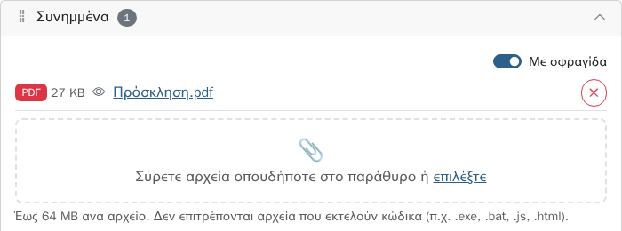

# R4f: the stamp when viewing / printing, not on save

| | |
|---|---|
| Status | ✅ Done |
| Branch | `task/R4f-stamp-on-view` (on top of R4c and R4e) |

## What was asked (owner, 2026-11-23)
Keep every file as it came. The stamp should be there by default when a file is opened, downloaded or printed, with a
choice to get the original; and a file must never be stamped twice.

## What changed
- **New files are stored unstamped** (from the form and from the inbox alike). The form's «Χωρίς σφραγίδα αριθμού
  στα αρχεία» is gone: there is nothing to skip any more.
- **Stamped copy on use:** opening (the preview's PDFs), downloading and printing a PDF, docx or odt gives a copy
  with the stamp (R4e's template), made the first time and kept in `storage/app/stamped/`. It is made again by itself
  when what it shows changes: the protocol's number, year or date, the stamp's template or emblem, or the file. The
  stored file is never changed; a file moved to the trash loses its copy.
- **«Με σφραγίδα»** (on by default): a switch in the *Συνημμένα* panel and in the preview window, saved with the
  user's account; off = the files as stored. The open PDF is shown again at once. `…/download/N?original=1` always
  gives the original.
- **Files saved before R4f** carry their stamp inside them: the migration marks every existing PDF, docx and odt
  (`attachments.stamp_in_file`). They are served as stored, in both modes, with a note *η σφραγίδα είναι μέσα στο
  αρχείο* (in the panel and in the preview window). R4g looks at removing those old stamps.
- With the setting *Σφραγίδα στα συνημμένα* off, nothing is stamped and the switch is not shown. The setting's text
  explains the new way.

## How verified
- PHPUnit `StampOnViewTest` (6): a file saved from the form is stored byte for byte; the download is stamped (the
  original bytes first, the stamp after them), made once and reused, made again after a change of number and of
  template (the old copy removed), the original with `?original=1`, the copy removed when the file goes to the trash;
  a user's choice (`stamped`: yes / no; wrong values refused); never stamped: files saved before, text files, the
  setting off; the switch and the note in the form and the preview window; the migration marks PDFs / docx / odt
  (also run twice). Full suite: 632 tests, green.
- Browser (`stamp-on-view.spec.js`): with the setting on, a new PDF downloads stamped; the switch off gives the
  original byte for byte; the preview window's switch follows, turning it on reloads the PDF; kept after a reload.
  The settings, preview, stamp designer and protocol form specs pass too (20 tests).

## Owner actions
None. To try it: step 68 in [OWNER-TODO.md](../../OWNER-TODO.md).
