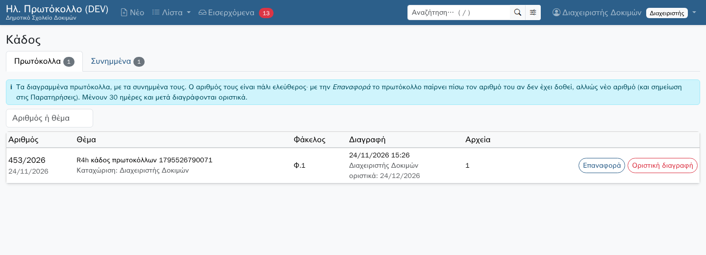
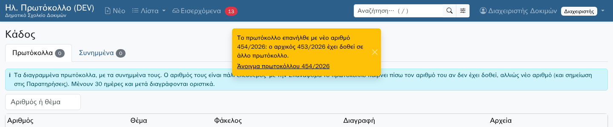

# R4h: deleted protocols go to the trash

| | |
|---|---|
| Status | ✅ Done |
| Branch | `task/R4h-protocol-trash` |

## What was asked (owner, 2026-11-24)
«Διαγραφή» should not delete a protocol for good: it goes to the trash, its number becomes free again, and it can be
restored: with its own number if still free, otherwise with a new one, the original noted. Administrators restore any
protocol; Συγγραφέας (and Αναθέτων) only the ones they registered; Αναγνώστης none.

## What changed
- **«Διαγραφή»** (administrators, as before) moves the protocol to the trash (`App\Services\Protocols\ProtocolTrash`):
  a snapshot in the new table `trashed_protocols` (the row as it was, its assignments, the attachments that went with
  it, number / year / date / subject / folder, who registered it, who deleted it and when). The `protocols` row goes,
  so **the number is free again** (registering that number again, Q-2, still works). Its files go to the attachments'
  trash with it; files trashed on their own before stay where they were and do not come back with it. The confirmation
  and the message say *στον κάδο*.
- **Κάδος → «Πρωτόκολλα»** (new tab next to *Συνημμένα*): number and date, subject, who registered it, folder, who
  deleted it and when, when it goes for good, how many files; search by number or subject. Administrators see all of
  them and the files tab; **Συγγραφέας and Αναθέτων** open the trash too (*Διαχείριση → Κάδος*), but see only the
  protocols they registered, and no files. Αναγνώστης: no trash.
- **«Επαναφορά»**: the protocol gets its **own id** back (so its files and links follow), its assignments and its
  files. Its **original number** if that number / year is still free; otherwise a **new number** of the year in use,
  taken under the same lock as a save, with today's date. Παρατηρήσεις get: *Επαναφορά από τον κάδο DD/MM/YYYY HH:MM
  (user) — αρχικός αρ. πρωτ. N/YYYY, ημ/νία DD/MM/YYYY*. The message says which happened, with a link.
- **«Οριστική διαγραφή»** (administrators) and the **daily clean-up** after the same retention days as attachments
  remove the protocol and the files that went with it.
- **Elsewhere:** a trashed protocol is not in the list, search or links (it has no row); the link `/protocol/N/YYYY`
  tells **administrators** *Στον κάδο* with a link (others get the usual *Δεν υπάρχει*); **folder merges** (D07)
  update the trashed protocols and where their files go back; an **inbox** e-mail registered as a protocol now in the
  trash says so instead of linking to it.
- Protocols deleted before R4h are gone for good, as before (their files are in the attachments' trash).

## How verified
- PHPUnit `ProtocolTrashTest` (7): deleting (snapshot, row and assignments gone, files trashed, an earlier trashed
  file left out, the number free for a new protocol, not reachable by link); restore with the original number (same
  id, number, date, subject, assignments, file back at its path, note with time and user); restore with a new number
  (next of the year in use, today's date, note with the original number and date); who may restore and who sees what
  (writer: own only; assigner: own only; reader: none; administrator: all) on the service and the page (purge refused
  to a writer); search; the link's *Στον κάδο* for administrators only; purge with its files; daily clean-up; folder
  merge (snapshot, saved row, where its file goes back, restored into the new folder); the form's confirmation and
  message. `TrashTest`: writers open the trash, never the files tab or its actions. Full suite: 643 tests, green.
- Browser (`protocol-trash.spec.js`): delete from the form → list message; the link says *Στον κάδο*; a new
  protocol takes the freed number; the trash shows it; *Επαναφορά* → new number, message with link; the note in
  Παρατηρήσεις; its file is back.

## Owner actions
None. To try it: step 70 in [OWNER-TODO.md](../../OWNER-TODO.md).
