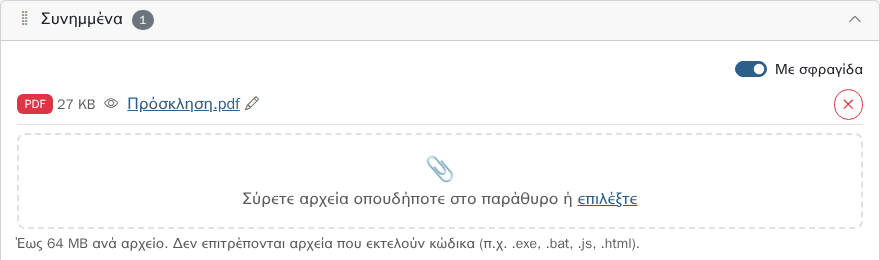
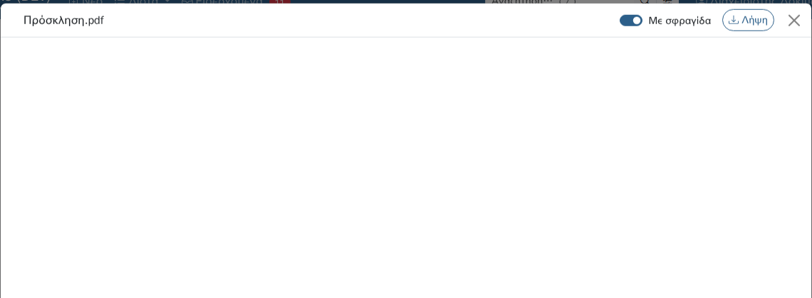

# R4i: the stamp for every user; the designer for administrators

| | |
|---|---|
| Status | ✅ Done |
| Branch | `task/R4i-stamp-for-everyone` |

## What was asked (owner, 2026-11-25)
- The stamp's settings (*Σφραγίδα αρχείων*) only for the administrator.
- «How does stamping work? I do not see relevant controls in the protocol edit screen.» All users should be able to
  include the stamp, if they want, when previewing and printing an attachment.

## How stamping works (since R4f)
- Files are **stored as they came**. The stamp (number, date, and the rest of the stamp's design) is put on a **copy**
  when a PDF, docx or odt is **opened (👁), downloaded or printed**. The copy is rebuilt by itself when the number,
  the date or the stamp changes.
- The control is the switch **«Με σφραγίδα»**: at the top right of a protocol's *Συνημμένα* (when it has files), and
  in the header of the 👁 preview window. It is each user's own choice, saved with the account. Printing is done from
  the opened file (the browser's PDF viewer), so it follows the same switch.
- Files saved before R4f already have the old stamp inside them: they say *η σφραγίδα είναι μέσα στο αρχείο* and are
  never stamped a second time.

**Why you saw no control:** the switch was shown only while *Ρυθμίσεις → Σφραγίδα στα συνημμένα* was on. That
setting is off in the demo data (and probably on your copy), and while it was off nobody could have the stamp.

## What changed
- **«Με σφραγίδα» for every user, always:** the switch is always there (form and preview window), and each user's
  choice is honoured whatever the setting. The setting is renamed *Σφραγίδα στα συνημμένα (αρχική επιλογή)*: it only
  decides for users who have not chosen yet (on: with the stamp; off: without).
- The note *η σφραγίδα είναι μέσα στο αρχείο* is shown always (it was hidden with the setting off).
- **Σφραγίδα αρχείων only for administrators:** the page, its actions and its menu entry. Αναθέτων and Συγγραφέας
  (allowed in R4e) get *403* and no longer see it in the menu.

## How verified
- PHPUnit:
  - `StampTest::test_the_designer_is_for_administrators_only`: the page, the Livewire component and the menu link;
    assigner, writer and reader are refused, with no link.
  - `StampOnViewTest::test_the_setting_is_only_the_default_choice`, setting off, then on:
    - a user who has not chosen: original, then stamped;
    - one who chose «yes»: stamped both times;
    - one who chose «no»: original both times;
    - `?original=1` always gives the stored file.
  - `test_the_form_offers_the_switch_and_marks_files_stamped_before`: with the setting off, the switch and the
    preview window's switch are still there, off for a user who has not chosen, and the in-file note stays.
  - `ModernLayoutTest`: the menu by role.

  Full suite: 675 tests, green.
- Browser:
  - `stamp.spec.js`: an administrator edits and saves the stamp; a writer and a reader get 403 and no menu entry.
  - `stamp-on-view.spec.js`: as before, plus, with the setting off, the switch is visible in the form and the preview
    window, still on for the user who chose it, and the download is stamped.

## Owner actions
None. To try it: steps 67, 68 and 75 in [OWNER-TODO.md](../../OWNER-TODO.md).
