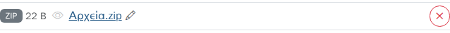

# R4j: a grey 👁 where there is no preview

| | |
|---|---|
| Status | ✅ Done |
| Branch | `task/R4j-preview-unavailable` |

## What was asked (owner, 2026-11-25)
Where a type of file has no preview (we mainly need PDF, docx, xlsx and txt), the 👁 should be grey and not
clickable, instead of opening the preview window.

## What changed
- Files of a type without preview (e.g. `.zip`, `.doc`, `.rar`, `.eml`) get a **grey 👁 that is not a button**. The
  mouse over it says *Δεν υπάρχει προεπισκόπηση για αυτό το είδος αρχείου· ανοίξτε το από το όνομά του*. Before, it
  opened the window only to say «not supported».
- They are also **left out of ‹ › and ← →** in the preview window, which now goes only through the files it can show.
- Previewed, as before: PDF, pictures, txt / csv, docx / odt, xlsx / xls / ods.
- The same in the protocol form's *Συνημμένα* and in the inbox's attachments (one component).

## How verified
- PHPUnit `PreviewTest::test_the_form_offers_a_preview_of_each_file`: the .zip has the grey 👁 (no button, the
  tooltip, its name in the label); only the PDF and the docx have buttons and are in the group. Full suite: 677
  tests, green.
- Browser (`preview.spec.js`):
  - the window counts 4 files, not 5; ‹ › and → go through those 4 and come round, never to the .zip;
  - the .zip's 👁 is grey (opacity below 0.5), has the tooltip, and a click opens nothing.

## Owner actions
None. To try it: step 78 in [OWNER-TODO.md](../../OWNER-TODO.md).
