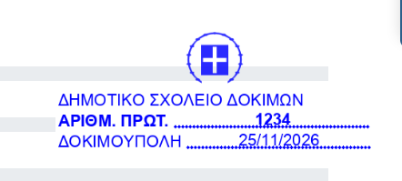

# R4k: the stamp's number and date always readable

| | |
|---|---|
| Status | ✅ Done |
| Branch | `task/R4k-stamp-opaque-number` |

## What was asked (owner, 2026-11-25)
There is often text or graphics under the stamp. The protocol number and date must always be visible, so their
background should be opaque white rather than transparent.

## What changed
- Every line of the stamp that shows **the number, the date or the year** ({αριθμός}, {ημερομηνία}, {έτος}) is drawn
  on **opaque white**, with a thin margin around it. With dotted field lines, the white covers the whole width, dots
  included. Whatever is printed under it on the document no longer shows through.
- The other lines (the office's name, other text) and the emblem stay **transparent**, as before: the stamp covers no
  more of the document than it needs to.
- It applies wherever the stamp is drawn: PDFs, Word files and the preview in *Σφραγίδα αρχείων*. Files already
  stamped are redone with it when next opened. Old files with the stamp inside them (before R4f) stay as they are.
- *Σφραγίδα αρχείων*: the sample page's «text» now runs under the stamp as on a real document, so the white shows.

## Review (Codex), fixed with tests
- A line written with the fields in another form (`{ΑΡΙΘΜΟΣ}`, `{ετος}`, `{ ημερομηνία }`) shows the number and date
  (the stamp reads them in any case, with or without accents), but did not get the white. The white now goes by the
  same reading. Test: the renderer test with those spellings.
- Copies already stamped (a file opened before) were kept and served again without the white: nothing in their key
  had changed. The way the stamp is drawn is now part of the key, so those copies are made again on their next
  opening. Test: `StampOnViewTest::test_copies_made_by_an_older_drawing_are_made_again`.

## How verified
- PHPUnit `StampTest::test_the_number_and_date_lines_are_on_opaque_white`, at 300 dpi:
  - a line without number or date has no white at all (transparent);
  - for {αριθμός}, {ημερομηνία} and {έτος}, plain and dotted: opaque white at the top and bottom of the line, a solid
    white area under the letters, and with dots up to the end;
  - in a stamp with both kinds, the office's line stays transparent and the number's is white.

  `test_the_drawing_has_its_size_in_mm_and_its_colour`: the only opaque colours are now the ink, white and the
  letters' soft edges between them. Both tests failed before the change. Full suite: 681 tests, green.
- Browser (`stamp.spec.js`): the designer's sample page, enlarged for the picture above.

## Owner actions
None. To try it: step 81 in [OWNER-TODO.md](../../OWNER-TODO.md).
