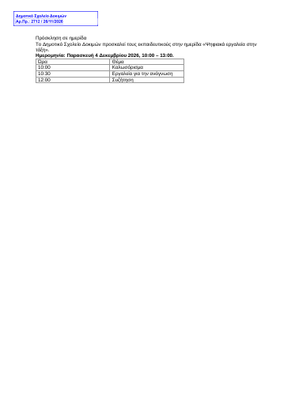
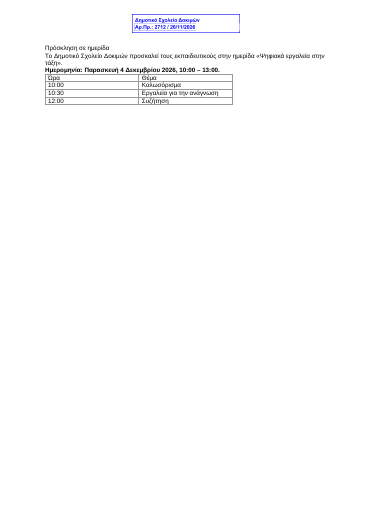

# R4n: the stamp's place on one file: top left, centre or right

| | |
|---|---|
| Status | ✅ Done |
| Branch | `task/R4n-stamp-corner-per-file` |

## What was asked (owner, 2026-11-26)
«On some documents the current stamp position hinders useful information.» After the options (a stamp to drag, or a
simpler choice of place), your choice was the simpler one: «give the ability to all users to place the stamp on the
top left, center and right corners.»

## What changed
- **In the preview window** (👁) of a protocol's file that takes the stamp, next to *Με σφραγίδα*, there are three
  buttons: **↖ ↑ ↗** (*πάνω αριστερά*, *πάνω στο κέντρο*, *πάνω δεξιά*).
  - The one pressed is where the stamp is now on this file. If no one has chosen, that is the stamp's usual place
    (Ρυθμίσεις → Σφραγίδα).
  - A click saves the place **for this file and for every user**, and the PDF is shown again with the stamp there.
  - Downloading and printing use the same place.
- **Who may change it:** every user who may see the protocol (your «all users», readers too).
- **What stays the same:**
  - the stored file never changes, only the stamped copy (made again);
  - the distance from the top stays the stamp's own;
  - *πάνω στο κέντρο* is centred across the page as shown (also on turned pages);
  - Word files (docx, odt) take the same place in their header;
  - the other files of the protocol keep the usual place.
- **When the buttons show:** only while *Με σφραγίδα* is on, and only for files that take a stamp (not files saved
  with the stamp inside, not an e-mail's attachments before they are registered). This includes the files listed in
  *Εισερχόμενα* after registering.
- **The Word preview:** it is converted on the server without the stamp, so for Word files the place shows in the
  downloaded file only.

| ↖ πάνω αριστερά | ↑ πάνω στο κέντρο |
|---|---|
|  |  |

(page 1 of the stamped file downloaded in the browser test; the test browser draws no PDF in the window itself)

## Review (Codex), fixed with tests
- **Changing the place while a stamped copy is being made** deleted that copy half-way, so the other user's download
  failed. Now the change waits for the copy to be made: it takes the same lock as the code that makes it. If that
  takes too long, the user is asked to try again. Test: `test_a_copy_being_made_is_not_deleted_under_it`, with the
  lock held, the work file stays and the place is unchanged; once free, it is saved.
- **Two quick clicks** could save the first one last. Now the three buttons wait while a place is being saved. Browser
  test (R4n): with the save held, all three are disabled; then enabled again.

## How verified
- PHPUnit:
  - `StampTest`:
    - `test_the_stamp_in_the_middle_of_the_top`: top-center on an upright page and a page turned 90°;
      `Stamp::placeAt` (an unknown place changes nothing; top-left keeps the distance from the side);
    - `test_word_files_take_the_middle_of_the_top`: the header image at (page − stamp) / 2.
  - `StampPlaceTest`:
    - a reader moves the stamp of one file to the top left, and the downloads of every user follow;
    - the stored file is unchanged, the other file keeps its place;
    - top-center lands between the two; one stamped copy per file;
    - refused: an unknown place, a file with the stamp inside, a protocol the user may not see (404), a guest;
    - the form passes the place and the address; the window has the three buttons.

  Full suite green.
- Browser (`stamp-on-view.spec.js`, R4n):
  - ↗ pressed at first; ↖ saved and the PDF shown again; the stamp's position in the downloaded file moves left;
  - ↑ lands it between;
  - hidden with *Με σφραγίδα* off;
  - a reader's page has the file's new place.

## Owner actions
None. To try it: step 106 in [OWNER-TODO.md](../../OWNER-TODO.md).
