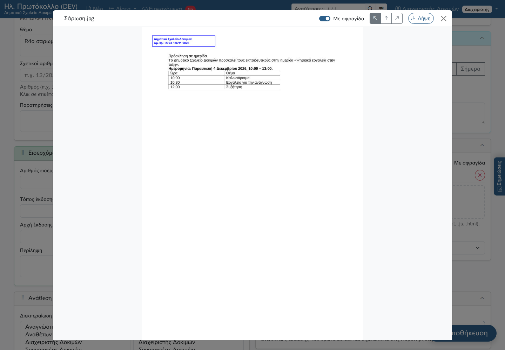

# R4o: the stamp on JPG and PNG pictures too

| | |
|---|---|
| Status | ✅ Done |
| Branch | `task/R4o-stamp-images` (on top of R4n) |

## What was asked (owner, 2026-11-26)
«Could the stamp also be added to JPG files?» Then: «yes, add stamping for JPG and PNG files.»

## What changed
- **JPG and PNG files** of a protocol get the stamp like PDFs and Word files.
  - It is drawn on a copy of the picture when the file is shown, downloaded or printed, with *Με σφραγίδα* on.
  - The stored picture is never changed; the copy is made once and reused.
  - The preview shows the stamped picture, and **↖ ↑ ↗** (R4n) move the stamp on it too.
- **Its size:** a picture has pixels, not mm, so it is taken as an **A4 page**: its width is 210 mm when it is upright
  and 297 mm when it is wider than high. The stamp then has the same size and distance from the edge as on a scanned
  PDF.
- **Phone photos** stored sideways (with an EXIF note saying how to turn them) are turned first, so the stamp is at
  the top as the photo is shown. The stamped copy is saved upright.
- **Left as they are:**
  - pictures over 30 megapixels (memory);
  - unreadable files.
- **Saving:** JPG at quality 92; PNG keeps its transparency.
- The texts of *Με σφραγίδα* and of the office's name in *Ρυθμίσεις* now name the pictures too.

## How verified
- PHPUnit:
  - `StampTest::test_pictures_get_the_stamp_at_its_size_and_place`:
    - an A4 scan (2100 × 2970): the stamp 10 mm from the right, 8 mm from the top, its width in mm (to the
      drawing's thin margin);
    - a wide PNG, centred, still a PNG;
    - a photo with EXIF orientation 6, turned upright and stamped top right;
    - a broken file left as it is.
  - `StampOnViewTest::test_a_picture_is_stamped_when_shown`: the download is a stamped JPG (ink at the top right,
    none at the top left), the stored picture unchanged, the original on request, one copy.

  Full suite green.
- Browser (`stamp-on-view.spec.js`, R4o):
  - a scanned page uploaded as JPG: the download is a JPG different from it, the original on request;
  - the preview shows it, ↖ moves the stamp and the picture is shown again.

  The test picture is made from the invented test PDF.

## Owner actions
None. To try it: step 107 in [OWNER-TODO.md](../../OWNER-TODO.md).
