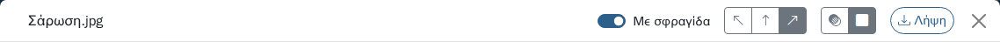
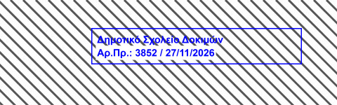

# R4p: the stamp see-through or opaque, per file

| | |
|---|---|
| Status | ✅ Done |
| Branch | `task/R4p-stamp-opaque-per-file` |

## What was asked (owner, 2026-11-27)
«Let's also give the ability to put a stamp as it is but also a completely opaque one.» Chosen: per file, by every
user, as the place buttons (R4n). «Make sure that the transparent stamp is not completely transparent. We still need
the opaque text we already have.»

## What changed
- In the preview window, next to ↖ ↑ ↗ (and shown with them: a file that takes the stamp, *Με σφραγίδα* on), two
  buttons:
  - **see-through**: the stamp as it is. What is under it shows, but the number and date lines stay on white (R4k).
  - **opaque**: all of the stamp on white (frame, emblem, every line). Nothing under it shows through.
- The choice is kept for the file (new column `attachments.stamp_opaque`, off by default) and applies to everyone:
  preview, *Λήψη*, printing.
- The stored file never changes. As with the place, only the stamped copy is made again.
- PDF, Word and pictures alike: the stamp's drawing is put on white before it is placed.
- [docs/LOCAL-REAL-DATA.md](../LOCAL-REAL-DATA.md): how to apply new database changes to the real copy you already
  have (`./dev.sh real artisan migrate --force`), and where the app's error log is.
- The same address as the place (`POST /attachments/{id}/stamp-place`) now takes `opaque`, alone or with `place`, under
  the same lock (review of R4n). A failed save shows «Η επιλογή διάφανη / αδιαφανής δεν αποθηκεύτηκε».

The two buttons in the window:

The downloaded copy, the stamp's corner at the picture's size (a page of grey lines, so what shows through is seen).

See-through: the number and date on white:

Opaque:

## How verified
- PHPUnit `StampPlaceTest::test_the_stamp_is_made_opaque_on_one_file`, on a black PNG:
  - inside the stamp, see-through shows the black (over 30% of the sampled pixels); opaque shows none;
  - the stored file is unchanged;
  - the page's button carries `data-preview-opaque`, and the window has the two buttons;
  - place and opacity together, and a place alone keeps the opacity;
  - one copy is left;
  - refused: a value that is not yes / no, and an empty request.

  The R4n and R4o tests are unchanged and pass. Full suite green.
- Browser (`stamp-on-view.spec.js`, R4p):
  - a JPG page of lines; the buttons visible, see-through pressed;
  - opaque: pressed, the picture fetched again, the download differs, the original unchanged;
  - after a reload, opaque is still pressed;
  - see-through again gives the same bytes as before.

## Owner actions
On your real copy, first `./dev.sh real artisan migrate --force` (it adds the column; the same is needed for R4n's
`stamp_place`: without it the place buttons say «Η θέση της σφραγίδας δεν αποθηκεύτηκε»). To try it: step 110 in
[OWNER-TODO.md](../../OWNER-TODO.md).
