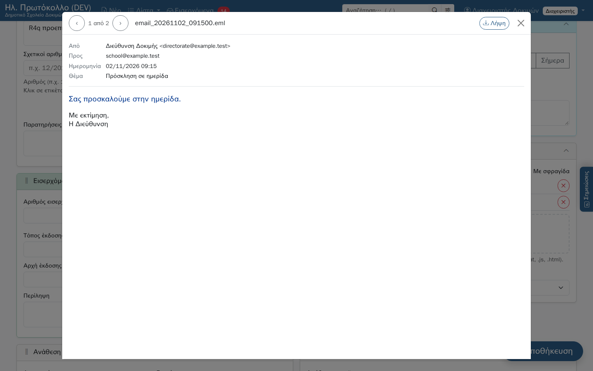
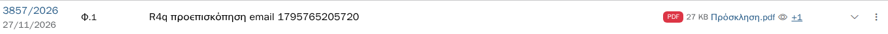
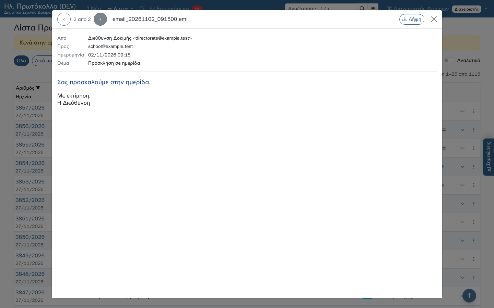

# R4q: e-mail files (.eml) previewed; 👁 next to each file in the list

| | |
|---|---|
| Status | ✅ Done |
| Branch | `task/R4q-eml-preview-list` |

## What was asked (owner, 2026-11-27)
«In the main protocol list and protocol edit screens, is it possible to add a preview for EML attachments as we do
with the PDFs? It would be great if we had the preview icon also in the main protocol list, so the user can preview the
attachments of each protocol. This would need some extra space for the Συνημμένα column; you may shrink the Θέμα column
a little.»

## What changed
- **E-mail files (.eml)** now have 👁, where they had the grey one: the form, the list, an e-mail's files in the inbox.
  The preview shows them as an e-mail program does:
  - Από, Προς, Κοιν., the date (local time) and Θέμα;
  - the names and sizes of the e-mail's own files;
  - then the message: its HTML with its own styles, or its text.
- **Safety:** the message stays in the preview's sandboxed page, as Word files do. Nothing in it can run, send a form or
  open a frame, and nothing is loaded from the internet, so remote pictures and trackers stay blank. `<script>`,
  `<iframe>`, `<object>`, `<meta>`, `<base>` and `<link>` are also removed from it.
- **Embedded pictures:** pictures inside the e-mail itself (a logo or a signature: `cid:`) are shown. They are put into
  the page from the e-mail, up to 15 MB in all (review finding).
- **Size limit:** an e-mail is read only for its headers and text, so it is shown up to 40 MB. The other converted files
  keep the 10 MB limit.
- **The list:** 👁 is next to each file in *Συνημμένα*. In a closed row it is next to the first file. ‹ › go through all
  the files of that protocol. For files that take the stamp, *Με σφραγίδα*, ↖ ↑ ↗ and see-through / opaque work as in
  the form.
- The *Συνημμένα* column is a little wider (15 → 17 rem; on narrow screens 8 → 9.5 rem). *Θέμα* takes what is left.
- The stamp's settings are read once for the list, not once per file.

## How verified
- PHPUnit `PreviewTest`:
  - `test_kinds`: `.EML` → `mail`, which is converted here.
  - `test_emails_are_shown_with_their_headers_and_their_html_kept_harmless`:
    - the headers and Greek encoded names, the date in local time, the file's name;
    - the HTML and its style are kept;
    - script, iframe, object, meta refresh, base, link and `alert(1)` are gone;
    - the CSP's `img-src data:`;
    - an embedded picture (`cid:`) is shown from the e-mail, and one that is missing is left as it is;
    - a text-only e-mail is escaped;
    - an e-mail over the 1 KB limit set for the test is still shown.
  - `test_the_list_offers_a_preview_of_each_file`:
    - the buttons grouped per protocol, PDF and mail kinds, the stamp's place;
    - the stamp's settings are read **once** for three stampable files. Without the shared corner it was 4: checked.

  Full suite green.
- Browser (`preview.spec.js`, R4q):
  - an uploaded .eml opens as an e-mail, with its styled paragraph;
  - its script did not run;
  - no «κατά προσέγγιση» note;
  - in the list, the row has two 👁, «1 από 2», and › goes to the other file.

## Owner actions
None. To try it: step 112 in [OWNER-TODO.md](../../OWNER-TODO.md).
