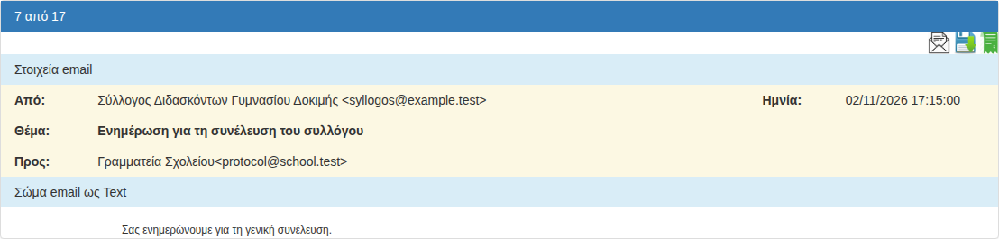
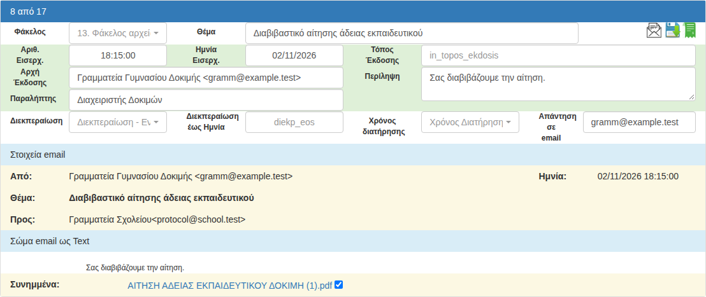

# R5a: e-mail service, inbox cache, charsets, all-or-nothing registration

| | |
|---|---|
| Status | ✅ Done (reaches the production server with the final deployment; until then see the security finding below) |
| Branch | `task/R5a-email-service` |

## What was wrong
1. **Slow inbox / timeouts.** Every visit to *Εισερχόμενα Email* downloaded every e-mail of the page in full from
   the mail server (with a 21 MB e-mail on the page, every time), then parsed each one twice.
2. **`??` in sender names and attachment names** (owner, 2026-11-16). Some mail programs (Horde webmail) split a
   long name in the middle of a 2-byte Greek letter: sender names into RFC 2047 encoded words, attachment names into
   RFC 2231 continuations (`filename*0*=…%CE; filename*1*=%91…`). Decoding each piece on its own → two invalid halves
   → `??`. (Two of the owner's private e-mails had it in an attachment name; checked locally, nothing from them is
   in the repository.)
3. **Half-registered e-mails.** When an attachment could not be saved, the protocol stayed (without that attachment),
   an error was shown and the e-mail stayed in the inbox, so registering it again made a second protocol.
4. 🔒 **Security finding: inbox e-mails could be downloaded without logging in.** The inbox saved each e-mail as
   `public/tmp/u<user>/<uid>.eml` (attachments included) and its HTML part as `.html`; everything under `public/` is
   served to anyone, and the numbers are small and guessable. Checked on the dev stack: `curl` without a session →
   HTTP 200. The HTML preview also ran on the application's own origin (an e-mail's script could act as the logged-in
   user), and the attachment view was not limited to users allowed to use the inbox.
5. Found on the way: in the old inbox's JavaScript, the "has attachments" flag was set for the wrong e-mail (fixed in
   D01 #35); the stamp's fallback wrote stamped attachments to a wrong path (missing `/`) when stamping failed.

## What changed
- **`App\Services\Mail\Inbox`**: one search for the list of UIDs (the e-mails received in the last
  *daysToCheckEmailBack* days, as before), then the e-mails of the page that are not cached yet are downloaded **in one
  request** and stored in **`MailCache`**. Order and paging are unchanged (arrival order, newest first if set; within
  a page by date).
- **`MailCache`**: `storage/app/mail-cache/<mailbox>/<UIDVALIDITY>/<UID>.eml`, private storage. A UID means the same
  e-mail only as long as the folder's UIDVALIDITY stays the same, hence that level: when the server rebuilds the
  folder, everything is downloaded again. Files are written under a temporary name and renamed, so a half-written
  e-mail is never read. **Expiry:** each visit keeps only the e-mails still in the inbox (registered, moved or deleted
  ones are removed) and drops other UIDVALIDITYs. **Several users at once:** downloads into one mailbox take turns
  (a lock); whoever waited finds the e-mails already there.
- **`Mailbox` / `ImapMailbox` / `MailboxConnector`**: the only code that talks to the IMAP server for the list (the
  move after registration still uses B07's `MessageMover`). Tests use an in-memory mailbox.
- **Charsets** (`App\Support\Mail\EncodedWords`, `MailParser`): adjacent encoded words with the same charset are
  decoded together (`HeaderDecoder`, inbox list), and before mail-mime-parser reads an e-mail, `MailParser` joins split
  encoded words and RFC 2231 continuations in the headers of the message **and of every MIME part** (also nested).
  The e-mail stored with the protocol stays byte for byte as received; the body is never touched (0.07 s for a 20 MB
  e-mail).
- **All-or-nothing registration:** every file write is checked; if one fails, the files already written, the
  attachment rows and the protocol are removed. Message: *"…Το email δεν καταχωρίστηκε και παραμένει στα
  εισερχόμενα. Κωδικός σφάλματος: E-XXXXXX"*. Registering it again then makes exactly one protocol. (If someone else
  saved a protocol in between, the removed number stays as a gap; *Κενά αρίθμησης* shows it.)
- **No public copies:** nothing is written to `public/tmp` any more, and the old `u<user>` folders are deleted on the
  first inbox visit. The HTML preview comes from `/viewEmailHtml/{uid}` (logged-in inbox users only) with
  `Content-Security-Policy: sandbox …; script-src 'none'` and an `<iframe sandbox>`: no scripts and no forms, links
  open in a new tab. Attachments (`/viewEmailAttachment`) need inbox access too, are sent with a correctly encoded
  Greek file name and run in a sandbox if they are HTML.
- For the old code still on the server: [`docs/BLOCK-PUBLIC-EMAIL-COPIES.md`](../BLOCK-PUBLIC-EMAIL-COPIES.md), one
  Apache line that refuses the `.eml` copies (tested on Apache 2.4 with this app's `.htaccess`).

## How verified
- `tests/Feature/InboxTest.php` (8, in-memory mailbox with the synthetic e-mails):
  first visit downloads the page's 3 e-mails in one request; later visits (also by another user) download nothing;
  other pages and a new e-mail download only what is new; the cache keeps only e-mails still in the inbox and follows
  UIDVALIDITY; Greek decoded, no `??`, old public copies (all users') removed; HTML preview only for inbox users, in a
  sandbox, no `allow-scripts`; attachment with its Greek name, only for inbox users; unreachable server → reference
  code; the split sender name of e-mail 09 shown correctly.
- `StoreFromEmailTest`: `known_bug_sender_name_split_inside_a_greek_letter_becomes_question_marks` replaced by
  `test_sender_name_split_inside_a_greek_letter_is_decoded` (saved protocol and inbox list; stored .eml unchanged);
  new `test_attachment_that_cannot_be_saved_leaves_nothing_behind` (no protocol, no rows, no files; registering again
  gives exactly one protocol). F08's known-bug test now documents that a too-long Greek name refuses the whole
  registration with a message (before: recorded without its file, "success").
- `tests/Unit/EncodedWordsTest.php` (8): B and Q words split inside a letter, ISO-8859-7 and Windows-1253, mixed
  charsets, text around the words, rejoined words hold whole characters and stay ≤ 75 characters, the body is never
  touched, e-mails without such runs pass through byte for byte. `MailParserTest` (3): attachment name with a letter
  cut between RFC 2231 sections (also in a nested multipart; plain-text sections and other parameters kept); 2 of 3
  fail with the parser before this change. `ImapMailboxTest`: header + body joined with one empty line.
  `StoreFromEmailTest::test_attachment_name_cut_inside_a_letter_is_saved_correctly` (new synthetic e-mail 10).
- The owner's 9 private e-mails, locally: attachment names with `?` before → after: two e-mails 2 → 0, all others
  0 → 0; the text of all 9 unchanged; the e-mail with emoji everywhere parses without loss.
- **Browser, real mock mail server** (`e2e/tests/inbox.spec.js`, new synthetic e-mail
  *09-sender-split-inside-letter*): the sender shows without `??`; the HTML preview loads through the new route in a
  sandbox and is sized to its content; not logged in → no preview; `/tmp/u1/<uid>.eml` → 404; e-mail 10's
  attachment is listed and downloaded with its correct Greek name. This test found a bug
  the in-memory tests could not: the server returns the header without its closing empty line, so the body was glued
  to the headers (fixed, `ImapMailboxTest`).

  
  
- Speed (dev stack, mock server, 16 e-mails / 43 MB on one page): first visit 3.5 s, then 0.2 s. Against a remote
  mail server the first visit costs what every visit used to cost; later visits only ask for the list.
- Review fixes (Codex, PR #36): expiry now runs under the same lock as downloads and never removes a file being
  written or a UID newer than its own list (`test_expiry_leaves_files_of_concurrent_requests_alone`); a rolled-back
  registration deletes its attachment rows for good, not into the archive's trash (`withTrashed()` count 0). Both
  tests fail on the reviewed code.
- Full suites: PHPUnit 216, browser 24/24.

## Owner actions
1. Owner decision (2026-11-16): no changes on the production server before the migration, so the Apache line in
   [`docs/BLOCK-PUBLIC-EMAIL-COPIES.md`](../BLOCK-PUBLIC-EMAIL-COPIES.md) is not applied; until the migration, anyone
   who can reach the server can download inbox e-mails by guessing their address.
2. Final deployment: nothing extra; the first inbox visit deletes the old copies.
