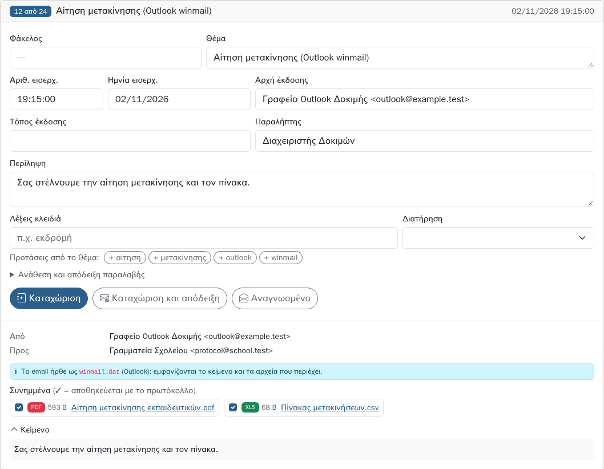

# R5b: winmail.dat (Outlook) opened in the inbox

| | |
|---|---|
| Status | ✅ Done |
| Branch | `task/R5b-winmail` (on top of R5d) |

## What was wrong
Outlook / Exchange, with "Rich Text" on, send the real message inside one attachment, `winmail.dat` (TNEF format).
The inbox showed only that file:
- no text;
- no way to open or store the documents inside it;
- registering stored `winmail.dat`, which nobody can open without special software.

The owner's example (2026-11-16) is a **read receipt** whose whole content is a `winmail.dat`, with no text at all.
The details are only in Outlook's properties: report text, original subject, sender, recipients, when sent and when
read, Greek in code page 1253.

## What changed
- **`App\Support\Mail\Tnef`** reads a winmail.dat ([MS-OXTNEF]):
  - the message class and subject;
  - the text: plain, or **compressed RTF** (LZFu / [MS-OXRTFCP]) turned into text. Paragraphs, tabs, Greek as `\'hh`
    in the document's code page, `\uN`; hidden parts, fonts and pictures skipped;
  - the HTML body when there is one;
  - each **file inside**, with its long (Unicode) name and its type;
  - for **read / delivery receipts**: a readable text in Greek, e.g.

    ```
    Αναφορά: Ανάγνωση μηνύματος:
    Θέμα: <original subject>
    Από / Προς: …
    Στάλθηκε: 12/11/2026 07:25:52
    Αναγνώστηκε: 12/11/2026 11:35:56
    ```

    Times are shown in the settings' time zone.
  - 8-bit strings are read in the message's code page with `iconv` (mbstring has no Windows-1253).
  - Anything unreadable gives `null`, and the inbox then shows `winmail.dat` as a plain file, as before.
- **Inbox** (`MailContent`):
  - the files inside are shown and stored **instead of** `winmail.dat`, with type and size, under keys like `0-1`;
  - the text, HTML and subject inside are used when the e-mail itself has none;
  - a notice says the e-mail came as `winmail.dat`, or that it is a read/delivery receipt.
  - A receipt has nothing to store but the e-mail itself; its details become *Περίληψη*.
  - The stored `.eml` copy stays exactly as received.
- Cached summaries of older versions are not reused (`Inbox::SUMMARY_VERSION` 2).
- Synthetic e-mail **11-outlook-winmail-dat.eml**: text as compressed RTF in code page 1253, a PDF and a CSV with long
  Greek names. It is built by `tests/Support/TnefBuilder.php`, which the tests use too.

## How verified
- PHPUnit:
  - `TnefTest`:
    - the read receipt with the owner's structure, made of invented values;
    - attachments with Unicode / 8.3 names and types;
    - compressed RTF in both forms (LZFu with a dictionary reference + end marker, MELA): Greek, `\uN`, `\par`, `\tab`,
      escapes, hidden groups;
    - HTML and a Unicode subject from properties;
    - not TNEF / cut short → `null`.
  - `InboxTest`:
    - a winmail with two files: shown instead of it, downloadable with the Greek name, one ticked → stored as
      `…_0-0_Αίτηση άδειας.pdf`;
    - a read receipt: notice, its text, nothing to store, registered;
    - a broken winmail: a plain file as before.
- Browser (`inbox.spec.js`): the synthetic Outlook e-mail shows its text (from the RTF) and both files, not
  `winmail.dat`. The PDF opens as a PDF; after registering, the protocol has the PDF and the CSV.
- On this computer only (nothing committed): the owner's read receipt now reads as six lines (report, subject, from,
  to, sent, read) and registers without a file. All 12 private e-mails still register.
- Full suites: PHPUnit 449, browser 68/68.

  

## Review
- Codex (P1): a crafted winmail.dat could declare millions (up to 4 billion) of values in a few bytes. The decoder
  then looped for each one, and since the inbox opens every winmail.dat, one e-mail could make the inbox page time out.
  - Fixed: every count and length is checked against the bytes left before reading.
  - Test `test_huge_counts_in_a_small_file_are_refused_at_once` (it failed before).
- Codex (P2): an HTML body stored in Windows-1253 was served as if it were UTF-8 (unreadable Greek).
  - Fixed: converted by the charset the page declares, else the message's code page.
  - Test `test_html_body_in_a_greek_code_page_becomes_utf8` (it failed before).
- Codex, second review (P1): with *saveEmailAs* empty (the e-mail kept as a page), the page had no text for a message
  that came only as winmail.dat, and winmail.dat itself was no longer stored.
  - Fixed: the page is written with the text the inbox shows.
  - Test `test_email_kept_as_a_page_has_the_winmail_text` (it failed before).
- Codex, second review (P2): Greek written in the RTF as plain code-page bytes (not `\'hh`) was not converted.
  - Fixed.
  - Test `test_literal_code_page_bytes_in_rtf` (it failed before).
- Codex, third review (P2): the page copy used the inbox's text, which is cut at 100 000 characters, so a longer
  e-mail lost its end (any e-mail, not only winmail).
  - Fixed: the page gets the whole text (`MailContent::text`).
  - Test `test_email_kept_as_a_page_has_its_whole_text` (it failed before).
- Codex, third review (P2): a winmail.dat ending inside an attribute's header was read as complete, so an attachment
  could go missing without notice.
  - Fixed: a file not read to its last byte is unreadable, and it is shown as plain `winmail.dat`, as before.
  - Test `test_a_file_ending_inside_an_attribute_header_is_not_read` (it failed before).
  - The owner's read receipt still decodes (checked on this computer only).
- Codex, fourth review (P2): a character beyond U+FFFF (an emoji) in Outlook's Rich Text, written as two `\uN` halves,
  was dropped.
  - Fixed: the halves are joined.
  - Test `test_rtf_unicode_beyond_the_basic_plane` (it failed before).

## Owner actions
None. When an Outlook e-mail arrives, its files appear in the inbox instead of `winmail.dat`.
