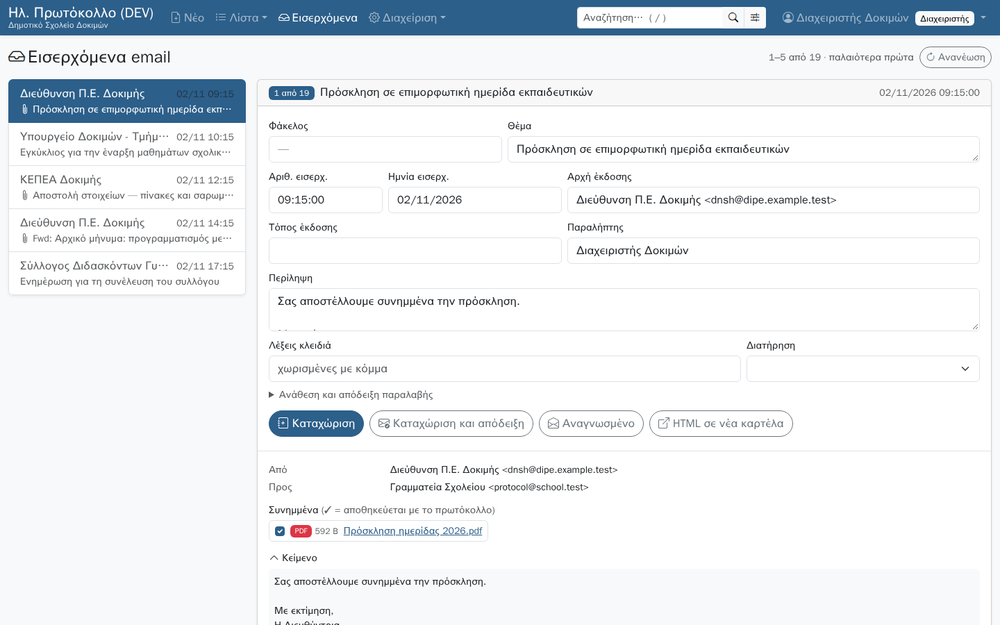
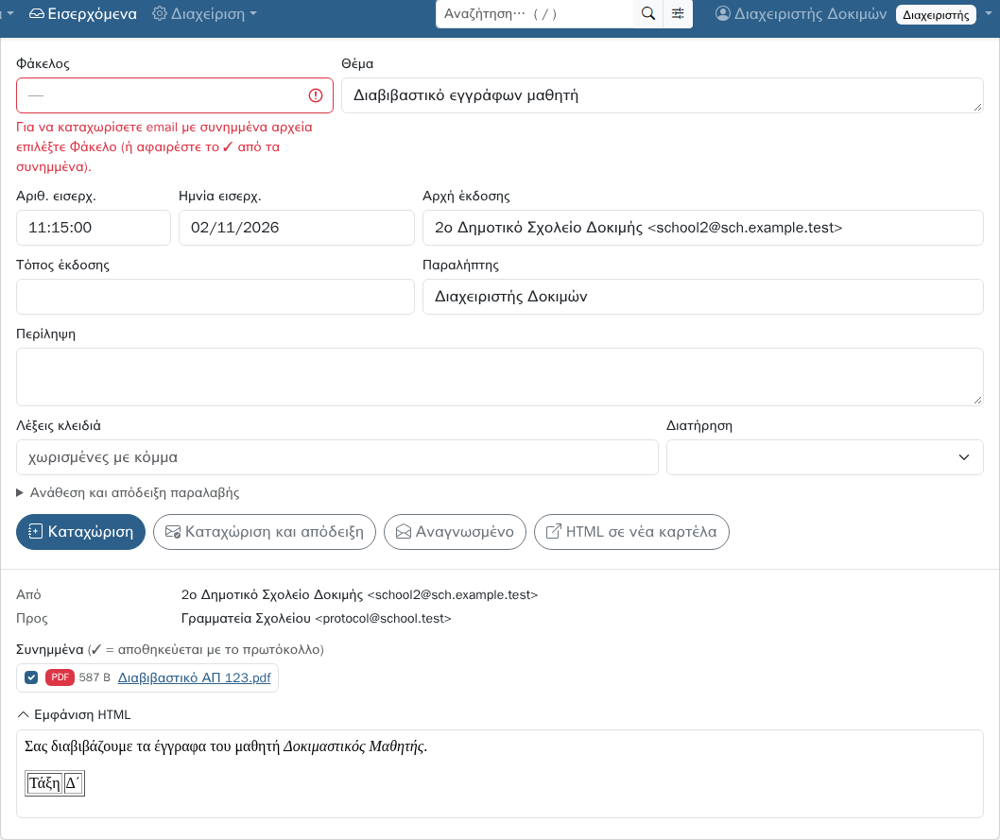
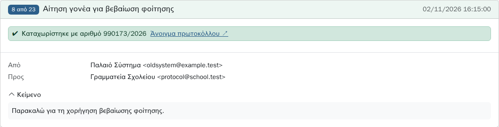

# R5c: the inbox screen, rebuilt

| | |
|---|---|
| Status | ✅ Done |
| Branch | `task/R5c-inbox-screen` |

## What was wrong
The old *Εισερχόμενα email* page (`/viewEmails`, Bootstrap 3) had several problems:
- **Long and hard to move through:** each e-mail was a block of form rows, with no overview of the page.
- **No feedback in place:**
  - every registration reloaded the whole page;
  - every error was a pop-up, and the e-mail looked the same afterwards;
  - the folder check ("choose a Φάκελος") ran only in the browser.
- **Different rules from the protocol form:** registering went through its own 300-line copy of the save code
  (`storeFromEmail`) instead of `ProtocolWriter` (R1a). It had no server-side checks (an over-long incoming number
  was refused by MySQL) and its own numbering and stamp code.

## What changed
- **New page `/inbox`** (top bar *Εισερχόμενα*), Livewire component `EmailInbox`.
  - The old address `/viewEmails?imap_page=N` redirects to `/inbox?page=N`.
  - Same rules for who may open it: writers and administrators, an IMAP account set, *allowedEmailUsers*. Every action
    checks them again.
- **List on the left:** sender, date, subject and 📎 for each e-mail of the page.
  - It stays in view while scrolling.
  - A click scrolls to that e-mail, below the top bar, and marks it as the current one.
  - Registered and read e-mails get a badge.
- **Each e-mail:** a card with
  - a header: *N από M*, the subject and the date;
  - the form, filled in as the old inbox did:
    - subject;
    - the time/date sent as *Αριθ./Ημνία εισερχ.*;
    - the sender as *Αρχή έκδοσης*;
    - the user as *Παραλήπτης*;
    - the start of the text as *Περίληψη*;
  - less used options (assignment, the receipt's address) in a closed *Ανάθεση και απόδειξη παραλαβής* part;
  - actions as pills: *Καταχώριση*, *Καταχώριση και απόδειξη*, *Αναγνωσμένο*, *HTML σε νέα καρτέλα*.
- **Attachments:** a type label (PDF, DOC, IMG…) and the **size** of each file, read from the e-mail's MIME structure.
  The size is the decoded file, what will be stored. A tick = stored with the protocol.
- **Κείμενο and HTML:** sections that open and close.
  - Closing one closes it in every e-mail of the page.
  - The browser remembers the choice (`localStorage`).
  - The HTML frame takes the height of its content.
- **Registering on the page** (no reload):
  - success: the e-mail's form is replaced by *«Καταχωρίστηκε με αριθμό N/YYYY»*, with a link to the protocol and any
    warnings;
  - an error: shown **at its field** (e.g. under *Φάκελος*), and the e-mail stays as it was;
  - pressing again on a registered e-mail does nothing (no second protocol).
- **Αναγνωσμένο:** the e-mail moves to the read folder; its card says so.
- **Pages:** *‹ Προηγούμενα / Επόμενα ›*.
  - A page emptied meanwhile (by this user or others) goes back to page 1, not to an empty page.
  - *Ανανέωση* asks the mail server for new e-mails.
- **Speed:** the mail server is asked only when the page opens, changes page or is refreshed.
  - Other clicks use the cached messages (R5a).
  - What the page shows of each e-mail (`MailContent::summary`) is cached too, so a 20 MB e-mail is parsed once, not
    on every click.
- **Saving through `ProtocolWriter`** (`App\Services\Mail\EmailRegistration`):
  - the same cleaning, checks, numbering, assignment e-mails and stamp as every protocol.
  - The checks now run on the server, so an over-long field is refused **at its field**. Before, MySQL refused it.
- What is particular to e-mails:
  - a **Φάκελος** is required when attachments are ticked (also checked on the server now), or always with the
    setting *alwaysShowFakelosInViewEmails*;
  - the e-mail itself is stored with the protocol: as received (`.eml`), or as a page when *saveEmailAs* is empty.
    Without a folder it goes to `arxeio/emails`, as before;
  - **all or nothing** (R5a): if one file cannot be stored, nothing is kept (files, rows, protocol). The e-mail stays
    in the inbox (`ProtocolWriter::create(…, allOrNothing: true)`, `AttachmentsNotSaved`);
  - *Τόπος έκδοσης* is not required for e-mails, as before;
  - the receipt uses the e-mail form of the text ("the message you sent on …").
- **Removed:**
  - the old page `viewEmails.blade.php`;
  - routes `POST /storeFromEmail`, `GET /setEmailRead`, `POST /checkSameEmail`, `GET /getEmailNum`;
  - their 600 lines in `ProtocolController`.
- **Moved to `InboxController`:** the attachment and HTML addresses (`/viewEmailAttachment/{uid}/{key}`,
  `/viewEmailHtml/{uid}`), unchanged.
- The duplicate check (same subject / incoming number) comes back as an inline notice in R5d.

## How verified
- PHPUnit:
  - `EmailRegistrationTest` (was `Legacy/StoreFromEmailTest`): all 14 tests ported to the new page, same assertions:
    - decoding (ISO-8859-7, RFC 2231, split letters);
    - D01 long subject/sender;
    - D03 size/hash;
    - D05 emoji;
    - F08 file names;
    - R5a all-or-nothing, then a retry gives exactly one protocol.
    - The SQL-error test now checks the error at the *Αριθ. εισερχ.* field and that no SQL appears.
  - `InboxTest` (R5a cache tests on `/inbox`) and new tests:
    - list and anchors, sizes, sections, defaults;
    - pages and the emptied page;
    - *Αναγνωσμένο*;
    - errors at their field, success in place, no double registration;
    - a failed move = a warning;
    - the receipt needs an address;
    - access (reader, not in *allowedEmailUsers*, logged out).
  - Route middleware snapshot updated: removed routes; `/inbox` has `auth, writer, email`.
- Browser:
  - `inbox.spec.js`:
    - the list scrolls to a message and marks it;
    - attachments show type and size;
    - text open/closed for all and remembered after a reload;
    - the R5a checks on the new page.
  - `email-registration.spec.js`:
    - registering (B07, D05, D01) with the result in place;
    - an e-mail with an attachment without a folder: error at the field; after choosing one, registered with the
      `.eml` and the PDF.
- On this computer only (nothing committed): the owner's 12 private e-mails, each registered on the new page with a
  folder, all attachments and *Έλεγχοι καταχώρισης* on: all 12 registered with all their files.
- Full suites: PHPUnit 427, browser 65/65.

  
  
  

## Review
- Codex (P1): users who may choose the number (administrators with the checks off) or the date
  (*allowWriterChangeDate*) could not register e-mails. `ProtocolWriter` expected a year and a date that the inbox
  does not have, and the errors went to fields the page lacks.
  - Fixed: every e-mail is numbered on save and dated today, in the year in use.
  - An error about a field the page doesn't show now appears above the form.
  - Test `test_users_who_may_choose_number_or_date_register_too` (it failed before the fix).

## Owner actions
None. The address for bookmarks is now `/inbox`; the old one still works.
