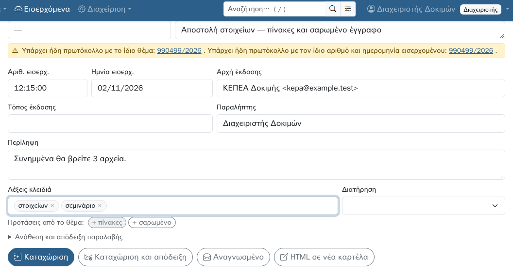
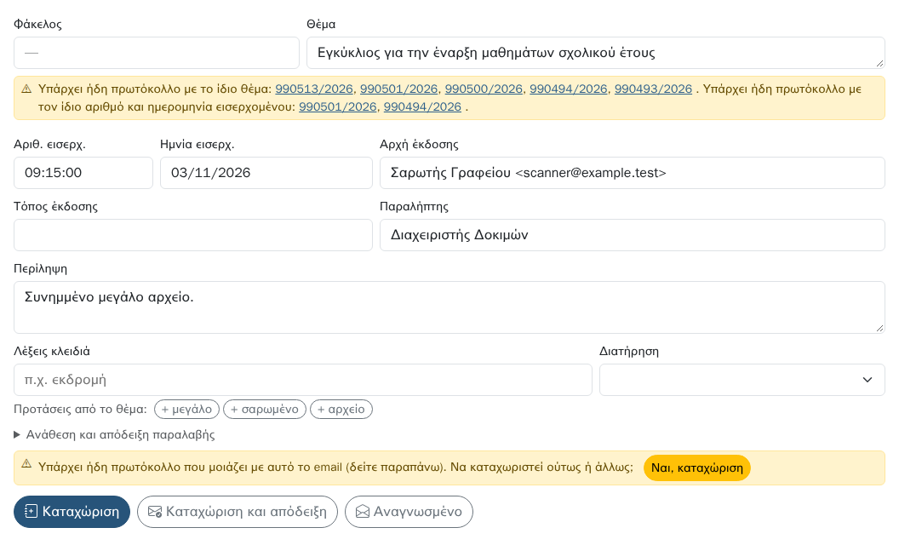

# R5d: registering from the inbox: duplicates, subject, keywords

| | |
|---|---|
| Status | ✅ Done |
| Branch | `task/R5d-email-registration` (on top of R5c) |

## What was asked (BACKLOG R5d)
"Register-from-email flow: AJAX save with a specific inline error (no reload, the e-mail stays visible as not
registered), no green attachment-count popup, inline notices, subject placeholder, keyword suggestions from significant
words."

R5c already did the first part:
- saving on the page without a reload;
- errors at their field, with the e-mail staying as it was;
- the result in the e-mail's place, with no pop-up and no attachment count.

This task adds the rest.

## What changed
- **Same document registered before?** Under the subject, a notice lists the protocols with the **same subject**, or
  with the **same incoming number and date**, with links. Only protocols the user may see.
  - On *Καταχώριση* such an e-mail is not registered at once: a second notice asks *«Να καταχωριστεί ούτως ή
    άλλως;»* with a *Ναι, καταχώριση* button.
  - This replaces the old pop-up dialog (`checkSameEmail`, removed in R5c).
  - The rule is shared with the protocol form (`App\Support\SimilarProtocols`, moved out of `ProtocolForm`).
- **Order of messages:** what the user must fix comes first. The folder needed for attachments is checked before the
  duplicate question (`EmailRegistration::checkFolder`).
- **E-mail without a subject:**
  - the *Θέμα* field offers its first attachment's name (`SubjectFromFile`, as in the protocol form, R1c);
  - a click puts it in the field;
  - if it is left empty, the protocol takes it.
  - Without an attachment, the field says *«Το email δεν έχει θέμα: γράψτε το θέμα»*.
  - A subject the user emptied is not guessed: the checks say so at the field.
- **Λέξεις κλειδιά as tags**, as in the protocol form (R1f): Enter or comma adds, a click edits, ✕ removes, and
  ↑ ↓ choose among the keywords already in use.
- **Keyword suggestions** (`App\Support\KeywordSuggestions`), shown under the field as *«Προτάσεις από το θέμα: + …»*.
  A click adds one.
  1. Keywords **already used** in protocols whose words appear in the e-mail's subject or the start of its text.
     They come in their usual spelling, most used first, case and accents ignored. Two-word keywords count too
     ("άδεια ασθενείας").
  2. Other **significant words of the subject**:
     - 5 letters or more;
     - not a number;
     - not a common word (articles, pronouns, and the words of every letter: *σχετικά, αποστολή, ενημέρωση,
       διαβιβαστικό, συνημμένα, Fwd* …);
     - not already part of an offered keyword.
  - At most 6; chosen ones are no longer offered. A word in capitals comes in lower case without accents (capitals
    have none to keep).
- `tagBox(field, suggestions, extra)` (tags.js) passes the e-mail's UID to the server.

## How verified
- PHPUnit:
  - `KeywordSuggestionsTest`:
    - known keywords first, in their spelling, two-word ones, their words not repeated;
    - common words, numbers and chosen ones left out;
    - the text searched for known keywords only;
    - at most 6.
  - `InboxTest`:
    - similar protocol: notice with link, first click refused, second registers;
    - keywords as tags: add, add a list, remove, a chosen suggestion disappears, registered with the protocol, only the
      keywords field;
    - e-mail without a subject: the attachment's name offered and used.
  - `EmailRegistrationTest`: the F08 test registers a second, identical e-mail. It now uses another subject and
    number, because the same ones are correctly flagged as a duplicate.
- Browser (`email-registration.spec.js`):
  - a suggestion clicked becomes a tag, a typed one too, and both are on the registered protocol;
  - an e-mail given the subject of a registered one: the notice names it and *Ναι, καταχώριση* registers it;
  - the earlier registration tests confirm the duplicate question when an earlier run left the same protocol.
- `smoke.spec.js` no longer depends on which mock e-mails other tests left on page 1.
- Full suites: PHPUnit 434, browser 67/67.

  
  

## Owner actions
None.
