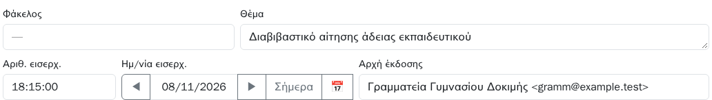
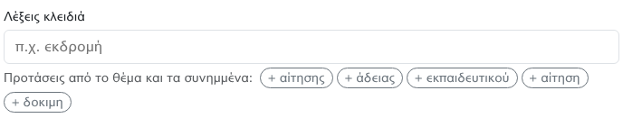

# R5e: inbox: the app's date field; keyword suggestions from the file names too

| | |
|---|---|
| Status | ✅ Done |
| Branch | `task/R5e-inbox-date-keywords` (on top of R2h) |

## What was asked (owner, 2026-11-19)
1. In *Εισερχόμενα*, *Ημ/νία εισερχ.* should have the same completion and date picker as the rest of the app.
2. The keyword suggestions should draw on the attachments' file names too. Examples: *ΑΙΤΗΣΗ-ΔΙΑΒΙΒΑΣΤΙΚΟ.pdf*,
   *ΙΑΤΡΙΚΗ ΓΝΩΜΑΤΕΥΣΗ.pdf*, *ΥΠΕΡΗΧΟΓΡΑΦΗΜΑ.bmp* could suggest *Αίτηση*, *Γνωμάτευση*, *Δικαιολογητικά*,
   *Απόφαση*…

## What changed
- **Ημ/νία εισερχ.** (the label had a typo, *Ημνία*) is now the app's date field (N04):
  - `9` → 09/this month, `9/4`, `0904` …;
  - ◀ ▶ (also ↑ ↓) one day earlier or later;
  - *Σήμερα* and the calendar 📅.

  The column is wider so the whole date shows. The usual hint line under the field is left out in the inbox's
  compact form (new `help=false` option of `x-date-input`).
- **Keyword suggestions** (*«Προτάσεις από το θέμα και τα συνημμένα»*):
  - The attachments' names (without the extension) are searched like the subject:
    - keywords you already use that appear in them come first, in their usual spelling (e.g. *Γνωμάτευση*);
    - then their significant words, after the subject's. Common words such as *διαβιβαστικό* are skipped, and so are
      words shorter than 5 letters such as *pdf* and *scan*.
  - **Accents for capitals:** a word written without accents (e.g. in capitals) takes the spelling it has in earlier
    subjects. *ΓΝΩΜΑΤΕΥΣΗ* → *γνωμάτευση*, where it used to be *γνωματευση*. Only subjects of protocols the user may
    see are used, and the spellings are kept for 10 minutes.
  - Up to 8 suggestions (was 6), since there are more sources now.
- **Not done:** *Δικαιολογητικά* and *Απόφαση* are not in the example names. They are categories, not words of the
  e-mail. They are offered when they are keywords already in use and appear in the subject, the text or a file name.
  Suggesting a category from other words (*γνωμάτευση*, *βεβαίωση* → *Δικαιολογητικά*) would need a list of such
  words, kept by the owner; it can be a later task.

## How verified
- PHPUnit:
  - `KeywordSuggestionsTest`:
    - the owner's three names → *αίτηση*, *ιατρικη*, *γνωμάτευση*, *υπερηχογραφημα*, after the subject's words;
      *διαβιβαστικό*, extensions and short words left out; accents from earlier subjects;
    - a keyword in use found in a file name, first, in its spelling;
    - at most 8.
  - `InboxTest`:
    - suggestions from an attachment's name, with accents from an earlier subject (*ιατρική*, *γνωμάτευση*);
    - *Ημ/νία εισερχ.* is the app's date field; `9` is saved as the 9th of this month.

  The four new tests failed before the change.
- Browser (`inbox.spec.js`): synthetic e-mail *«Διαβιβαστικό αίτησης άδειας εκπαιδευτικού»*, which no test
  registers, with the file *ΑΙΤΗΣΗ ΑΔΕΙΑΣ ΕΚΠΑΙΔΕΥΤΙΚΟΥ ΔΟΚΙΜΗ (1).pdf*:
  - `9` + TAB → 09/this month; ◀ → 08; the calendar button is there;
  - the suggestions include *αίτηση* and *δοκιμη*, which are only in the file's name. In the screenshot *αίτηση* has
    its accent (earlier subjects have the word) and *δοκιμη* has none (no earlier subject has it).

  All 7 inbox browser tests pass, also after the registration tests (as in CI: the first version used an e-mail that
  a registration test moves out of the inbox).
- Full suite: PHPUnit 535.

## Owner actions
None. To try it: step 37 in [OWNER-TODO.md](../../OWNER-TODO.md).
