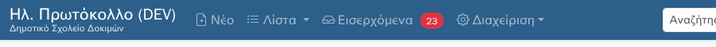

# R5f: a red badge next to Εισερχόμενα with the number of e-mails waiting

| | |
|---|---|
| Status | ✅ Done |
| Branch | `task/R5f-inbox-count` (on top of R2j) |

## What was asked (owner, 2026-11-20)
- A red mark next to *Εισερχόμενα* while there are e-mails in the inbox: the inbox should be empty when the users'
  work is done.
- It must be updated at intervals.
- Several users register e-mails. When one empties the inbox, the others must stop seeing the mark.

The owner chose a red badge with the number, counting **all** the e-mails in the inbox, not only the unread ones.

## What changed
- **Top bar:** next to *Εισερχόμενα*, a red badge with how many e-mails are in the inbox, on every page. At 0 it
  disappears. Over 99 it shows *99+*.
  - It counts the same e-mails as the inbox page: those of the last *Ημέρες ελέγχου email* days.
  - The mouse over it says *«8 e-mail στα Εισερχόμενα»*.
  - Only users who may use the inbox see it.
- **Updated:**
  - every minute while the tab is shown;
  - at once when the user comes back to the tab;
  - at once on the inbox page itself, after each registration or *Αναγνωσμένο*.
- **One count for everybody.** The server keeps a single count for one minute, so the mail server is asked at most
  once a minute, however many users are logged in.
  - When any user registers an e-mail or marks it as read, the count is refreshed.
  - The other users' badges change at their next check: within a minute, or at once when they return to the tab.
  - Drawing a page never waits for the mail server: the badge starts from the kept count and the browser asks for
    the rest.
- If the mail server does not answer, the badge keeps what it showed; nothing breaks.

## How verified
- PHPUnit `InboxTest::test_the_top_bar_badge_counts_the_inbox_for_everybody` checks:
  - the count, the same for a second user within the minute;
  - the badge on any page;
  - the inbox page's own count;
  - *Αναγνωσμένο* by one user lowers the count the other user gets;
  - an empty inbox gives no badge;
  - readers get neither the badge nor the count.
- The route list snapshot gained only `/inbox/count`, with the inbox's access rules.
- Browser (`inbox.spec.js`, R5f):
  - the badge equals the inbox page's total, on other pages too;
  - coming back to the tab after another user emptied the inbox hides it;
  - a new number shows;
  - no answer from the server keeps what is shown.
- Full suites: PHPUnit 553, browser 92 (one local failure came from a stale layout preference in the development
  database; with it reset, all pass).

## Review
- Codex (P2): when the kept count expired, several users' badges could each ask the mail server at the same moment.
  - Fixed: one request asks the server under a shared lock; the others wait up to 10 seconds and take its count. If
    it takes longer, they keep what they show.
  - Test `InboxTest::test_the_badge_count_is_asked_once_at_a_time`: with the lock held elsewhere, a check does not
    ask the server and returns the count once it is there; with the lock free, exactly one search. The test uses the
    new wait setting, so it cannot run on the old code, which had no lock at all.
- Codex (P2), two more:
  - After a registration or *Αναγνωσμένο*, the badge here was worked out from the count when the page was loaded. If
    other users had emptied the inbox meanwhile, it was wrong.
  - A registered e-mail whose move out of the inbox failed still lowered the badge.
  - Fixed: after each action the inbox is counted again (one quick search on the server), for everybody and for this
    page.
  - Tests: `test_the_badge_after_an_action_is_counted_not_worked_out` and the failed-move registration test. Both
    failed before.

## Owner actions
None. To try it: step 45 in [OWNER-TODO.md](../../OWNER-TODO.md).
