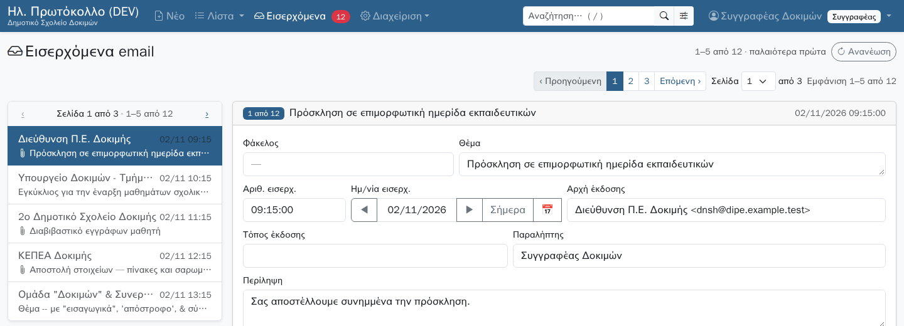

# R5g: every e-mail of the inbox can be reached

| | |
|---|---|
| Status | ✅ Done |
| Branch | `task/R5g-inbox-pager` (on top of R5f) |

## What was asked (owner, 2026-11-20)
The demo inbox said 24 e-mails, but only 5 were listed and the owner found no way to see the others.

## What was found
The inbox shows *Email ανά σελίδα* e-mails at a time (5 in the demo). The only way to the next ones was a small pager
under the last of the 5 e-mails, each with its full registration form: far down the page and easy to miss. The list on
the left did not say that it was one page of several.

## What changed
- **The list's pager** (as on *Λίστα*, R2e/R2g), above the e-mails on the right, and again under the last one:
  - *‹ Προηγούμενη*, the page numbers, *Επόμενη ›*;
  - *Σελίδα [ ▾ ] από N* to go to any page;
  - *Εμφάνιση 1–5 από 24*.

  The lower one brings the upper one into view.
- **The list on the left** starts with *‹ Σελίδα 1 από 5 · 1–5 από 24 ›*. It stays in view while scrolling, so the
  next page is always one click away.
- The page is kept in the address (`?page=3`), as before. A page past the last one shows the last.
- With one page only, there are no pagers.

## How verified
- PHPUnit `InboxTest::test_every_page_of_the_inbox_can_be_reached` (8 e-mails, 3 per page) checks:
  - both pagers, each with a page choice, and the left-hand list's line;
  - next, any page, previous, and a page past the last;
  - no pagers with one page.
- Browser (`inbox.spec.js`, R5g):
  - the upper pager is in view on arrival;
  - choosing the last page shows other e-mails and keeps the page in the address;
  - ‹ in the left-hand list, then *Επόμενη ›* under the e-mails, bring the upper pager into view.

  Inbox and registration browser tests pass: 15 of 15.
- Full PHPUnit: 554 tests pass.

## Correction (2026-11-20)
The first screenshot of this report was taken while the development inbox also held the owner's private e-mails
(`local-data/emails`, loaded there for the owner's own use). It showed one of them: a ministry circular, sender and
subject.
- It was replaced by one taken with only the invented test e-mails.
- The browser tests now always load only the invented and the approved public e-mails (`./dev.sh e2e` →
  `make-emails.php --no-private`), so no screenshot can show a private e-mail again.
- The old image is still in this branch's history. See OWNER-TODO for the owner's decision on that.

## Owner actions
None. To try it: step 46 in [OWNER-TODO.md](../../OWNER-TODO.md).
