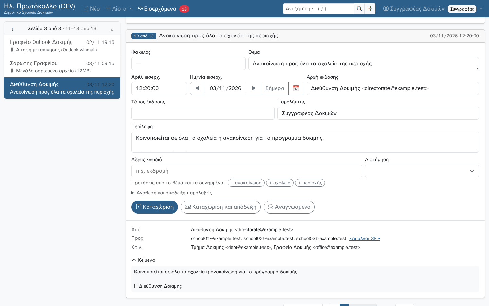

# R5i: inbox: a long list of recipients is folded

| | |
|---|---|
| Status | ✅ Done |
| Branch | `task/R5i-inbox-recipients` (on top of R2k) |

## What was asked (owner, 2026-11-20)
When *Προς* holds many recipients (e.g. every school and directorate), it fills half the screen. It is not essential
to the users, so make it collapsible.

## What changed
- *Προς* and *Κοιν.* show up to three addresses as before. A longer list shows the first three and **και άλλοι N ▾**.
  A click shows the whole list; **λιγότεροι ▴** folds it again.
- An invented test e-mail with 41 recipients and two in *Κοιν.* (`tests/fixtures/emails/synthetic/12-many-recipients.eml`,
  addresses at `example.test`).
- **Browser tests use only invented e-mails.** The development inbox also loads the owner's private e-mails
  (`local-data/emails`) for the owner's own use. The browser tests now always load it without them
  (`make-emails.php --no-private`), because their screenshots are committed. An earlier screenshot (R5g) had shown one;
  see R5g's report.

## How verified
- PHPUnit `InboxTest::test_a_long_list_of_recipients_is_folded`: 41 recipients give three and *και άλλοι 38*; two in
  *Κοιν.* and one in *Προς* are shown in full.
- Browser (`inbox.spec.js`, R5i): the toggle shows and hides the rest; *Κοιν.* has no toggle.
- `sh tests/shell/dev-sh.test.sh`: all dev.sh checks pass.
- Full suites: PHPUnit 556; browser 98 (one browser test needed a fix of its own text check).

## Owner actions
None. To try it: step 50 in [OWNER-TODO.md](../../OWNER-TODO.md).
