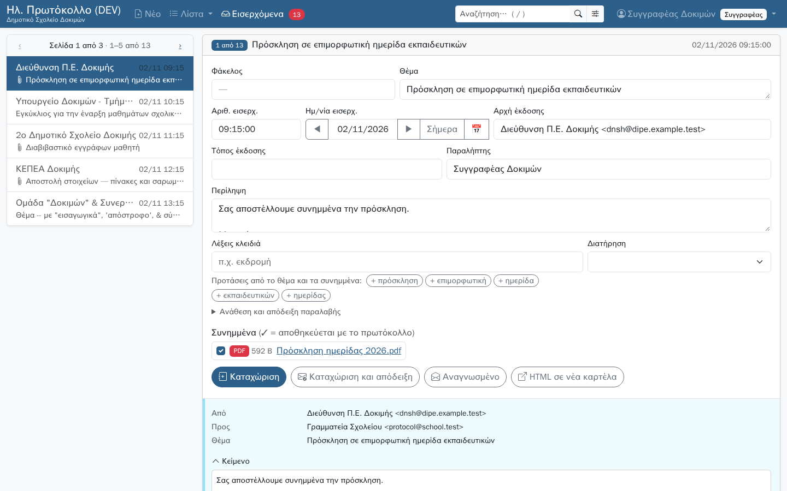

# R5j: inbox: the files above the buttons; the e-mail set apart

| | |
|---|---|
| Status | ✅ Done |
| Branch | `task/R5j-inbox-mail-view` (on top of R5i) |

## What was asked (owner, 2026-11-20)
- Move *Συνημμένα* just above *Καταχώριση*, *Καταχώριση και απόδειξη* …. The attachments are opened and printed almost
  every time, so the users should scroll less.
- Colour the e-mail itself differently, from *Από* to the end of the HTML: the users only glance at it.
- Add *Θέμα* under *Από* and *Προς*, as an e-mail program shows it.

## What changed
- **Συνημμένα** (with their ✓ and, for Outlook, the *winmail.dat* note) are right above the buttons, under the
  registration form.
  - Once the e-mail is registered or marked as read there are no buttons, so the files stay with the e-mail.
- **The e-mail** below the buttons has a light blue background with a blue bar on its left. Its text and HTML boxes
  are white. It runs from *Από* to the end of the HTML.
- **Θέμα** follows *Προς* (and *Κοιν.*).

## How verified
- PHPUnit `InboxTest::test_files_above_the_buttons_and_the_subject_in_the_mail` checks:
  - the files come before *Καταχώριση*, and only once;
  - *Θέμα* comes after *Προς*;
  - after *Αναγνωσμένο* the files are in the e-mail part.
- Browser (`inbox.spec.js`, R5j): the files are above the button, the e-mail has *Θέμα*, and its background differs
  from the form's.
- The R5g browser test now sets 2 e-mails per page itself. Since R5i the test inbox holds only the invented e-mails,
  and after the registration tests one page was left. Inbox and registration browser tests pass: 18 of 18.
- Full PHPUnit: 557 tests pass.

## Owner actions
None. To try it: step 51 in [OWNER-TODO.md](../../OWNER-TODO.md).
