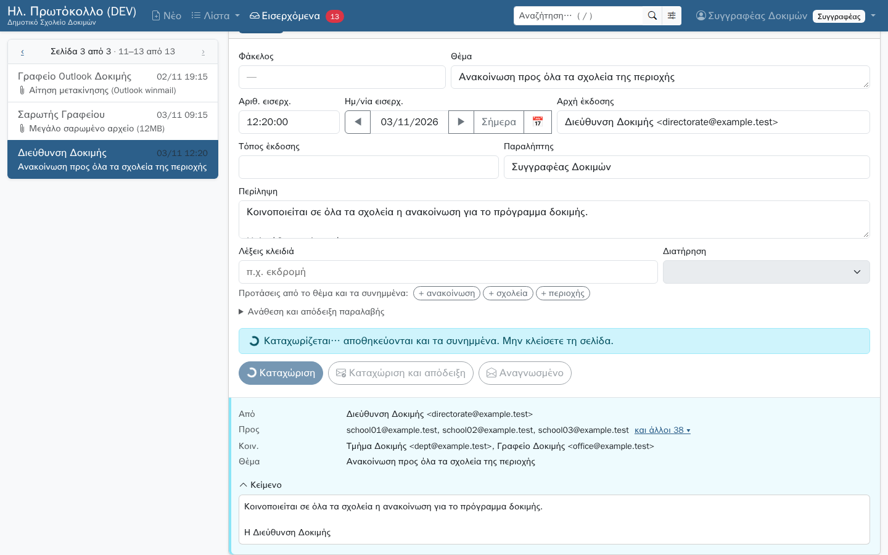

# R5k: inbox: registering an e-mail says so until it is done

| | |
|---|---|
| Status | ✅ Done |
| Branch | `task/R5k-inbox-saving-indicator` (on top of R5j) |

## What was reported (owner, 2026-11-20)
- On the question *«Υπάρχει ήδη πρωτόκολλο που μοιάζει με αυτό το email … Να καταχωριστεί ούτως ή άλλως;»*, the yellow
  button seemed to do nothing. A few seconds later the e-mail showed as registered.
- There should be a sign that the save is under way.
- Could the user save a second e-mail while one is being saved? What would happen?

## What was found
- The yellow button gave no sign at all: not disabled, no spinner, no message. The other buttons were greyed out but
  said nothing either. Registering an e-mail with files takes a few seconds (the files are saved too).
- **Two e-mails at once:**
  - While one e-mail was being registered, the *Καταχώριση* buttons of every e-mail were already disabled.
    *Αναγνωσμένο* and the yellow button were not.
  - The page sends one request at a time. A click during a save would wait and run after it, never mixed with it.
  - Protocol numbers are given under a database-wide lock. Two e-mails, or two users at the same moment, always get
    two consecutive numbers, never the same one.
  - So nothing would go wrong, but the user had no way to see what was happening.

## What changed
- **While an e-mail is being registered**, whichever of its buttons was pressed:
  - right above its buttons, a blue notice with a spinner: *«Καταχωρίζεται… αποθηκεύονται και τα συνημμένα. Μην
    κλείσετε τη σελίδα.»*;
  - the pressed button (*Καταχώριση*, *Καταχώριση και απόδειξη* or the yellow *Ναι, καταχώριση*) turns into a spinner.

  When it is done, the e-mail says *«Καταχωρίστηκε με αριθμό …»* as before.
- **One at a time:** meanwhile, every e-mail's *Καταχώριση*, *Καταχώριση και απόδειξη*, *Αναγνωσμένο* and yellow
  button are greyed out. They come back as soon as the save is done.

## How verified
- PHPUnit `InboxTest::test_similar_protocol_is_shown_and_needs_a_second_click` now also checks two things: the yellow
  button is disabled during any save and has its own spinner, and the e-mail's notice follows all four of its
  registration calls.
- Browser (`inbox.spec.js`, R5k): the registration request is held back. While it is held, the test checks:
  - the notice and the spinner show;
  - another e-mail's *Καταχώριση* and *Αναγνωσμένο* are disabled and show no notice.

  Then the request is let through: the e-mail is registered and the other buttons come back. When the similar-protocol
  question appears, the yellow button is checked the same way.
- Inbox and registration browser tests: 19 of 19. Full PHPUnit: 557 tests pass.

## Owner actions
None. To try it: step 52 in [OWNER-TODO.md](../../OWNER-TODO.md).
