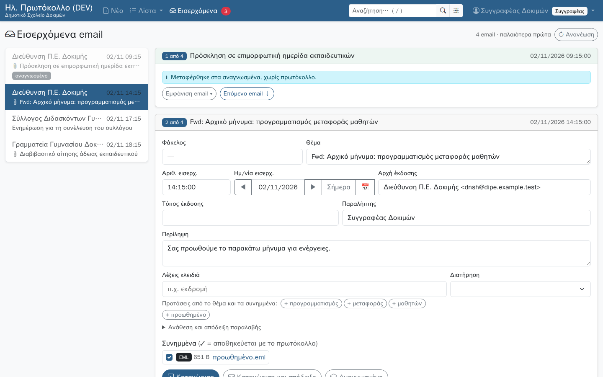

# R5l: inbox: a done e-mail folds

| | |
|---|---|
| Status | ✅ Done |
| Branch | `task/R5l-inbox-fold-done` (on top of R5k) |

## What was asked (owner, 2026-11-20)
Right after an e-mail is saved and *«Καταχωρίστηκε με αριθμό … Άνοιγμα πρωτοκόλλου ↗»* appears, collapse the whole
e-mail. Let the user view it again by expanding it, or simply move on.

## What changed
- Once an e-mail is registered or marked *Αναγνωσμένο*, its card shows only:
  - its header (number on the page, subject, date);
  - the result: *Καταχωρίστηκε με αριθμό …* with *Άνοιγμα πρωτοκόλλου ↗*, or *Μεταφέρθηκε στα αναγνωσμένα*;
  - two buttons:
    - **Εμφάνιση email ▾** opens the e-mail again (from, to, subject, files, text, HTML); **Απόκρυψη ▴** folds it;
    - **Επόμενο email ↓** goes to the next e-mail on the page still waiting, as the list on the left does. It is not
      shown when none is left on the page.
- The list on the left keeps marking done e-mails as before.

## How verified
- PHPUnit `InboxTest::test_a_done_email_folds_with_a_way_to_open_it_or_go_on` checks:
  - after *Αναγνωσμένο* the card is marked done and has both buttons;
  - *Επόμενο* leads to the next e-mail still waiting;
  - no *Επόμενο* when none is left.
- Browser (`inbox.spec.js`, R5l): after *Αναγνωσμένο* the e-mail is hidden; *Εμφάνιση* shows it and folds it again;
  *Επόμενο* scrolls to the next e-mail and names it in the address.
- Full suites: PHPUnit 560, browser 101.

## Owner actions
None. To try it: step 53 in [OWNER-TODO.md](../../OWNER-TODO.md).
