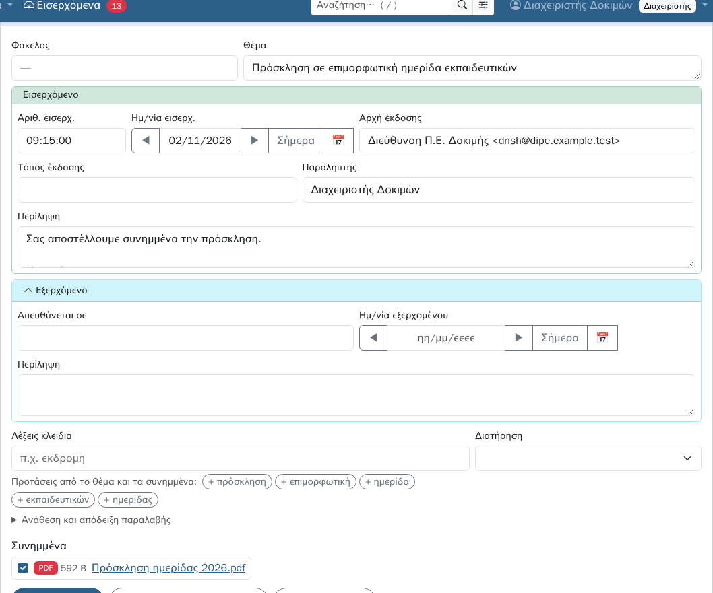
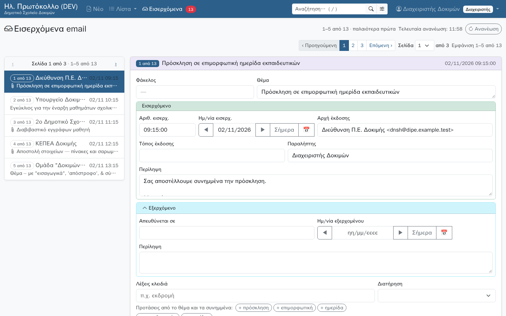
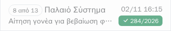

# R5o: inbox: no jump, form sections, colours, list positions

| | |
|---|---|
| Status | ✅ Done |
| Branch | `task/R5o-inbox-form-sections` |

## What was asked (owner, 2026-11-23)
1. Opening *Κείμενο* or *Εμφάνιση HTML* scrolled the page up a little: disorienting.
2. Some inbox e-mails are outgoing documents: the form needs the *Εξερχόμενο* fields, folded by default and left empty
   for the user to fill in when needed.
3. The form's *Εισερχόμενο* / *Εξερχόμενο* backgrounds as in the protocol form; the e-mail preview in its own colour
   (owner's choice: light purple).
4. *HTML σε νέα καρτέλα*: an icon next to *Εμφάνιση HTML* instead of a pill among the actions; the note
   *(✓ = αποθηκεύεται με το πρωτόκολλο)* removed.
5. The list on the left: each e-mail's *«N από M»*, as in its header. Each e-mail's header in the preview's lavender,
   so the e-mails stand apart.
6. In the list, the green pill with the new protocol number under the time, with a ✓.

## What was wrong (1)
*Κείμενο* and *HTML* open and close in **every** e-mail of the page at once (R5c). The e-mails above the clicked one
grew or shrank, so the clicked one moved; frames loaded later moved it again. A browser test measured it: the clicked
button moved **204 px**.

## What changed
- **No jump** (`keepInPlace` in `resources/modern/inbox.js`): the clicked toggle is kept where it was.
  - It corrects at once, then as HTML frames load and are fitted, for 2 seconds.
  - It stops as soon as the user scrolls, types or presses the mouse (also on the scrollbar).
  - Only one runs at a time, and it scrolls instantly (Bootstrap makes the page scroll smoothly).
- **Form sections** as in the protocol form:
  - **Εισερχόμενο** (light green header): the incoming fields, as before.
  - **Εξερχόμενο** (light blue header), folded:
    - fields *Απευθύνεται σε*, *Ημ/νία εξερχομένου* (the app's date field) and *Περίληψη*, empty by default;
    - it opens by itself when filled in or when one of its fields has an error;
    - only for users allowed to fill the outgoing fields (`ProtocolAccess::out`); the server ignores them otherwise.

  The protocol's own checks apply as in the protocol form: with *Απευθύνεται σε*, the date is needed.
- **Colours:**
  - the e-mail preview is light purple (`rgba(111, 66, 193, .07)`, purple left bar), apart from the form's green /
    blue and the yellow warnings;
  - each e-mail's header (*«N από M»*, subject, date) is a little stronger lavender. Registered or read e-mails keep
    their green header.
- **HTML in a new tab:** the ↗ icon right after *Εμφάνιση HTML* (title *«Άνοιγμα του HTML σε νέα καρτέλα»*); the pill
  is gone. *Συνημμένα* without the "✓ = …" note.
- **The list on the left:**
  - each e-mail shows its *«N από M»*, the same as its header;
  - the result sits under the e-mail's time: green *«✓ 284/2026»* for a registered e-mail, grey *αναγνωσμένο* for a
    read one.

## How verified
- **PHPUnit, `InboxTest`:**
  - the form has the green *Εισερχόμενο* and the folded blue *Εξερχόμενο* with its three fields;
  - the HTML tab icon is there, and the pill and the note are gone;
  - the list has *«N από M»* for each e-mail, and each header has the lavender class;
  - the outgoing fields are saved on the protocol (recipient, date, summary);
  - a recipient without a date is refused at the date, and the section opens;
  - after registering, the list shows *✓ number* under the time.
- **Full suite:** PHPUnit 588 tests pass.
- **Browser, new R5o test:**
  - on a page of 5 e-mails, opening and closing *Κείμενο* and *HTML* on a lower e-mail keeps its toggle within
    4 px (without the fix: 204 px);
  - the sections and their colours; *Εξερχόμενο* opens; the list's positions match the headers.
- **Browser, other changes:**
  - the registration test checks the *✓ number* in the list;
  - the R5e date test now points at the incoming date (there are two date fields now);
  - 34 inbox, registration, smoke and secure-file browser tests pass, twice in a row.

## Owner actions
None. To try it: steps 58–59 in [OWNER-TODO.md](../../OWNER-TODO.md).
