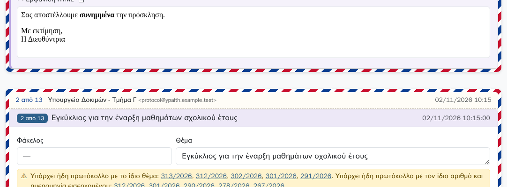
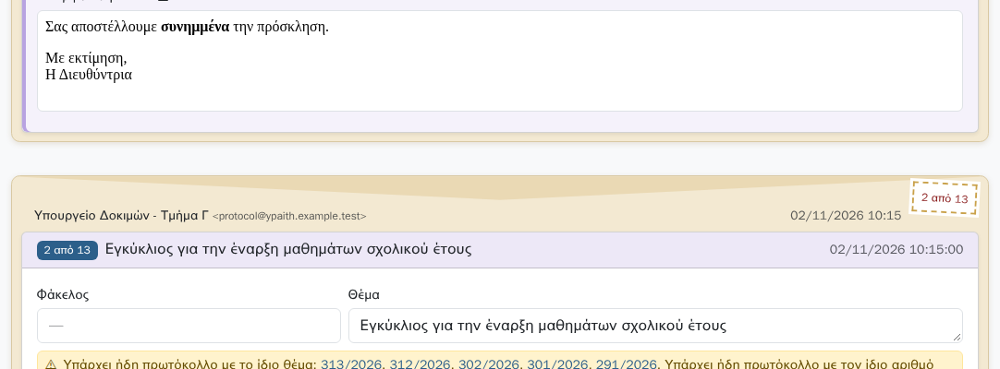
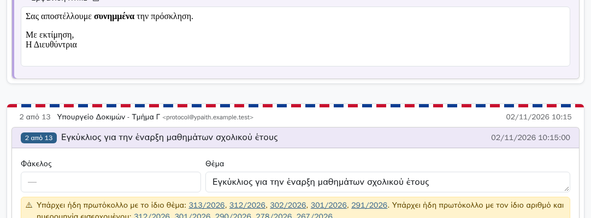

# R5p: each e-mail in an envelope

| | |
|---|---|
| Status | ✅ Done (the owner chooses the look) |
| Branch | `task/R5p-inbox-envelopes` |

## What was asked (owner, 2026-11-23)
In *Εισερχόμενα* it should be obvious where one e-mail ends and the next begins: each e-mail inside an envelope, the
sender and the date like the address, a gap between envelopes; 2–3 versions to choose from.

## What changed
- Each e-mail is in an **envelope**: on top, an address strip with *N από M*, the sender (name and address) and the
  date and time; then the e-mail as before (form, text, files). A gap of about 2 lines separates envelopes. This
  replaces R5o's thin line with «↓ N από M ↓»; the *N από M* badge in each e-mail's header stays.
- **Three looks**, chosen in *Ρυθμίσεις → E-mail → Εμφάνιση των e-mail* (setting `inboxEnvelope`), so you can compare
  them on your own e-mails before deciding:

  **A. Αεροπορικός φάκελος** (the default): red-white-blue stripes all round, the address on cream paper.

  

  **B. Χάρτινος φάκελος με γραμματόσημο**: the colour of an envelope, a flap at the top, *N από M* on a stamp.

  

  **C. Λιτός φάκελος**: white, with air-mail stripes along the top edge only.

  

  Once you choose, I remove the other two (or keep the setting, if you prefer to let each installation choose).

## How verified
- PHPUnit `InboxTest`: every e-mail in an envelope with *N από M* (the thin line is gone); the setting's three
  looks, and an unknown value falls back to A; the sender and the date on the strip.
- Browser (`inbox-envelopes.spec.js`, invented e-mails only): for each look, the envelopes, *2 από N* on the
  second, the sender on the strip, a gap of more than 20 px between envelopes; the three screenshots above.
  `inbox.spec.js` updated (the R5o line → the envelope's *N από M*).

## Owner actions
**Choose A, B or C** (step 71 in [OWNER-TODO.md](../../OWNER-TODO.md)).
